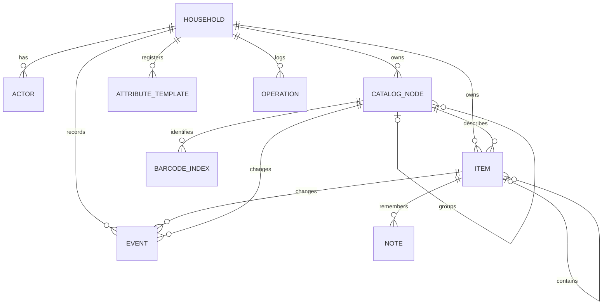
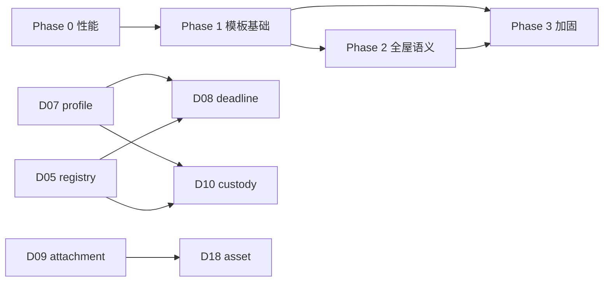

# 松仓数据模型诊断（v1 基线）

> 诊断日期：2026-10-31  
> 诊断对象：`migrations/001`–`005`、`007`、`008`，`packages/contracts`、`packages/domain`、`apps/server`、`apps/web` 的读写路径  
> 诊断方式：静态审阅代码、迁移、契约与文档；未连接生产库，未做压力测试  
> 证据标记：【迁移】数据库定义，【代码】运行实现，【文档】设计声明，【推断】基于结构的估算

## 0. 阅读指南

### 0.1 严重度

| 级别 | 含义 | 处理时机 |
| --- | --- | --- |
| P0 | 阻断“全屋物品”扩展，或让查询/读取直接不可用 | 扩品类之前必须修 |
| P1 | 明显限制某类物品，或存在一致性/语义风险 | 第一个品类包之前修 |
| P2 | 加固、运维、体验、可观测性 | 可与功能并行 |

### 0.2 这份诊断不是什么

- 不是“推翻重来”的方案。核心身份模型（两棵树 + 一物一 UUID）是成立的，问题集中在属性层、时间语义、关系语义和查询规模。
- 不是生产性能报告。文中所有容量数字都是【推断】，用于确定修复优先级，不能当作 SLA。
- 不是最终产品决策。涉及“是否支持自定义模板”“是否开放字段级权限”等，需要产品确认后再落库。

配套的机器可读清单见 [data-model-findings.csv](data-model-findings.csv)：44 条（28 条详细 + 16 条次级），含证据、影响、修复、验收，可直接导入 issue 跟踪。

---

## 1. 执行摘要

### 1.1 五条结论

1. **骨架正确，承载力不足。** `CatalogNode`（是什么）+ `Item`（哪一件、在哪）+ `Event`（怎么变）能覆盖全屋，不需要加第二套实体；但当前模板只描述“食品 + 少量商品共性”，不是“家庭资产”。
2. **最大的技术风险不是缺字段，是查询规模。** `query_items` / `query_catalog_nodes` / `get_history` 都是“全表取出 → 应用层过滤 → 内存分页”，并伴随逐对象 N+1 查询（【代码】[service.ts:556–615](apps/server/src/service.ts#L556-L615)、[service.ts:487–500](apps/server/src/service.ts#L487-L500)）。全屋几千件、几万条事件时会先撞到 15 秒语句超时。
3. **模板系统是“代码定义 + 数据库登记”的双源结构。** 校验用代码里的 Zod，登记表只用来检查“版本是否存在”；读取接口返回代码定义。新增/退役模板会同时影响 6–10 个触点，且退役会让历史对象直接不可读。
4. **跨品类缺四个原语：** 通用日期、实体引用、附件、适用性（哪个 SKU 该出现哪些模板）。这四件事不做，“衣服/电子/杂物”只能靠 Note 和自由字符串勉强记录。
5. **现有不变量有一半只在应用层。** 无环、父子类型、容器能力、模板适用性、内容量一致性都靠写路径检查；运行角色仍拥有 `items/catalog_nodes/operations` 的 `DELETE` 权限（【迁移】[grants.sql:6](deploy/grants.sql#L6)），与“无硬删除、追加式历史”的契约不完全一致。

### 1.2 粗评分（用于排序，不是精确度量）

| 维度 | 评分 | 依据 |
| --- | --- | --- |
| 身份与位置 | 9/10 | 一物一 UUID、双树、移动容器只改一行，设计扎实 |
| 属性表达 | 5/10 | 7 个模板、字段类型少、无引用、无 UI 元数据 |
| 时间语义 | 4/10 | 只服务食品保质期；保修/维护/归还/复购都缺 |
| 关系语义 | 3/10 | 除父子与 SKU 外没有实体关系；归属/借用/兼容无法表达 |
| 查询规模 | 3/10 | 全表 + N+1 + 内存分页；无属性索引 |
| 扩展成本 | 3/10 | 新模板需改代码、迁移 seed、三端解析 |
| 运维安全 | 6/10 | 事件/模板不可变、事务完整；迁移校验和权限偏弱 |
| **整体** | **5/10** | 食品库存可用；全屋资产尚不可用 |

### 1.3 最值得先修的十件事

| # | 问题 | 对应编号 |
| --- | --- | --- |
| 1 | `query_items` 全表 + N+1 | D01 |
| 2 | `get_history` 全量事件 + 应用层过滤 | D02 |
| 3 | 快照全量下发，客户端搜索 O(物品×笔记) | D03 |
| 4 | 缺属性 GIN、名称 trigram、时间/排序索引 | D04 |
| 5 | 模板枚举、版本 1\|2、初始属性上限 7 硬编码 | D05 |
| 6 | 未知/退役模板会让对象不可读 | D06 |
| 7 | 没有“SKU 适用哪些模板”的声明层 | D07 |
| 8 | 日期事实只服务食品 | D08 |
| 9 | 附件（照片/票据/说明书）未实现 | D09 |
| 10 | 归属、借用、处置、作废无法正确表达 | D10–D12 |

---

## 2. 现状全景

### 2.1 表的构成（36 张）

| 组 | 数量 | 表 | 说明 |
| --- | --- | --- | --- |
| 领域核心 | 10 | `households`、`actors`、`catalog_nodes`、`items`、`attribute_templates`、`barcode_index`、`notes`、`events`、`operations`、`installations` | `attribute_sets` 曾存在，003 已并入 `attributes` 后删除 |
| 目录治理 | 3 | `catalog_policy_versions`、`catalog_proposals`、`catalog_identity_keys` | 008 增加；只服务入库规范与同款匹配 |
| 账号认证 | 22 | Better Auth 13 张 + `auth_owners` + 005 的 8 张 | 不属于库存读模型，检查器不展示 |
| 运维 | 1 | `migrations` | 迁移登记，无校验和 |
| **合计** | **36** | | 与发布说明的 36 张口径一致 |

### 2.2 核心关系



四个层次要分清：

| 层 | 载体 | 回答 | 可变性 |
| --- | --- | --- | --- |
| 定义 | `attribute_templates.definition` + 代码 `templates` | 有哪些字段、什么类型 | 已发布版本不可变 |
| 绑定 | `items.attributes` / `catalog_nodes.attributes` | 这件的具体值 | 随对象 revision 变化 |
| 关系 | `parent_id`、`catalog_node_id`、`barcode_index` | 放在哪、是什么、怎么识别 | 专用命令 |
| 历史 | `events`、`operations` | 怎么变的、谁改的 | 追加式（设计上） |

### 2.3 写入路径

```text
HTTP/MCP
  → parseCommand（Zod + expected_revisions 校验）
  → transaction
  → 读请求：REPEATABLE READ READ ONLY 后返回
  → 写请求：actors 归属检查
  → pg_advisory_xact_lock(household)
  → operations 幂等查询（同键同指纹则重放）
  → 领域命令（load → 校验 → 修改 → revision+1 → event）
  → operations 写入
  → COMMIT
```

要点：

- 家庭级 advisory lock 把所有写请求串行化，防环、容量、条码冲突都依赖它（【代码】[service.ts:326](apps/server/src/service.ts#L326)）。
- revision 由 `UPDATE ... revision=revision+1` 应用层递增，没有数据库触发器保护。
- Event 与快照同事务；`events` 有 `immutable_events` 触发器（【迁移】[001_initial.sql:31](migrations/001_initial.sql#L31)）。
- `operations` 没有不可变触发器，运行角色还有 `UPDATE/DELETE` 权限（【迁移】[grants.sql:6](deploy/grants.sql#L6)）。

### 2.4 读取路径（五条，性能差异很大）

| 路径 | 实现 | 复杂度 | 使用方 |
| --- | --- | --- | --- |
| `webSnapshot` | 3 条固定 SQL + JS 聚合 | O(全屋) | Web、插件 |
| `terminalSnapshot` | 全量目录/物品 + 全量标签事件 JSONB 展开 | O(全屋 + 全屋事件) | Android 终端 |
| `query_items` / `query_catalog_nodes` | 全表 id + 逐对象 `load` + JS 过滤 + 内存分页 | O(全屋 × 绑定) | MCP、调试、部分 HTTP |
| `get_item` | 单对象 + 绑定校验 + 笔记 + 家庭时区 | O(绑定) | 详情 |
| `get_history` | 全量事件 + JS 过滤 + 内存分页 | O(全屋事件) | 动态、对象历史 |

---

## 3. 逐表审计

### 3.1 核心表

| 表 | 主键 / 唯一 | 已强制的边界 | 缺失的强制约束 | 风险 |
| --- | --- | --- | --- | --- |
| `households` | `id` | 存在性 | `timezone` 合法性；无更新时间触发器 | 低 |
| `actors` | `id`；`(household_id,id)` | 同家庭唯一 | 名称非空无 DB 检查 | 低 |
| `catalog_nodes` | `id`；`(household_id,id)` | `kind IN (GROUP,SKU)`；名称非空；`revision>0`；同家庭父引用；自引用禁止 | 父必须是 GROUP；SKU 不可有子节点；GROUP 不可被 Item 引用；无环 | P2 |
| `items` | `id`；`(household_id,id)` | 同家庭 SKU/父引用；自引用禁止；`revision>0` | 引用的 SKU 必须是 SKU；父必须具备 `container.can_contain=true`；无环 | P2 |
| `attribute_templates` | `(household_id,id,version)` | `target_kind` 枚举；不可变触发器 | 版本只能新增；无退役标记；`definition` 不是校验源 | P1 |
| `barcode_index` | `(household_id,barcode)` | 同家庭内条码唯一；catalog_node 外键 | `catalog_node_id` 必须是 SKU | 低 |
| `notes` | `id` | `body_format=Markdown`；同家庭 Item/Actor 外键 | 只能挂 Item；无删除/归档 | P2 |
| `events` | `id`；索引 `event_target` | 目标 ID 格式；Actor 外键；不可变触发器 | `target_id` 无对象外键；`operation_id` 无外键 | P2 |
| `operations` | `(household_id,actor_id,idempotency_key)` | 幂等键唯一；`operation_id` 格式 | `operation_id` 无唯一约束；无不可变保护 | P1 |
| `installations` | `slot` | 单家庭槽位 | 历史兼容用途，未随多家庭扩展 | 低 |

### 3.2 治理表

| 表 | 作用 | 风险 |
| --- | --- | --- |
| `catalog_policy_versions` | 家庭分类规范快照 | 不可变触发器已有；`revision` 由应用计算，无并发保护（依赖家庭锁） |
| `catalog_proposals` | 待确认提案 | 状态只允许 `PENDING/APPROVED`，无拒绝/过期状态；`result` 可被应用更新 |
| `catalog_identity_keys` | 同款匹配索引 | 与 `policy_revision` 无外键；策略变更时整表清空（【代码】[intake.ts:571](apps/server/src/intake.ts#L571)），匹配能力暂时退化 |

### 3.3 五个关键判断

1. **`attributes` 不是“任意 JSON”。** 绑定成员固定为 `template_id/template_version/values/created_at/updated_at`，且每次读取都会校验（【代码】[service.ts:99–137](apps/server/src/service.ts#L99-L137)）。好处是历史可解释，代价是读取放大。
2. **属性校验的事实来源是代码，不是数据库。** `attribute_templates.definition` 只是发布记录；把数据库里的 `definition` 改掉不会改变校验行为。
3. **模板只能用于 SKU。** `allowed_catalog_node_kinds` 永远是 `['SKU']`（【代码】[index.ts:163](packages/contracts/src/index.ts#L163)），GROUP 的 `attributes` 实际恒为 `[]`，因此无法做“整类隐藏”“分类默认值”。
4. **事件是可信的，操作记录不是完全可信的。** 事件有触发器 + 只给 INSERT；操作记录可被运行角色改写，而幂等重放直接返回 `operations.result`。
5. **位置就是 Item。** 房间、柜子、冰箱都是 Item，这是正确的简化；代价是“位置属性”（温区、责任人、照片）只能借用通用模板，且 `container` 只有 `can_contain` 一个字段。

---

## 4. 模板系统审计

### 4.1 一个模板从定义到显示要经过的环节

```text
代码 templates（Zod schema）
  → templateDefinition() 生成 JSON Schema + paths
  → 初始化/迁移写入 attribute_templates（每家庭一份）
  → 对象 attributes 中写入绑定（template_id + version + values）
  → 读取时 validateBindings() 用代码 Zod 重新校验
  → 前端 fields.tsx 用硬编码 label/widget 渲染
```

### 4.2 双源真相

| 读取方 | 事实来源 | 后果 |
| --- | --- | --- |
| 写入校验 | 代码 `templates` | 数据库 `definition` 改了也不生效 |
| `validateBindings` | 数据库登记（仅存在性/target） | 未 seed 的模板“列表可见、写入失败” |
| `list_attribute_templates` | 代码 `templates` | 返回的字段与实际登记可能不一致 |
| 前端标签 | `fields.tsx` 硬编码 | 新增模板不会自动出现 |

这是 D24 的核心：**当前不是“数据驱动模板”，而是“代码定义 + 数据库登记副本 + 前端硬编码”**。在扩品类之前必须明确选哪条路：

- 路线 A（推荐，成本低）：代码仍是唯一校验源，数据库只做登记；把 `definition` 标记为“只读投影”，前端标签短期继续硬编码，但由共享 registry 生成。
- 路线 B（成本高）：数据库 `definition` 成为校验源，运行时用通用 JSON Schema 校验器。好处是理论上可在线发布模板；坏处是要处理引用类型、单位、交叉字段规则，且与“已发布版本不可变”叠加后迁移复杂。

### 4.3 七个模板的边界

| 模板 | 目标 | 能表达 | 表达不了 |
| --- | --- | --- | --- |
| `product` v2 | SKU | 品牌、型号、规格、条码、净含量、储存要求、保质天数/起算 | 价格、供应商、保修、适用人群 |
| `lifecycle` | Item | 库存状态、状况、可用性、开封、单一到期日、购入日、批次 | 处置原因/日期、保修、维护、借用、多个日期 |
| `contents` | Item | 剩余量（mL/g/count/percent）、精度 | 非消耗品数量、包装规格换算 |
| `container` | Item | 能否容纳 | 位置类型、温区、容量、责任人 |
| `catalog` | SKU | 可见/隐藏 | 物品形状（profile）、适用模板 |
| `clothing` | SKU | 材质、颜色、尺码（自由字符串） | 结构化尺码、季节、洗护、归属人 |
| `device` | SKU | 接口（自由字符串）、额定功率 | 序列号、电压/插头、保修、维修周期 |

### 4.4 新增一个模板要改的触点（实测清单）

| # | 位置 | 改动 |
| --- | --- | --- |
| 1 | [index.ts:25–122](packages/contracts/src/index.ts#L25-L122) | 增加 `templates.<id>` 的 paths + Zod schema |
| 2 | [index.ts:124–132](packages/contracts/src/index.ts#L124-L132) | 增加 `templateId` 枚举 |
| 3 | [index.ts:147](packages/contracts/src/index.ts#L147) | 更新 `latestTemplateVersion` |
| 4 | [intake.ts:12–25](packages/contracts/src/intake.ts#L12-L25) | 更新 `intakeAttribute` 的模板枚举 |
| 5 | [intake.ts:44–72](packages/contracts/src/intake.ts#L44-L72) | 若字段参与同款匹配，更新 `identity_fields` |
| 6 | 新迁移 | 为所有既有家庭 `INSERT ... SELECT ... FROM households` |
| 7 | [web.ts:5–10](packages/contracts/src/web.ts#L5-L10) | `Attribute.template_version` 目前是 `1 \| 2` |
| 8 | [fields.tsx:17–78](apps/web/src/ui/fields.tsx#L17-L78) | 增加中文标签、控件、单位 |
| 9 | Android | 快照解析与展示（未知模板要能透传） |
| 10 | 测试与文档 | domain/integration/web 投影 |

结论：**模板不是数据，是代码发布物。** 这本身可以接受（内置模板由产品团队维护），但必须把触点收敛成一张清单 + 一个生成器，否则每加一个品类都在赌三端同步。

### 4.5 退役风险（最容易被忽略）

`load()` 每次读取都会执行 `validateBindings()`，其中要求 `templates[template_id]` 存在且数据库登记存在（【代码】[service.ts:99–137](apps/server/src/service.ts#L99-L137)）。这意味着：

- 从代码中删除或重命名一个模板 → 所有绑定了它的历史对象**读取直接抛错**，而不是“显示未知模板”。
- 模板版本从 2 回退、或迁移漏 seed 某个家庭 → 同样不可读。

这是 D06。修复原则：**读路径必须宽容，写路径必须严格。** 未知模板以不透明形式保留并展示“未知模板 vN”，只有写入新值时拒绝。

---

## 5. 不变量矩阵

对照 [domain-model.md 第 8 节](docs/domain-model.md#L296-L311) 的十条要求：

| # | 不变量 | 数据库强制 | 应用强制 | 结论 |
| --- | --- | --- | --- | --- |
| 1 | 每件 Item UUID 独立，身份与路径无关 | 主键 / 唯一 | 是 | ✅ |
| 2 | 两棵树无环、同家庭、父类型正确、容器能力 | 同家庭外键、自引用 CHECK | 是 | ⚠️ 无环/类型/能力仅应用层 |
| 3 | 被引用 SKU 不可删、有子容器不可删/撤销能力 | FK（NO ACTION/RESTRICT） | 是 | ⚠️ 运行角色仍有 DELETE 权限 |
| 4 | 模板不可变；属性满足目标/版本/类型/单位/范围 | 不可变触发器 | 是 | ⚠️ 目标/版本/值仅应用层 |
| 5 | 状态不双写；缺失不变成肯定事实 | 无 | 是 | ⚠️ 仅应用层 |
| 6 | 默认库存含未知；内容非负、单位有依据 | 无 | 是 | ⚠️ JSON 数值无 DB CHECK |
| 7 | 变化 + revision + Event 原子；事件不可回写 | 事务 + 事件触发器 | 是 | ✅（operations 除外） |
| 8 | 幂等/并发覆盖所有入口；树变更防成环 | 幂等键唯一 + 家庭锁 | 是 | ✅ |
| 9 | 修正沿用 UUID，不新建掩盖 | 无硬删除接口 | 是 | ⚠️ 误建无法作废 |
| 10 | 派生值不可写；隐藏目录项仍查权限 | 无 | 是 | ✅ |

**结论：** 第 2、3、4、5、6、9 条都依赖“所有写入都走应用”。当前确实只有应用写入，所以不是漏洞；但一旦增加导入脚本、运维修复、批量工具或直接 SQL 习惯，就会产生模型外状态。修复方向不是把所有规则塞进数据库，而是：**能在 DB 用低成本约束表达的就下沉（父类型、SKU 引用、删除权限、操作记录不可变），复杂跨字段规则继续留在应用，并补一个“直接 SQL 写入”的禁用与审计策略。**

---

## 6. 能力覆盖矩阵

符号：✅ 直接支持；⚠️ 需约定或变通；❌ 不支持。

| 物品类别 | 识别查找 | 位置容纳 | 数量余量 | 日期提醒 | 状态处置 | 归属借用 | 凭证照片 | 补货维护 | 覆盖 |
| --- | --- | --- | --- | --- | --- | --- | --- | --- | --- |
| 食品 / 药品 | ✅ | ✅ | ✅ | ✅ | ✅ | ❌ | ⚠️ | ❌ | 5/8 |
| 日化 / 耗材 | ✅ | ✅ | ✅ | ⚠️ | ✅ | ⚠️ | ❌ | ❌ | 4/8 |
| 衣物 / 鞋包 | ⚠️ | ✅ | ✅ | ❌ | ⚠️ | ❌ | ❌ | ⚠️ | 3/8 |
| 电子 / 电器 | ⚠️ | ✅ | ✅ | ❌ | ⚠️ | ❌ | ❌ | ❌ | 3/8 |
| 工具 / 杂物 | ⚠️ | ✅ | ⚠️ | ❌ | ⚠️ | ❌ | ❌ | ❌ | 2/8 |
| 家具 / 空间 | ⚠️ | ✅ | ✅ | ❌ | ⚠️ | ❌ | ❌ | ❌ | 2/8 |
| 文件 / 贵重 | ⚠️ | ✅ | ✅ | ❌ | ⚠️ | ❌ | ❌ | ❌ | 2/8 |
| 宠物 / 儿童 | ⚠️ | ✅ | ⚠️ | ❌ | ⚠️ | ❌ | ❌ | ❌ | 2/8 |

**读法：** 食品之所以高，是因为 7 个模板里有 4 个（product/lifecycle/contents/container）都在为它服务；其他类别只能借用食品字段。这不是“再加几个字段”能解决的，缺的是 D07（适用性）、D08（通用日期）、D10（归属）、D09（凭证）。

---

## 7. 缺陷清单

### 7.1 P0：扩品类之前必须修

#### D01 · 查询全表 + N+1，全屋规模不可用

- **证据：** `query_items`/`query_catalog_nodes` 先 `SELECT id ... ORDER BY id` 取全屋，再逐条 `load()`，每条 `load()` 又校验全部绑定并查模板登记，最后 JS 过滤和内存分页（【代码】[service.ts:556–615](apps/server/src/service.ts#L556-L615)、[service.ts:79–137](apps/server/src/service.ts#L79-L137)）。
- **影响：** 3k 件物品约 3k 次主查询 + 每条 3–8 个绑定查询；很容易撞上 15 秒 `statement_timeout`（【代码】[db.ts:10](apps/server/src/db.ts#L10)）。MCP 助手每次“冰箱里有什么”都会触发。
- **修复：** SQL 侧过滤（目录子树用递归 CTE，容器子树同理，属性用 JSONB 路径/包含查询），绑定用一次 `WHERE id = ANY($1)` 批量加载，keyset 分页按 `(created_at,id)`；读路径不做模板登记校验，只做形状校验。
- **验收：** 5k 物品、20k 事件、每件 5 个绑定；`query_items` p95 < 300ms，单次请求 SQL 数 ≤ 5；用测试统计 SQL 次数，防止回归。

#### D02 · `get_history` 全量事件 + 应用层过滤

- **证据：** `SELECT * FROM events WHERE household_id=$1 ORDER BY recorded_at DESC,id DESC` 后 `.filter()`，再内存分页（【代码】[service.ts:487–500](apps/server/src/service.ts#L487-L500)）。
- **影响：** 家庭动态、对象历史在 10 万事件时每次加载全表；已有 `event_target` 和 `event_operation` 索引在 `get_history` 中未被使用。
- **修复：** `WHERE household_id=$1 AND ($2::text IS NULL OR (target_kind,target_id)=($2,$3)) AND ($4::text IS NULL OR operation_id=$4) ORDER BY recorded_at DESC, id DESC LIMIT $5`；补 `events(household_id, recorded_at DESC, id)`；游标用 `(recorded_at,id)`。
- **验收：** 100k 事件下 p95 < 150ms；`EXPLAIN` 必须走索引，禁止 Seq Scan。

#### D03 · 快照全量下发，客户端搜索 O(物品×笔记)

- **证据：** `webSnapshot` 一次返回全部 `catalog`、`items`、`notes`（含正文）（【代码】[web.ts:34–52](apps/server/src/web.ts#L34-L52)）；客户端 `searchInventory` 对每件物品都 `data.notes.filter(...)`（【代码】[browse.ts:72](apps/web/src/lib/browse.ts#L72)）；群体视图 `productGroups` 又是另一套搜索条件（不含笔记/位置/条码）（【代码】[web.ts:125–160](packages/contracts/src/web.ts#L125-L160)）。
- **影响：** 按每件 0.8–1.5KB 估算，1 万件约 8–15MB（不含笔记正文）；5k 物品 × 5k 笔记的一次按键搜索约 2500 万次比较；Android 的 `terminalSnapshot` 还会在每次同步时对全屋事件做 `jsonb_array_elements(changes)` 扫描来推导标签时间（【代码】[terminal.ts:65–68](apps/server/src/terminal.ts#L65-L68)）。
- **修复：** 快照增加 `since`/`updated_at` 水位与 `ETag`；笔记拆成独立接口或只回摘要；搜索下沉服务端；统一 `searchInventory` 与 `productGroups` 的匹配字段；移动端做增量同步。
- **验收：** 10k 物品首屏快照 gzip < 2MB；增量请求 < 200KB；搜索 p95 < 200ms；三端搜索结果一致。

#### D04 · 缺关键索引

- **证据：** 仅有父子、SKU、条码、笔记、事件目标、规范名索引（【迁移】[001_initial.sql:7–13](migrations/001_initial.sql#L7-L13)、[008_intake_policy.sql:25–26](migrations/008_intake_policy.sql#L25-L26)）；`attributes` 无 GIN，`name` 无 trigram，`created_at`/`updated_at` 无索引。
- **影响：** 一旦把过滤下沉 SQL，没有这些索引会变成全表扫描；名称模糊搜索无法用现有 btree。
- **修复：** 先补索引（见下），再配合查询下沉与热路径表达式索引。
  ```sql
  CREATE EXTENSION IF NOT EXISTS pg_trgm;
  CREATE INDEX items_attributes_gin ON items USING gin (attributes jsonb_path_ops);
  CREATE INDEX catalog_attributes_gin ON catalog_nodes USING gin (attributes jsonb_path_ops);
  CREATE INDEX catalog_name_trgm ON catalog_nodes USING gin (acornary_normalize_name(name) gin_trgm_ops);
  CREATE INDEX items_created ON items (household_id, created_at, id);
  CREATE INDEX items_updated ON items (household_id, updated_at, id);
  CREATE INDEX notes_updated ON notes (household_id, updated_at DESC, id);
  CREATE INDEX events_household_time ON events (household_id, recorded_at DESC, id);
  CREATE INDEX catalog_kind ON catalog_nodes (household_id, kind);
  ```
  中文两字搜索 trigram 可能不命中，必要时改用 `pg_bigm` 或“规范化二元组”生成列；先测真实数据再定。
- **注意：** GIN 只加速“包含/等值”（`attributes @> ...`）；日期范围和排序需要额外方案：
  - 热路径表达式索引：对 `expiry.date`、`warranty.until` 等少数路径建 btree 表达式索引（`attributes` 是数组，表达式需要 `jsonb_path_query_first` 或 `EXISTS` 子查询，写法要实测）；
  - 或新增只读投影表 `item_facts(household_id, item_id, template_id, path, kind, text_value, num_value, date_value)`，随写入事务维护，支持任意路径的范围/排序。投影表不得有独立写入入口；
  - 几千件规模先用热路径索引，超过 1 万件或需要任意字段排序时再上投影表。
- **验收：** 以上查询在 1 万行上 `EXPLAIN (ANALYZE)` 走索引；写入吞吐下降 < 10%；等值与日期范围分别验证。

#### D05 · 模板扩展被三处硬编码卡死

- **证据：** 三处硬编码：
  - 模板 ID 是 Zod 枚举（【代码】[index.ts:124–132](packages/contracts/src/index.ts#L124-L132)）；
  - `template_version` 在核心命令和 Web 类型中是 `1 | 2`（【代码】[index.ts:217](packages/contracts/src/index.ts#L217)、[web.ts:10](packages/contracts/src/web.ts#L10)）；
  - `initial_attributes` 与 `correct_item.attributes` 最多 7 个（【代码】[index.ts:224–227](packages/contracts/src/index.ts#L224-L227)、[index.ts:352–358](packages/contracts/src/index.ts#L352-L358)）。
- **影响：** 加第 8 个模板或任一模板 v3 时，协议直接拒绝；电子物品同时需要 lifecycle/contents/container/asset/service/custody/deadline 就会满 7。
- **修复：** `template_version: z.int().positive().max(1000)`；上限提到 16；把模板清单收敛到单一 registry，`templateId`、intake 枚举、版本表、前端标签都从 registry 生成；新增模板只改 registry + 一个 seed 迁移。
- **验收：** 新增一个 `asset` v1 模板只改动 2 个文件 + 1 个迁移；v3 产品模板可写入并在 UI 显示。

#### D06 · 未知/退役模板会让对象不可读

- **证据：** `validateBindings` 要求 `templates[id]` 存在且家庭内有登记，否则抛 `ATTRIBUTE_VALIDATION_FAILED`（【代码】[service.ts:99–137](apps/server/src/service.ts#L99-L137)）；`load()` 在每次读取时调用它。
- **影响：** 代码删模板、改名、回退版本、漏 seed 家庭，都会让历史物品打不开，且不是“部分字段丢失”，是整件不可读。
- **修复：** 读路径分离：`validateBindingShape()` 只校验成员结构；未知 `template_id` 原样保留，视图标记 `unknown_template`；写路径继续严格。新增 `attribute_template_retirements(household_id,id,version,retired_at,reason)`，退役后只读可显示。
- **验收：** 构造一个绑定 `retired` 模板的历史对象，`get_item`/快照仍返回，UI 显示“未知模板 v1”；尝试写入时返回明确错误。

#### D07 · 没有“哪个 SKU 适用哪些模板”的声明层

- **证据：** 模板只按 `target_kind`（ITEM/CATALOG_NODE）区分，不按品类；`list_attribute_templates` 返回全部（【代码】[service.ts:479–486](apps/server/src/service.ts#L479-L486)）。
- **影响：** “食品显示保质期、杂物不显示”只能靠前端猜分类名，或靠“有没有绑定”事后判断；新建食品时不会提示填保质期，新建杂物时却会看到保质期字段。
- **修复：** 在 `catalog_nodes` 增加核心列 `profile text NULL CHECK (profile IN ('CONSUMABLE','DURABLE','WEARABLE','SPACE','MISC'))`；模板定义增加 `applies_to_profiles`；`list_attribute_templates` 支持 `catalog_node_id`/`profile` 过滤；未知 profile 返回全部（不猜）。
- **验收：** 食品 SKU（`CONSUMABLE`）的表单只出现 lifecycle/contents/stock；杂物（`MISC`）不出现保质期；未设置 profile 时退回全部模板并显示“未分类”。

#### D08 · 日期事实只服务食品

- **证据：** 提醒只读 `lifecycle.expiry.date` 与“开封 + 开封后天数”（【代码】[reminders.ts:1–22](packages/domain/src/reminders.ts#L1-L22)）；范围过滤只允许 `expiry.date` 和 `acquisition.acquired_on`（【代码】[service.ts:544–548](apps/server/src/service.ts#L544-L548)）。
- **影响：** 保修到期、滤芯更换、借出归还、证件续期、订阅续费全部无法提醒/筛选；这是“全屋”和“食品库存”最大的功能差距。
- **修复：** 新增 `deadline` 模板（ITEM）：`entries[] = {kind, date, recurrence_days?, basis?}`，kind 含 `EXPIRY/WARRANTY_END/SERVICE_DUE/RETURN_BY/RENEWAL/REORDER_BY`；`reminderDate` 改为接收“日期事实列表”；`query_items` 为所有日期路径开放 `gte/lte` 和 `sort`；不迁移食品 expiry，避免破坏历史。
- **验收：** 一条相机记录 `warranty.until` 后，能在“未来 30 天”筛出；借出记录 `due_on` 后，能在“逾期”筛出；食品行为不变。

#### D09 · 附件未实现

- **证据：** 设计已有 `NoteAttachment` 字段（【文档】[domain-model.md:290](docs/domain-model.md#L290)），但没有表、没有上传端点、没有存储接口。
- **影响：** 衣服、电子、票据、说明书、保修卡的核心信息是照片；纯 Markdown 无法支撑，用户会回到相册/微信。
- **修复：** 见附录 A4：`attachments` 表（多目标、`sha256`、`sensitivity`、`sort_order`），本地 BlobStore 接口 + 预签名/受限下载，大小/类型/数量限制，失败清理任务。
- **验收：** 给一件物品上传 3 张照片并在详情/列表缩略图显示；删除关联保留事件；未关联上传 24h 清理。

### 7.2 P1：第一个品类包之前修

#### D10 · `availability` 五维合一

- **证据：** 一个枚举同时表达使用中、外借、清洁、维修、运输（【代码】[index.ts:69–71](packages/contracts/src/index.ts#L69-L71)）。
- **影响：** 衣服在洗衣机、相机在维修、工具借给邻居无法组合查询；借出没有借给谁、何时还。
- **修复：** 拆成 `custody`（谁持有）+ `service_state`（维修/清洁）+ `location`（运输中就是位置）；`availability` v2 保留为派生或兼容字段。先新增模板，不删除旧字段。
- **验收：** 把一件衣物置为 CLEANING、一件相机置为 MAINTENANCE、一件工具借出，三者可分别筛选；借出记录含持有人与应还日。

#### D11 · 没有实体引用字段

- **证据：** 模板值只支持字符串、布尔、数字、日期、枚举、measurement（【代码】[index.ts:16–19](packages/contracts/src/index.ts#L16-L19)），没有 `{kind,id}`。
- **影响：** “这件衣服是小明的”“借给张阿姨”“兼容显示器 A”“替代 SKU B”只能写字符串；重命名断链、不能反向查询、无法完整性校验。
- **修复：** 新增 `REFERENCE(kind,id)` 字段类型 + 值对象 `{kind:'ACTOR'|'ITEM'|'CATALOG_NODE', id}`；写入时校验同家庭存在；若要“我的东西/谁借走了”反向查询，再加 `attribute_references` 索引表（源对象、模板、路径、目标），随写入维护。
- **验收：** 按 `owner=actor_x` 筛出全部物品；Actor 改名后引用不断；跨家庭引用被拒绝。

#### D12 · 处置语义不足，误建无法作废

- **证据：** `lifecycle.state` 只有 `ACTIVE/CONSUMED/DISPOSED/LOST/ARCHIVED`；`update_attributes` 可直接置 `DISPOSED` 而无 reason；没有 `void` 命令。
- **影响：** 卖/送/捐/退没有区分；语音入库建错实物只能改成 `DISPOSED`，污染“已处置”统计；耐久品“用完”语义错误。
- **修复：** `dispose_item`（reason/date/recipient）；`lifecycle` v2 增加 `disposition.reason/at`；`void_item` 用于误建（保留 ID、事件，所有读模型排除，`revision` 正常递增）；`update_attributes` 禁止直接进入终态。
- **验收：** 误建一件 → void 后不出现在库存/统计，历史仍可查；送人/卖出在“已处置”中可区分。

#### D13 · 单位只有四种

- **证据：** `measurement.unit` 仅 `mL/g/count/percent`（【代码】[index.ts:16–19](packages/contracts/src/index.ts#L16-L19)）。
- **影响：** 线材长度、屏幕英寸、家具尺寸、功率、金额、能量都记不了；kg/L 必须手工换算成 g/mL，用户容易填错。
- **修复：** 定义量纲（质量、体积、长度、功率、能量、金额）+ 规范单位；写入时归一化存储，事件保留原始输入；`count` 保持整数；`percent` 保持独立语义。
- **验收：** 录入 1.5 kg 与 500 mL，归一化存储；查询按 kg/L 正确汇总；事件保留原始输入。

#### D14 · 无拆包 / 套装关系

- **证据：** 文档明确 v1 不自动拆包（【文档】[domain-model.md:143](docs/domain-model.md#L143)），也没有 BOM/组件关系。
- **影响：** 一箱 24 瓶饮料、多双装袜子、成套工具只能按“整包”或“逐件”二选一；拆开后无法保留来源关系。
- **修复：** `split_item`（包 → N 件，复制属性，包标记 `CONSUMED` 并记录 `split_into`）；套装先按“一个 Item + contents.count”约定，确有需要再引入 `component_of` 关系，不要复用 `parent_id`（那是位置）。
- **验收：** 一箱 24 瓶拆成 24 件后总数不变；包记录显示 split_into；子件各自可操作。

#### D15 · 无最低库存 / 补货

- **证据：** 没有 threshold、目标数量、消耗速率字段；统计只回答“现在有多少”。
- **影响：** “纸巾快没了”“牛奶该买了”只能靠人记；这是家庭库存最高频的决策之一。
- **修复：** `stock` 模板（ITEM 或 SKU）：`reorder_threshold`、`target_count`、`pack_size`；查询返回“低于阈值”的显式结果；补货建议不写库存。
- **验收：** 设置阈值 2 后剩 1 时出现在“需补货”；补货后自动消失；统计不写库存。

#### D16 · SKU 爆炸与“未分类”禁令冲突

- **证据：** 分类规范默认禁止 `其他/未分类` 名称（【代码】[intake.ts:39](packages/contracts/src/intake.ts#L39)），且每个 Item 必须挂 SKU（【迁移】[001_initial.sql:9](migrations/001_initial.sql#L9)）。
- **影响：** 食品需要精确 SKU 是对的；杂物/礼品/纪念品会迫使家庭编造大量低质量 SKU，最终目录比物品还难维护。
- **修复：** 为 `MISC` 形状开一个受控分支（`allow_direct_products=true`、弱身份字段、名称允许“待归类 + 日期”），并规定追踪粒度：消耗品按包装、衣物按件、袜子按双、数据线按根、药品按盒。粒度规则写进家庭规范，而不是散落在提示词里。
- **验收：** 录入 20 件无名杂物，只产生 1 个 MISC SKU + 20 件实物；目录不出现“其他/未分类”。

#### D17 · Note 只能挂 Item

- **证据：** `notes.item_id NOT NULL`（【迁移】[001_initial.sql:23](migrations/001_initial.sql#L23)），schema 也只接受 `item_id`。
- **影响：** SKU 的保养说明、选购经验、保修条款无处放；位置（虽然是 Item）可以放，但目录不能。
- **修复：** `notes.target_kind/target_id`（ITEM/CATALOG_NODE），迁移旧行；或新增 `catalog_notes`。前者更统一，后者更省迁移风险。
- **验收：** 给 SKU 写一条保养说明，在商品页可见且产生商品事件；Item 笔记行为不变。

#### D18 · 没有价值/凭证字段

- **证据：** 模板无价格、币种、供应商、保单号、发票号。
- **影响：** 保险理赔、搬家清点、二手转卖、家庭资产统计都做不了；这是“全屋资产”最常见的附加价值。
- **修复：** `asset` 模板：`price {amount,currency}`、`vendor`、`purchased_on`、`serial_no`、`manual_url`；保修到期放 B1 的 `deadline`，不要双写；配合附件存票据。
- **验收：** 录入购入价 3999 CNY、序列号、发票照片；保险导出包含这些字段；总额按币种汇总。

#### D19 · 敏感数据无分级

- **证据：** 所有家庭成员与授权 MCP token 都能读全部属性/笔记；没有字段级权限或脱敏。
- **影响：** 序列号、证件号、钥匙照片、保单一旦入库，等于全家可见；未来开放外部共享会更严重。
- **修复：** `sensitivity`（NORMAL/SENSITIVE/SECRET）字段或模板级标记；列表默认脱敏序列号；导出默认排除 SECRET；明确“证件照片不入库”的产品边界。
- **验收：** SECRET 字段在列表/导出默认隐藏；成员可见范围符合设定；日志不含明文。

### 7.3 P2：加固与运维

#### D20 · `events.target_id` 无外键，`operations` 可变

- **证据：** `events.target_id` 只有格式 CHECK、没有对象外键（【迁移】[002_unified_ids.sql:94](migrations/002_unified_ids.sql#L94)）；`operations` 无不可变触发器，运行角色有 `UPDATE/DELETE`（【迁移】[grants.sql:6](deploy/grants.sql#L6)）。
- **影响：** 直接 SQL 或未来导入工具可造孤儿事件；幂等重放会返回被改写过的结果，审计与重试都不可信。
- **修复：** 事件目标用触发器校验（多态无法 FK）；`operations` 加 `immutable_operations` 触发器，收回 `UPDATE/DELETE`；`operation_id` 加唯一约束。
- **验收：** 直接 UPDATE/DELETE operations 失败；删除事件失败；造孤儿事件失败。

#### D21 · 运行角色权限过宽

- **证据：** `GRANT INSERT,UPDATE,DELETE ON catalog_nodes,items,notes,barcode_index,operations`（【迁移】[grants.sql:6](deploy/grants.sql#L6)）。
- **影响：** 代码没有删除核心对象的路径，但权限允许；一旦出现缺陷、误操作或凭证泄露，历史会消失。
- **修复：** 只保留 `INSERT/UPDATE`（若确实需要删除笔记再单独授权）；`barcode_index` 保留 DELETE（重建需要）；用迁移角色处理运维删除。
- **验收：** 以运行角色执行 DELETE FROM items 失败；应用写入不受影响。

#### D22 · 关键不变量只在应用层

- **证据：** 无环、父类型、容器能力、SKU 引用、模板适用性都由 [service.ts:163–240](apps/server/src/service.ts#L163-L240) 检查，数据库只有同家庭外键。
- **影响：** 任何绕过应用的写入都会产生模型外状态；未来加导入/修复脚本时风险陡增。
- **修复：** 能低成本下沉的先下沉：
  - `items.catalog_node_id` 必须是 SKU：用触发器（或物化 `is_sku` 冗余列 + FK，不推荐）；
  - 父类型：触发器；
  - 容器能力：触发器（检查父的 `attributes` 中 `container.can_contain`）；
  - 无环：递归 CTE 触发器（写入频率低，可接受）。
  跨字段规则（contents 归零、终态恢复）继续留在应用。
- **验收：** 直接 SQL 造环、Item→GROUP、非容器父、悬空 SKU 全部被拒绝。

#### D23 · 迁移无校验和、无不可变保护

- **证据：** `migrations` 只记录 `name` 和 `applied_at`（【代码】[migrate.ts:6–16](apps/server/src/migrate.ts#L6-L16)）；没有 checksum；已应用迁移被编辑不会发现。
- **影响：** 修复型迁移容易“改了文件但没生效”；多环境漂移无法检测。
- **修复：** 增加 `checksum` 列（文件 sha256），启动时对比；增加 `transactional boolean`，允许 `CREATE INDEX CONCURRENTLY` 这类不能在事务里跑的迁移；迁移用独立连接池，避免 15s `statement_timeout`。
- **验收：** 修改已应用迁移文件后启动报漂移；非事务迁移可执行；大索引不被 15s 超时打断。

#### D24 · 模板定义双源

- **证据：** 写入校验用代码（[index.ts:169–193](packages/contracts/src/index.ts#L169-L193)），登记表只用于存在性检查；`list_attribute_templates` 返回代码定义（[service.ts:479–486](apps/server/src/service.ts#L479-L486)）。
- **影响：** 数据库里的 `definition` 与真实行为可能不一致；未来做模板管理界面会误导。
- **修复：** 明确“代码是唯一校验源”，`definition` 标注为投影；或在 registry 生成时把 `definition` 的 hash 写进登记表，启动时校验一致。
- **验收：** 启动时 definition hash 一致；不一致报错并指出模板版本。

#### D25 · 模板定义缺 UI 元数据

- **证据：** `templateDefinition` 只输出 `id/version/name/target_kind/allowed_catalog_node_kinds/paths/schema/fields_optional`（【代码】[index.ts:156–168](packages/contracts/src/index.ts#L156-L168)）；中文标签在 [fields.tsx:17–78](apps/web/src/ui/fields.tsx#L17-L78) 硬编码。
- **影响：** 模板驱动 UI 做不到；新增模板三端都要手写标签，容易不一致。
- **修复：** 字段级 `ui: {label, section, order, widget, unit, help}` 进入定义；前端从定义渲染，保留一份兜底标签。
- **验收：** 新增模板只改 registry，前端自动出现标签/控件，无硬编码补充。

#### D26 · 事件类型与错误映射漂移

- **证据：** `edit_item` 携带笔记时事件类型是 `EDIT`，而 `add_note` 是 `NOTE_CREATE`（【代码】[service.ts:995–1040](apps/server/src/service.ts#L995-L1040)）；数据库唯一冲突统一映射为 `ATTRIBUTE_VALIDATION_FAILED`（【代码】[service.ts:380–382](apps/server/src/service.ts#L380-L382)），条码冲突可能被误报。
- **影响：** 历史筛选、审计语义、客户端错误处理都会偏差。
- **修复：** 事件类型按实际变化生成（一个命令可产生多个事件，或加 `change_kind`）；`23505` 按约束名映射到 `BARCODE_CONFLICT`/`IDEMPOTENCY_CONFLICT`。
- **验收：** 仅改笔记的事件类型为 NOTE_UPDATE；条码重复返回 BARCODE_CONFLICT。

#### D27 · 多套读模型投影，行为会漂移

- **证据：** 服务端 `webSnapshot.groups`、Web `pages.tsx` 的本地 `productGroups`、插件 `plugin/client.ts` 的 `productGroups`、Android Room 投影各自实现；`searchInventory` 与 `productGroups` 的搜索字段不同（前者含笔记/位置，后者不含）。
- **影响：** 同一个搜索词在“按商品”和“明细”视图结果不同；三端统计口径可能不一致。
- **修复：** 把过滤/聚合下沉为共享纯函数 + 服务端接口；客户端只做展示分页；为三端加同一组黄金样本测试。
- **验收：** 同一查询在 Web/插件/Android 返回相同 ID 集合；黄金样本测试通过。

#### D28 · 备份、健康检查与可观测性缺口

- **证据：** 云模式启动只检查 `005_accounts.sql`（【代码】[index.ts:17](apps/server/src/index.ts#L17)），`release.json` 校验仅在存在发布元数据时生效；日常备份默认关闭；附件未来需要纳入备份。
- **影响：** 新增关键迁移（索引、触发器、新模板）不会被启动检查发现；附件丢失无法恢复。
- **修复：** 启动检查改为“当前 release 的全部 migrations”；健康接口报告迁移/模板版本/附件存储状态；备份清单随表增加更新。
- **验收：** 漏迁移启动失败；健康接口报告迁移/模板/附件状态；备份恢复覆盖新表。

### 7.4 次级问题

| # | 问题 | 证据 | 建议 |
| --- | --- | --- | --- |
| S01 | `households.timezone` 无更新校验 | 仅初始化时 `Intl` 验证（[initialize.ts:18](apps/server/src/initialize.ts#L18)） | 加 DB CHECK + 更新接口校验 |
| S02 | 笔记无删除 | 只有 `add/update_note` | 增加软删除/归档，保留事件 |
| S03 | `operations.operation_id` 无唯一约束 | 001 schema | 加唯一索引 |
| S04 | 每次改目录节点都重建全部条码 | [service.ts:773–781](apps/server/src/service.ts#L773-L781) | 只在 barcodes 变化时重建 |
| S05 | `load()` 读放大 | [service.ts:79–137](apps/server/src/service.ts#L79-L137) | 读路径只做形状校验 |
| S06 | 事件 `changes` 无 schema/大小上限 | 001 schema | 定义 JSON Schema + 上限 |
| S07 | 查询无排序参数 | `ORDER BY id` | 增加 `sort=date/created/name` |
| S08 | 无服务端聚合查询 | 统计在 JS | 需要时加 `group_by` |
| S09 | 调试检查器不含治理表 | [debug.ts:6–18](apps/server/src/debug.ts#L6-L18) | 排障时按需加入 |
| S10 | 迁移 006 缺号 | 008 注释说明 | 文件名语义弱，靠文档 |
| S11 | `edit_item`/`update_item`/`update_attributes` 功能重叠 | contracts | 收敛命令面 |
| S12 | `condition/state/availability` 无组合规则 | 无校验 | 明确互斥/组合矩阵 |
| S13 | 目录同级名称无唯一约束 | 001 schema | 允许同名不同规格，但 UI/入库应提示潜在重复；不要硬唯一 |
| S14 | `operations.result` 无大小上限 | 001 schema | 批量入库回执可能很大；加大小上限/压缩/归档 |
| S15 | `events.source`/`event_type` 无枚举检查 | 001 schema | 加 CHECK 或字典表，避免自由文本漂移 |
| S16 | `notes` 无 `updated_by` | 001 schema | 只能从事件推断最后编辑者；如需审计加列 |

---

## 8. 修复路线图

### Phase 0 · 止血（不改模型语义）

目标：让全屋规模“能查得动”，且不引入新表。

| 任务 | 覆盖 | 产出 |
| --- | --- | --- |
| 查询下沉 SQL + 批量绑定 + keyset | D01 | `query_items`/`query_catalog_nodes` 重写 |
| 历史查询走 SQL | D02 | `get_history` + 索引 |
| 索引迁移 | D04 | 009 迁移 |
| 快照增量/ETag/笔记拆分 | D03 | 协议扩展 |
| SQL 次数与耗时测试 | D01–D04 | `tests/query-scale.test.ts` |

**DoD：** 5k 物品/100k 事件基准通过；查询 SQL 数 ≤ 5；快照首包 < 2MB gzip；现有测试全绿。

### Phase 1 · 模板基础（解锁品类）

目标：让“食品显示保质期、杂物不显示”成为数据声明，而不是前端猜测。

| 任务 | 覆盖 | 产出 |
| --- | --- | --- |
| 模板 registry 收敛 | D05 | 单一清单 + 生成器 |
| 读路径宽容、写路径严格 | D06 | 未知模板可读 |
| `catalog_nodes.profile` | D07 | 核心列 + 协议 |
| `deadline` 模板 + 通用提醒 | D08 | 保修/维护/归还 |
| 字段 UI 元数据 | D25 | 定义扩展 |
| 模板双源说明 | D24 | 文档 + 启动校验 |

**DoD：** 新增一个模板只改 2 个文件 + 1 个 seed 迁移；食品/杂物/电子三种 profile 的表单与详情按声明渲染；未知模板对象仍可读。

### Phase 2 · 全屋语义

目标：衣物、电子、杂物、文件都能被正确记录和查询。

| 任务 | 覆盖 | 产出 |
| --- | --- | --- |
| `attachments` + 存储 | D09 | 照片/票据/说明书 |
| `REFERENCE` + 归属/借用 | D10/D11 | `custody`、`asset` |
| 处置/作废 | D12 | `dispose_item`、`void_item` |
| 单位量纲 | D13 | 归一化 |
| 拆包/套装 | D14 | `split_item` |
| 补货阈值 | D15 | `stock` |
| 杂物例外与粒度规则 | D16 | 规范扩展 |
| Note 目标 | D17 | SKU 备注 |
| 价值/敏感度 | D18/D19 | `asset` + `sensitivity` |

**DoD：** 用一个真实家庭样本（≥200 件，覆盖 8 类）完成录入、查询、提醒、借出、处置、照片全流程；不依赖 Note 存可筛选事实。

### Phase 3 · 加固

| 任务 | 覆盖 |
| --- | --- |
| 事件/操作不可变 + 权限收回 | D20/D21 |
| 关键不变量下沉 | D22 |
| 迁移 checksum/非事务迁移 | D23 |
| 事件类型与错误映射 | D26 |
| 读模型统一 | D27 |
| 备份/健康/可观测 | D28 |

**DoD：** 直接 SQL 尝试破坏 5 条关键不变量全部失败；迁移漂移可检测；健康接口报告迁移/模板/附件状态。

### 依赖关系



关键点：**不要先加 `asset`/`wardrobe` 模板再做 profile**，否则表单会立刻出现“所有物品都有序列号”的噪音；也不要先做 profile 而不做 `deadline`，否则食品之外仍然没有日期能力。

---

## 9. 验收测试清单

| 测试文件 | 新增用例 | 对应 |
| --- | --- | --- |
| `tests/query-scale.test.ts` | 5k 物品下 SQL 数、p95、keyset 翻页一致性 | D01/D04 |
| `tests/history-scale.test.ts` | 100k 事件下目标/操作/家庭三种查询走索引 | D02 |
| `tests/snapshot.test.ts` | 增量快照、ETag、笔记拆分、三端黄金样本 | D03/D27 |
| `tests/template-registry.test.ts` | 未知/退役模板可读、写拒绝、v3 可写、8 模板可绑 | D05/D06 |
| `tests/applicability.test.ts` | 三种 profile 的表单字段集合与详情区块 | D07 |
| `tests/deadline.test.ts` | 保修/维护/归还/复购提醒与时区 | D08 |
| `tests/attachments.test.ts` | 上传、关联、删除关联、未关联清理、大小/类型限制 | D09 |
| `tests/references.test.ts` | 归属/借用、反向查询、跨家庭拒绝、重命名不断链 | D10/D11 |
| `tests/disposition.test.ts` | 卖出/送人/丢弃/作废、统计排除、历史保留 | D12 |
| `tests/invariants.test.ts` | 直接 SQL 造环、Item→GROUP、非容器父、孤儿事件全部失败 | D20/D22 |
| `tests/migration.test.ts` | checksum 漂移检测、非事务迁移、seed 全家庭 | D23/D24 |
| `tests/search-parity.test.ts` | 服务端/Web/插件同一查询同一结果 | D27 |

现有 `integration.test.ts` 只验证应用层错误（CYCLE_DETECTED/INVALID_PARENT），没有验证“绕过应用的写入”。新增 `invariants` 用例时要区分：**应用层错误**与应用层已拒绝、**数据库层拒绝**两种断言。

---

## 10. 附录

### A. DDL 草案（需在副本验证，不要直接上生产）

#### A1. Phase 0 索引

见 D04。注意：`CREATE EXTENSION pg_trgm` 需要迁移角色权限；`CREATE INDEX CONCURRENTLY` 不能在当前单事务迁移器里执行，需先改 D23 的迁移器。

#### A2. 操作记录不可变 + 权限

```sql
-- 009_data_model_hardening.sql（草案）
CREATE TRIGGER immutable_operations
  BEFORE UPDATE OR DELETE ON operations
  FOR EACH ROW EXECUTE FUNCTION reject_mutation();

CREATE UNIQUE INDEX operations_operation_id
  ON operations (household_id, (result->>'operation_id'));

-- grants.sql 同步调整
-- REVOKE UPDATE, DELETE ON operations FROM acornary_app;
-- GRANT INSERT ON operations TO acornary_app;
-- REVOKE DELETE ON catalog_nodes, items, notes FROM acornary_app;
```

注意：收回 `operations` 的 UPDATE 前，确认没有修复脚本依赖它；幂等重放只读，应该安全。

#### A3. 事件目标完整性（多态触发器）

```sql
CREATE FUNCTION check_event_target() RETURNS trigger LANGUAGE plpgsql AS $$
BEGIN
  IF NEW.target_kind = 'ITEM' THEN
    IF NOT EXISTS (SELECT 1 FROM items
      WHERE household_id = NEW.household_id AND id = NEW.target_id) THEN
      RAISE EXCEPTION 'event target does not exist in household';
    END IF;
  ELSIF NEW.target_kind = 'CATALOG_NODE' THEN
    IF NOT EXISTS (SELECT 1 FROM catalog_nodes
      WHERE household_id = NEW.household_id AND id = NEW.target_id) THEN
      RAISE EXCEPTION 'event target does not exist in household';
    END IF;
  END IF;
  RETURN NEW;
END $$;
CREATE TRIGGER event_target_exists BEFORE INSERT ON events
  FOR EACH ROW EXECUTE FUNCTION check_event_target();
```

成本：每条事件多一次索引查找。写入频率低，可接受；若批量入库 100 件，多 100 次查找，仍可接受。

#### A4. 附件表

```sql
CREATE TABLE attachments (
  id text PRIMARY KEY CHECK (id ~ '^attachment_[0-9a-f-]{36}$'),
  household_id text NOT NULL REFERENCES households(id),
  target_kind text NOT NULL CHECK (target_kind IN ('ITEM','CATALOG_NODE','NOTE')),
  target_id text NOT NULL,
  storage_key text NOT NULL UNIQUE,
  sha256 text NOT NULL,
  mime_type text NOT NULL,
  file_size bigint NOT NULL CHECK (file_size > 0 AND file_size <= 26214400),
  width integer, height integer,
  caption text,
  sort_order integer NOT NULL DEFAULT 0,
  sensitivity text NOT NULL DEFAULT 'NORMAL'
    CHECK (sensitivity IN ('NORMAL','SENSITIVE','SECRET')),
  created_by text NOT NULL,
  created_at timestamptz NOT NULL DEFAULT now(),
  FOREIGN KEY (household_id, created_by) REFERENCES actors(household_id, id)
);
CREATE INDEX attachment_target ON attachments (household_id, target_kind, target_id, sort_order);
CREATE INDEX attachment_hash ON attachments (household_id, sha256);
```

`target_id` 多态无 FK，用触发器校验；`storage_key` 由服务端生成，不接受客户端路径。附件属于“物品变化”时同样递增对象 revision 并写事件；上传未关联不算。

#### A5. `profile` 核心列

```sql
ALTER TABLE catalog_nodes
  ADD COLUMN profile text NULL
  CHECK (profile IN ('CONSUMABLE','DURABLE','WEARABLE','SPACE','MISC'));
CREATE INDEX catalog_profile ON catalog_nodes (household_id, profile) WHERE profile IS NOT NULL;
```

不设默认值：未设置就是未知，UI 显示“未分类”，不要自动猜成 `MISC`。`profile` 参与行为（表单、提醒、统计），所以放核心列比放模板更合适；这与 `kind` 已经是核心列一致。

#### A6. 模板退役登记

```sql
CREATE TABLE attribute_template_retirements (
  household_id text NOT NULL REFERENCES households(id),
  id text NOT NULL,
  version integer NOT NULL,
  retired_at timestamptz NOT NULL DEFAULT now(),
  reason text NOT NULL,
  PRIMARY KEY (household_id, id, version),
  FOREIGN KEY (household_id, id, version)
    REFERENCES attribute_templates(household_id, id, version)
);
CREATE TRIGGER immutable_template_retirements
  BEFORE UPDATE OR DELETE ON attribute_template_retirements
  FOR EACH ROW EXECUTE FUNCTION reject_mutation();
```

### B. 建议的模板草案

#### B1. `deadline`（ITEM）

```json
{
  "entries": [
    {
      "kind": "WARRANTY_END",
      "date": "2028-03-15",
      "basis": "购买发票",
      "recurrence_days": null,
      "note": "延保两年"
    }
  ]
}
```

约束：`entries` 最多 20 条；`date` 为 `YYYY-MM-DD`；`recurrence_days` 为正整数或 null；`kind` 枚举固定；同一 kind 允许多条（例如多次维修）。提醒查询取“最近一条未过期/即将到期”。

#### B2. `asset`（ITEM）

| 字段 | 类型 | 说明 |
| --- | --- | --- |
| `serial_no` | STRING | 序列号，默认脱敏显示 |
| `imei` / `mac` | STRING | 可选 |
| `purchased_on` | DATE | 购入日 |
| `price` | `{amount, currency}` | 金额字符串 + ISO 4217 |
| `vendor` | STRING | 商家 |
| `warranty_until` | DATE | 仅当不用 `deadline` 时才放这里；两者不要双写 |
| `manual_url` | URL | 说明书链接 |
| `model_no` | STRING | 型号；SKU 已有 model，可省略 |

#### B3. `custody`（ITEM）

| 字段 | 类型 | 说明 |
| --- | --- | --- |
| `owner` | REFERENCE(ACTOR) | 归属人 |
| `holder` | REFERENCE(ACTOR) 或 `{name}` | 当前持有人；外部人用名字 |
| `since` | DATE | 借出/交接日 |
| `due_on` | DATE | 约定归还日 |
| `note` | STRING | 借用说明 |

#### B4. `service`（ITEM）

| 字段 | 类型 | 说明 |
| --- | --- | --- |
| `interval_days` | INTEGER | 维护周期 |
| `last_service_on` | DATE | 上次维护 |
| `next_service_on` | DATE | 下次维护；可由前两者派生，二选一 |
| `provider` | STRING | 服务商 |
| `note` | STRING | 备注 |

#### B5. `wardrobe`（ITEM）

| 字段 | 类型 | 说明 |
| --- | --- | --- |
| `owner` | REFERENCE(ACTOR) | 归属人 |
| `size_override` | STRING | 单件实际尺码（与 SKU 不同） |
| `season` | ENUM[] | SPRING/SUMMER/AUTUMN/WINTER/ALL |
| `care_state` | ENUM | CLEAN/DIRTY/REPAIR（或复用 custody/service） |

#### B6. `stock`（SKU 优先，ITEM 覆盖）

| 字段 | 类型 | 说明 |
| --- | --- | --- |
| `reorder_threshold` | `{value, unit}` | 低于则提醒 |
| `target_count` | INTEGER | 目标补充量 |
| `pack_size` | `{value, unit}` | 单包规格，仅作说明，不做换算 |

#### B7. `clothing` v2 与 `device` v2

- `clothing` v2：`size: {system:'ALPHA'|'CN'|'EU'|'US'|'SHOE_EU', value}`、`color: {name, hex?}`、`care: {wash, dry, iron}`、`season[]`。注意 `clothing.size` 参与同款匹配，v2 上线需要重建 `catalog_identity_keys`。
- `device` v2：`connector` 枚举 + `connector_note`、`power: {value, unit:'W'}`、`voltage`、`plug_type`。同样影响同款匹配。

**通用规则：** 能派生的事实不落库（保修剩余天数、维护剩余天数、补货缺口）；一个事实只存一处（`warranty_until` 不要再同时写 `deadline`）；未知保持未知。

### C. 协议变更清单

| 变更 | 影响面 | 兼容策略 |
| --- | --- | --- |
| `template_version` 改为正整数 | 核心写命令、Web 类型 | 旧客户端发 1/2 仍通过 |
| `initial_attributes` 上限 7 → 16 | 创建/纠正 | 向后兼容 |
| `list_attribute_templates({catalog_node_id?, profile?})` | MCP/HTTP/UI | 不传参数返回全部，保持旧行为 |
| `query_items` 增加 `sort`、`contains/in/prefix` | MCP/HTTP | 默认行为不变 |
| `get_history` 游标改为 `(recorded_at,id)` | MCP/UI | 旧数字游标可继续解析 |
| 快照 `since`/`ETag` | Web/插件/Android | 不传即全量 |
| `list_attribute_templates` 返回 UI 元数据 | UI | 旧字段保留 |
| 新增 `void_item`/`dispose_item`/`split_item` | MCP/Web | 新能力，不改旧命令 |
| 附件上传/完成/删除 | Web/插件 | 新端点 |
| `REFERENCE` 字段类型 | 模板/UI/指纹 | 新模板使用；旧模板不受影响 |

### D. 迁移与回滚策略

1. **只增不改。** 不重写已有 ID、事件、绑定；新模板用新版本，不原地改 v1。
2. **先副本验证。** 在 `pg_dump` 恢复的空库上跑新迁移 + 全量测试；再在生产停写窗口执行。
3. **索引分批。** 大表索引用 `CREATE INDEX CONCURRENTLY`，需要先让迁移器支持非事务迁移（D23）；否则在低峰窗口执行普通索引并接受短锁。
4. **先回填后加约束。** `profile` 可空；先加列，再由 UI/入库逐步填充；不要把 NULL 强行改成 `MISC`。
5. **模板 seed 覆盖所有家庭。** 新模板迁移必须 `INSERT ... SELECT ... FROM households ON CONFLICT DO NOTHING`，并验证 `count(distinct household_id)` 一致。
6. **退役不删除。** 用 `attribute_template_retirements` 标记；读路径保留，写路径拒绝。
7. **回滚边界。** 迁移已提交且产生新数据后，不自动回退旧应用；先保全新数据，再评估兼容窗口。附件回滚要同时处理对象存储与数据库关联。
8. **备份清单更新。** 新增表/附件后同步 `verify-restore` 与备份脚本；附件备份与数据库备份分开验证。

### E. 上线前检查清单

- [ ] 5k 物品/100k 事件基准通过，SQL 数受测试保护
- [ ] 所有新增查询 `EXPLAIN` 无 Seq Scan（小表除外）
- [ ] 新模板已为所有家庭 seed；`count(distinct household_id)` 一致
- [ ] 未知/退役模板的历史对象可读，写入被明确拒绝
- [ ] 各 profile 的表单/详情按声明渲染，未设置时不猜
- [ ] 附件上传有类型/大小/数量限制，未关联上传有清理任务
- [ ] 直接 SQL 破坏 5 条关键不变量全部失败
- [ ] `operations` 不可变，运行角色无核心表 DELETE
- [ ] 迁移 checksum 漂移可检测；非事务迁移可执行
- [ ] 快照增量在三端（Web/插件/Android）验证一致
- [ ] 敏感字段默认脱敏，导出默认排除 SECRET
- [ ] 备份恢复覆盖新表与附件；恢复后 ID/事件/附件关联一致
- [ ] 文档更新：domain-model、architecture、product-language、release notes

---

## 11. 一页结论

**现在最该做的不是加“衣物模板”，而是先让模型具备“按品类声明字段”和“通用日期”的能力，并把查询从全表扫描改成 SQL 过滤。** 这两件事做完，食品、衣物、电子、杂物才是在同一个模型里被正确表达，而不是四套特例；附件和引用则决定“全屋资产”能不能从“记数量”升级为“可核对的家庭台账”。

如果只做三件事：**D01（查询下沉）、D07（profile 适用性）、D08（通用日期）**。  
如果做五件事：再加 **D09（附件）** 和 **D06（未知模板可读）**。  
其余按 Phase 2/3 推进，不要在 Phase 0 之前扩品类。
