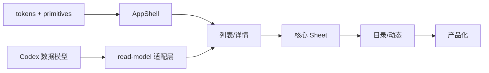

# 松仓前端设计完整方案（v1）

> 状态：设计契约，待实施  
> 日期：2026-10-31  
> 范围：`apps/web`、MCP Apps 共享界面、移动 Web  
> 前置文档：[前端与 UI 审核](./frontend-ui-audit.md)、[数据模型诊断](./data-model-diagnosis.md)、[领域模型](./domain-model.md)、[Ant Design 约定](./antd-ui.md)、[DESIGN.md](../DESIGN.md)  
> 数据前提：数据模型修改正在由 Codex 实施；本方案用“读模型适配层”隔离接口变化，见第 2 节

---

## 0. 一页决策

| 决策点 | 结论 |
| --- | --- |
| 组件库 | **保留 Ant Design 6** 作为行为层，不整体替换 |
| 设计层 | 自建 `ui/tokens` + `ui/primitives`，页面不再直接拼 Ant |
| 样式 | **CSS 变量 + CSS Modules**；不引入 Tailwind 页面级混用 |
| 风格 | **Warm editorial utility / 温暖的家庭账本**；浅色、纸面、陶土、账本行 |
| 布局 | 一套 AppShell：桌面侧栏、平板抽屉、手机底部导航；container queries 适配宿主 |
| 列表 | 语义 list/grid，单件商品一行；Ant Table 只用于目录/检查器 |
| 详情 | 一套响应式档案：桌面侧栏、手机全页；删除全页/侧栏双实现 |
| 表单 | 每个操作独立 Sheet，共享 Field/FormSection/Draft 原语 |
| 路由 | TanStack Router 显式路由 + `validateSearch` + 路由级懒加载 |
| 数据 | TanStack Query + 前端 view model 索引；服务端搜索/分页逐步替换全量快照 |
| 图标 | 统一线性 1.5px；Lucide 用于自建表面，Ant 内部图标保留 |
| 动效 | CSS transition，120–180ms；不引入 Framer Motion |
| 主题 | 仅浅色；token 预留深色，不在本轮实现 |
| 测试 | Storybook（或 `/ui`）+ Playwright 视觉回归 + axe + Lighthouse |
| 非目标 | 换组件库、做深色模式、做原生 App、做通用低代码设计器、远程字体 |

**一句话：** 先把“行为”交给 Ant，把“外观与结构”收回到自己的设计层；先统一一套列表/详情/历史，再谈品牌与动效。

---

## 1. 设计目标与原则

### 1.1 目标

1. **5 秒内回答“这是什么、在哪、什么状态、下一步做什么”。**
2. **单件商品一行、20 件一屏半**：桌面 1440×900 ≤ 1800px，手机 390×844 ≤ 2400px。
3. **高频动作不超过 3 步**：入库、消耗、移动、编辑、打印。
4. **一个关注点一个实现**：列表、详情、历史、页头、标签各一套。
5. **接口变化不穿透 UI**：Codex 改数据模型时，只改适配层，不改页面。

### 1.2 六条设计原则

| 原则 | 含义 | 反例 |
| --- | --- | --- |
| 一行一个决定 | 每行只回答“这是什么 + 下一步” | 组头 + 子行重复同一名称 |
| 事实先于字段 | 先显示“剩 1 L / 11-05 到期”，不显示 schema | 9 行资料 7 行“未记录” |
| 安静的 surface | 纸面 + 细线 + 留白，不靠阴影/渐变 | 卡片套卡片、满屏白块 |
| 动作贴着对象 | 消耗/移动/编辑在行尾，不跳三层 | 详情 → 记录消耗 → 用掉一部分 → 数量 |
| 渐进披露 | 默认 3 个关键事实，其余折叠 | 所有模板字段平铺 |
| 状态可恢复 | 草稿、离线、冲突、撤销都有出口 | 保存失败丢输入、误操作只能纠正 |

### 1.3 成功指标

| 维度 | 指标 |
| --- | --- |
| 任务 | 5 人测试 ≥4/5 完成；入库 ≤3 动作；消耗 ≤3；移动 ≤3 |
| 视觉 | 5 秒测试能指出名称/状态/主操作；20 件不超页长 |
| 一致性 | 1 套列表/详情/历史/页头/标签；0 死类名 |
| 可访问性 | axe 0 critical；键盘全流程；正文 ≥14px；触控 ≥44px |
| 性能 | 5k 物品输入 <100ms；筛选 <200ms；INP <200ms；CLS <0.1 |
| 工程 | 页面组件 ≤400 行；0 重复 label map；路由级 chunk |

---

## 2. 接口稳定性与前端解耦

### 2.1 先回答：接口稳定吗？

**不能假设稳定。** 需要分三层看：

| 层 | 内容 | 稳定性 | 前端怎么用 |
| --- | --- | --- | --- |
| 领域身份层 | Household、Item、CatalogNode、Actor、Note、Event、Operation 的 ID；revision；幂等；事件追加 | **稳定** | 可直接依赖 |
| 命令层 | `create_items`、`consume_items`、`move_item`、`update_attributes` 等命令名与语义 | **较稳定** | 通过 API client 调用 |
| 读模型层 | `InventorySnapshot`、`ItemRecord`、模板绑定、分组统计、终端快照 | **演进中** | 必须经适配层 |
| 能力层 | profile、deadline、attachments、custody、references、补货 | **正在新增** | 能力探测 + 功能开关 |
| 模板层 | 模板 ID、版本、字段路径、`attributes` 形状 | **明确演进** | 不直接读路径 |

**当前事实：** 这个 checkout 里 `git diff` 为空，只有我们新增的文档；Codex 的改动不在这个工作区或还没落盘，所以我无法核实它具体改了什么。按诊断方案推演，以下内容很可能变化：

- `catalog_nodes.profile` 或等效的物品形状字段；
- 新模板（asset/deadline/custody/service/stock 等）与模板版本；
- `attribute_templates` 的注册/退役；
- `query_items` 的过滤/排序/分页形状；
- `InventorySnapshot` 的字段（profile、能力、聚合、附件）；
- Note 的目标类型、附件、事件/历史游标；
- `template_version` 的类型（当前核心命令是 `1 | 2`）。

**所以：** 如果前端直接绑定 `attr(item,'lifecycle')?.expiry`、`item.attributes` 数组、`template_version: 1|2`，Codex 一改就会大面积返工。**本方案用读模型适配层把 UI 与这些字段隔开。**

### 2.2 三层契约

```text
领域契约（后端/数据库）
  └─ 读模型契约（HTTP/MCP snapshot，允许演进）
       └─ 前端 View Model（UI 只依赖这一层）
```

- **领域契约**：ID、revision、幂等、命令语义。前端只通过 `api` 调用，不直接操作。
- **读模型契约**：`InventorySnapshot` 原始数据。允许新增字段；前端解析必须容忍未知字段/未知模板。
- **View Model**：`ItemView`、`GroupView`、`Fact`、`Capability`。UI 组件只接收 View Model，不接收 `attributes`。

### 2.3 前端只依赖的 View Model

```ts
export type Tone = 'neutral' | 'success' | 'warning' | 'danger' | 'info';

export type Capability =
  | 'profiles'
  | 'attachments'
  | 'deadlines'
  | 'references'
  | 'restock'
  | 'savedViews';

export interface Fact {
  kind: 'remaining' | 'expiry' | 'opening' | 'condition' | 'warranty' | 'loan' | 'custom';
  label: string;
  value: string;
  tone?: Tone;
  priority: number; // 0 最高；UI 只取前 3
  source?: { templateId: string; path: string; version: number };
}

export interface ItemView {
  id: string;
  skuId: string;
  name: string;
  subtitle?: string;
  location: { id: string | null; path: string[]; label: string };
  profile?: 'CONSUMABLE' | 'DURABLE' | 'WEARABLE' | 'SPACE' | 'MISC';
  status: { label: string; tone: Tone };
  facts: Fact[];
  attention: ('past' | 'soon' | 'low' | 'away')[];
  thumbnailUrl?: string;
  revision: number;
  updatedAt: string;
}

export interface InventoryView {
  household: { id: string; name: string; timezone: string };
  capabilities: Record<Capability, boolean>;
  counts: { products: number; items: number; attention: Record<string, number> };
  items: ItemView[];
  groups: GroupView[];
  notesByItem: Record<string, NoteView[]>;
  locations: LocationView[];
  catalog: CatalogView[];
}
```

`GroupView/NoteView/LocationView/CatalogView` 是列表分组、笔记、位置、目录的轻量投影；字段按页面需要定义，原则同上：不暴露模板路径，不把原始 `attributes` 传给页面。

**实现位置：**

```text
apps/web/src/features/inventory/model/
  read-model.ts      // 原始 snapshot -> InventoryView
  facts.ts           // 模板 -> Fact[]（含未知模板兜底）
  groups.ts          // 分组/统计
  selectors.ts       // itemById / catalogById / notesByItem / childrenByParent
  capabilities.ts    // 能力探测
```

页面只 import `useInventoryView()`，不 import `attr()` 和模板路径。

### 2.4 未知模板与未知字段

- 未知 `template_id`：不崩溃，生成 `Fact { kind:'custom', label:'其他资料', value:'已记录（暂不支持展示）' }`，或直接忽略；保留原始数据供技术信息。
- 未知字段：忽略，不渲染；不把未知当“未记录”。
- `schema_version` 不匹配：显示“数据已更新，请刷新”，不白屏。
- 新增字段：旧版前端忽略；新版前端按能力显示。
- 模板版本升级：旧绑定继续按旧版本展示；只在新写入时用新版本。

### 2.5 能力探测与功能开关

```ts
const caps = view.capabilities;
{caps.attachments && <AttachmentsSection />}
{caps.deadlines && <DeadlineSection />}
{caps.restock && <RestockBadge />}
```

服务端未提供能力时，UI 不显示入口；不要用“字段是否存在”猜能力。

### 2.6 契约冻结协议（给 Codex 的约束）

1. **一个变更一份 ADR**：改了哪些字段、为什么、迁移方式、对 Web/插件/Android 的影响。
2. **同一发布内只增不删**：不重命名、不移除；废弃字段至少保留一个小版本。
3. **breaking change 升 `schema_version`**：前端支持 N/N-1；不匹配时降级而不是崩溃。
4. **黄金 fixture**：`tests/fixtures/read-model/*.json` 覆盖旧/新快照；前端适配层测试必须通过。
5. **前端评审前置**：涉及 `packages/contracts/src/web.ts`、`terminal.ts`、模板注册的 PR，需要前端确认适配层改动。
6. **能力开关**：新能力先以 optional/capability 形式出现；UI 完成前不强制。
7. **不把模板路径写进 UI**：Codex 可自由加模板；UI 只读 View Model。

### 2.7 现在就可以做的事

即使 Codex 还没完成，也可以先做：

- `ui/tokens`、`ui/primitives`、`AppShell`；
- `read-model` 适配层的接口与 mock；
- 列表/详情的静态骨架与视觉回归；
- 用 mock `InventoryView` 完成组件开发；
- 等真实契约落地后，只改适配层。

**结论：** 核心 ID/命令稳定；读模型/模板/能力不稳定。**不要把“接口稳定”当成设计前提**；把适配层当成第一道工程边界，接口变化就只影响一个目录。

---

## 3. 视觉方向

### 3.1 North Star

> **像一本经常翻开的家庭账本：纸面温暖、字迹清楚、每件东西只占一行，但那一行足够你决定下一步。**

关键词：安静、具体、居家、精确；不是可爱、不是企业后台、不是生活方式杂志。

### 3.2 参考与反参考

| 参考 | 提取什么 |
| --- | --- |
| Muji / Fog Linen / Kinfolk | 纸面、留白、克制的颜色、生活感 |
| Things 3 | 安静的层级、清楚的主操作 |
| Linear | 密度、快捷键、命令面板、克制的动效 |
| Paprika / Grocy | 库存任务、补货、到期 |
| Apple Home | 房间/设备的心智模型 |
| 日本家庭库存笔记本 | 账本行、手写标签、分类色 |

反参考：Ant Design 默认后台、渐变/玻璃拟态/新拟态、巨大 hero、满屏 pill、两套图标、现在做深色模式。

### 3.3 色板

| Token | 值 | 用途 |
| --- | --- | --- |
| `--ac-paper` | `#F6F0E6` | 页面底色 |
| `--ac-surface` | `#FFFCF6` | 内容面 |
| `--ac-surface-raised` | `#FFFFFF` | 浮层/输入 |
| `--ac-ink` | `#2B2420` | 正文 |
| `--ac-ink-2` | `#51463D` | 次级正文 |
| `--ac-muted` | `#68615C` | 辅助文字 |
| `--ac-line` | `#E8DFD2` | 分隔线 |
| `--ac-line-strong` | `#D8C9B8` | 强分隔/边框 |
| `--ac-accent` | `#AB5F40` | 主操作/选中 |
| `--ac-accent-hover` | `#965136` | 主操作 hover |
| `--ac-accent-soft` | `#F5E5D8` | 选中底/主色浅底 |
| `--ac-success` | `#5F7358` | 在库/可用 |
| `--ac-success-soft` | `#E8EFE4` | 成功浅底 |
| `--ac-warning` | `#A9742A` | 临期/待补 |
| `--ac-warning-soft` | `#F6EAD6` | 警告浅底 |
| `--ac-danger` | `#A33828` | 过期/危险 |
| `--ac-danger-soft` | `#F7E2DC` | 危险浅底 |
| `--ac-info` | `#4F6B7A` | 借出/运输 |
| `--ac-info-soft` | `#E4EDF0` | 信息浅底 |

规则：

- 主色只给主操作和选中；链接用 `--ac-ink-2` + 下划线，不再用陶土色。
- 状态用 tint 背景 + 深色文字；不要只用颜色，必须带文字。
- 对比度：正文 ≥4.5:1；大字 ≥3:1；状态文字在浅底上 ≥4.5:1。
- 不在 CSS 里写裸 hex；全部走 token。

### 3.4 字体

| 角色 | 字体 | 字号/行高 | 字重 | 用途 |
| --- | --- | --- | --- | --- |
| Display | Songti SC / STSong / SimSun | 28/1.25 | 600 | 品牌、页面标题 |
| Title | PingFang SC / system | 20/1.3 | 600 | 区块标题 |
| Row | PingFang SC / system | 16/1.35 | 600 | 物品名 |
| Body | PingFang SC / system | 14/1.5 | 400 | 说明、表单 |
| Micro | PingFang SC / system | 12/1.4 | 500 | 状态、元信息 |

- 宋体只用于 ≥20px 的标题；**不要用宋体做行名/正文**。
- 数字统一 `font-variant-numeric: tabular-nums`。
- 不引入远程字体；MCP/CSP/离线都不合适。
- 中文正文不要全大写/加宽字距；标题字距 `0.02em` 即可。

### 3.5 间距、圆角、边框、阴影

| 类别 | 值 |
| --- | --- |
| 间距 | 4 / 8 / 12 / 16 / 24 / 32 / 48 |
| 行高 | 桌面 64；手机 72；表格 48 |
| 控件高 | 桌面 36；手机 44 |
| 圆角 | 控件 8；面板 12；chip 999 |
| 边框 | 1px `--ac-line`；强分隔 1px `--ac-line-strong` |
| 阴影 | 内容面无阴影；浮层 `0 12px 32px rgba(43,36,32,.12)` |
| 内容宽度 | 列表 960–1120；详情 720–840；设置 640–720 |

**只保留一层内容面**：背景 → 内容区 → 行分隔；不要在内容面里再套卡片。卡片只用于“浮层/独立区块”，不是每个模块都包一层。

### 3.6 动效

| 场景 | 时长/曲线 |
| --- | --- |
| Sheet 打开/关闭 | 180ms `cubic-bezier(.2,.8,.2,1)` |
| 筛选结果更新 | 120ms opacity/translateY 2px |
| 保存成功 | 120ms check + toast |
| hover/focus | 80ms color/background |

- 不做列表 stagger、不做弹跳、不做视差。
- `prefers-reduced-motion` 下全部 0.01ms。

### 3.7 图像与图标

- 列表缩略图 40×40，圆角 8；无图用分类色块 + 首字/线性图标。
- 分类图标：食品、清洁、衣物、电子、工具、文件、宠物、其他；单色 + 分类色底。
- 图标统一线性 1.5px、16/20px；Lucide 用于自建表面；Ant 内部图标保留，但不要在同一行混两套风格。
- 空状态用单色线稿/几何图形，不用大幅插画。
- 照片规范：自然光、浅色背景、方形裁切、不修图过度；没有照片时不伪造。

### 3.8 文案

- 动词开头：“记录消耗”“移到位置”“补充到期日”“打印标签”。
- 具体、短句；不用“轻松管理一切”“让生活更美好”。
- “未记录”= 没填；“未知”= 系统不能推断；两者不混。
- 不用“尾号/UUID/商品关联/数量依据/生命周期”作为主标签；技术信息折叠。
- 错误文案：发生了什么 + 为什么 + 下一步；不直接抛错误码。

---

## 4. 布局系统

### 4.1 AppShell

```text
桌面 ≥1200
┌──────────────┬──────────────────────────────────────────────┐
│ Brand        │ PageHeader                                   │
│ Household    │ Toolbar                                      │
│              │ Smart views / active chips                   │
│ 我的物品      │                                              │
│ 商品目录      │  List / Table          │ Detail panel 400px  │
│ 动态          │                        │ (可选)              │
│              │                                              │
│ 设置          │ Pagination                                   │
└──────────────┴──────────────────────────────────────────────┘

平板 768–1199
┌──────────┬───────────────────────────────────────────────────┐
│ 64/200   │ PageHeader + Toolbar + List                       │
│ sidebar  │ Detail = Drawer 480                               │
└──────────┴───────────────────────────────────────────────────┘

手机 <768
┌──────────────────────────────┐
│ Brand + Household            │
│ PageHeader                   │
│ Toolbar                      │
│ List                         │
│                              │
│ Bottom nav 64 + safe area    │
└──────────────────────────────┘
Detail = 全页；Sheet = 全屏
```

### 4.2 尺寸与容器

| 区域 | 值 |
| --- | --- |
| 侧栏 | 224；折叠 64；平板 200 |
| 顶栏 | 桌面 64；手机 56 |
| 底部导航 | 64 + safe-area |
| 内容 padding | 桌面 24–32；手机 16 |
| 列表最大宽 | 1120 |
| 详情最大宽 | 840 |
| 设置最大宽 | 720 |
| 详情侧栏 | 400（独占时 720） |

布局用 **container queries**，因为 MCP iframe/侧栏宽度不等于视口：

```css
.app-shell { container-type: inline-size; }
@container (min-width: 1080px) { .workspace { grid-template-columns: minmax(0,1fr) 400px; } }
@container (max-width: 719px) { .toolbar { grid-template-columns: 1fr; } }
```

媒体查询只做兜底：`<768` 手机布局，`≥1200` 宽屏。

### 4.3 网格与密度

- 12 列栅格只用于页面级分区，不引入栅格库。
- 列表行用 CSS Grid：`[thumb 40] [content 1fr] [status auto] [actions 40]`。
- 桌面列表 64px，手机 72px；表格 48px。
- 同一屏最多 3 个视觉层级：页面标题、区块标题、行内容；不要 5 种字号。

---

## 5. 组件库

### 5.1 组件清单

| 层 | 组件 | 说明 |
| --- | --- | --- |
| 基础 | `Button` / `IconButton` | primary/secondary/quiet/danger；md/sm；loading |
| 基础 | `Field` / `FormSection` | label/hint/error/required；分组 |
| 基础 | `Banner` | info/warning/danger；离线/错误/回执 |
| 基础 | `StatusTag` | tone + dot + label |
| 基础 | `FactChip` | 关键事实；最多 3 个 |
| 基础 | `Metric` | 指标卡：label + value + hint |
| 基础 | `Skeleton` | 行/卡片/页面 |
| 基础 | `EmptyState` | 图标 + 标题 + 说明 + 主操作 |
| 布局 | `PageHeader` | 返回 + 标题 + 说明 + 操作 |
| 布局 | `Toolbar` | 搜索 + 筛选 + 排序 + 视图 |
| 布局 | `Section` | 标题 + 操作 + 折叠内容 |
| 列表 | `ItemRow` | 缩略图 + 名称 + facts + 位置 + 状态 + 溢出 |
| 列表 | `GroupHeader` | 多件商品的组头；单件不显示 |
| 列表 | `DataTable` | 目录/检查器；排序/空/分页 |
| 覆盖 | `Sheet` | 桌面右抽屉；手机全屏；焦点陷阱 |
| 反馈 | `ActivityItem` | 人话摘要 + 技术详情折叠 |
| 导航 | `CommandPalette` | Phase 3；⌘K 搜索/跳转 |

### 5.2 关键组件规格

#### Button

- 变体：`primary`（陶土实底）、`secondary`（描边）、`quiet`（文字）、`danger`（红）。
- 尺寸：`md` 36（手机 44）、`sm` 28。
- 状态：default/hover/active/focus/disabled/loading。
- 焦点：2px `--ac-accent`，offset 2。
- 规则：一屏最多一个 primary；破坏性动作必须 `danger` + 确认；全宽只用于移动端 ActionBar。

#### PageHeader

- 结构：`[返回 44] 标题 / 说明 [操作]`。
- 手机：标题 24；说明 14；操作在标题右侧或下一行。
- 不再使用 `page-header` + `space-between` 直接塞 `a + h1` 的写法。
- 一个页面只有一个 `h1`。

#### Toolbar

- 桌面一行：搜索（flex）+ 筛选按钮（带 count）+ 排序菜单 + 视图菜单。
- 手机：搜索第一行；筛选/排序/视图第二行；不再并排三个不同外观的控件。
- 已应用筛选在下方显示 chips；单个可移除；“清除全部”只在 ≥2 个时出现。
- 0 值关注不显示；`日期已过 2` 作为 chip，不做第二排按钮。

#### ItemRow

```text
[ ] [40 thumb]  名称 16/600                    [StatusTag]
                1 L · 冷藏 · 开封 3 天 · 剩 60%
                厨房 / 冰箱 / 冷藏层              [⋯]
```

- 桌面 64，手机 72；整行可点开详情；复选框只在选择模式出现。
- `facts` 最多 3 个，按 priority；溢出菜单：消耗、移动、编辑、打印、整件用完。
- 同名物品用位置/到期区分；不显示 UUID/尾号。
- 键盘：Enter 打开；`M` 移动、`C` 消耗（Phase 3，可选）；`aria-label` 只读名称+位置+状态。

#### StatusTag

- tone：success/warning/danger/info/neutral；dot + 文字。
- 不用颜色单独表达；文字必须存在。
- 例：`临期 3 天`、`已过期`、`借出`、`维修`、`未记录`。

#### FactChip

- 只放可扫读的事实：`1 L`、`冷藏`、`开封 3 天`、`剩 60%`、`保修至 2028-03`。
- 不放大段文字；不换行超过 2 行；不放按钮。

#### Sheet

- 桌面：右侧 480/560；手机：全屏。
- 结构：标题 + 关闭 44 + 内容 + sticky footer。
- 焦点：打开时聚焦标题/首个字段；关闭回到触发点；Esc 关闭（busy 时禁用）。
- 底部主操作 + 次操作；破坏性动作在 footer 用 danger。
- 表单不跳“核对页”（入库除外）；提交前在 footer 上方显示摘要。

#### Field / FormSection

- `Field`：label、hint、error、required；控件；`aria-describedby`。
- `FormSection`：标题 + 说明 + 字段；2–4 个字段一组。
- 手机输入 16px；控件高 44。
- 错误在字段下；业务错误在表单顶部 Banner；网络错误在全局 Banner。

#### EmptyState

- 图标/线稿 48；标题 16/600；说明 14；一个主操作。
- 例：“这里还没有物品” + “添加第一件” + “从模板开始”。
- 搜索空：“没有找到‘牛奶’” + “清除筛选” + “搜索全部位置”。

### 5.3 组件 API 约定

- 变体用 `variant`/`tone`/`size`，内部转 `data-*` 属性 + CSS；不要给每个页面传 style。
- 不暴露 `className` 作为主要定制手段；只允许 `className` 做布局定位。
- 所有交互组件必须有 `aria-label` 或可见文字；图标按钮必须有 label。
- 组件不直接读 `useInventory`；数据由页面/容器传入。
- 组件不 import `packages/contracts` 的模板；只 import View Model 类型。

---

## 6. 页面设计

### 6.1 我的物品（首页）

**目的：** 找到物品、看清状态、直接做下一步。

**桌面布局：**

```text
┌ PageHeader: 我的物品        46 种商品 · 298 件实物     [+ 添加] ┐
│ Toolbar: [搜索............] [筛选 2] [排序] [视图]              │
│ Chips: [临期 2 ×] [需补货 3 ×] [清除]                          │
│ ┌ 位置树 224 ┐ ┌ 列表 1fr ────────────────────────────────┐   │
│ │ 全部 298    │ │ 多件组：牛奶 6 件 · 2 位置  ▾            │   │
│ │ 厨房 42     │ │   行 1 [图] 蒙牛 1L · 冷藏 · 开封 3 天   │   │
│ │ 冰箱 18     │ │   行 2 ...                              │   │
│ │ 衣柜 12     │ │ 单件：T恤 · 衣柜 · 良好                  │   │
│ └─────────────┘ └─────────────────────────────────────────┘   │
│ Pagination: 1–20 / 46 种商品                        20/页      │
└────────────────────────────────────────────────────────────────┘
```

**规则：**

- 单件商品一行，不渲染组头；多件商品组头 40px，展开显示行。
- 组头显示“名称 + N 件 + M 个位置 + 需留意”；不重复子行名称。
- 位置树默认隐藏 0 计数；搜索/折叠状态保留；长名称 tooltip 显示全路径。
- 关注事项只显示 >0 的 chip；点击切换筛选；多个条件“任一”组合并说明。
- “选择”模式显式进入；非选择模式不显示复选框；批量栏固定在顶部/底部。
- 空状态：无物品 / 搜索无结果 / 位置为空，三种文案与动作不同。

**手机：**

- 顶部：品牌 + 家庭；标题 + 添加。
- 搜索第一行；筛选/排序/视图第二行；chips 第三行（可横向滚动）。
- 行 72px；点行打开全页详情；长按/行尾进入选择（Phase 3）。
- 底部导航 4 项；详情页底部 ActionBar 固定。

### 6.2 单件档案

**目的：** 回答“这是什么、在哪、什么状态、下一步”。

**桌面侧栏 400 / 手机全页：**

```text
← 返回                               [状态 chip] [⋯]
名称（28/600）
厨房 / 冰箱 / 冷藏层

┌ 剩余 1 L ┬ 到期 11-05 ┬ 可用 ┐
└──────────┴────────────┴──────┘

[记录消耗]  [移动]                         ← ActionBar
────────────────────────────────
资料（已记录 4 项）                  ▾
  品牌 蒙牛 · 规格 1 L · 购入 10-01
  + 补充资料
笔记（最近 1 条）                    ▾
历史（最近 3 条人话摘要）            查看全部
技术信息（UUID / revision / 绑定）     ▾
```

**规则：**

- 指标最多 3 个：剩余/到期/状态；没有则用“未记录”占位卡，不堆 9 行。
- 资料只显示已记录字段；未记录折叠为“补充资料”，点击打开对应 Sheet。
- 主操作 1 个（消耗）+ 溢出菜单（移动/编辑/开封/整件用完/纠正/打印）。
- 历史先显示人话摘要；技术 diff 折叠。
- 桌面侧栏 400；空间不足用 Sheet；手机全页；不要同时存在全页和侧栏两套实现。
- 删除重复入口：顶部“更多资料”和底部“更多资料”只留一个；X 与返回只留一个。

### 6.3 商品目录

**目的：** 管理 SKU，不抢日常入口。

- 左侧分类树 + 右侧表格；表格列：商品、关键规格、在库/位置、最近变化、状态、操作。
- 支持多选：批量改分类、合并重复、隐藏、导出。
- “需要整理”入口：未分类、缺规格、重复名称、无在库。
- 行点击打开 SKU 侧栏（不跳全页）；从物品详情可直接打开。
- 表格用 Ant Table（管理视图），但套 token + 统一表头/空状态。

### 6.4 动态

**目的：** 回答“家里最近发生了什么”。

- 按天分组；每条：操作者 + 动作 + 对象 + 时间 + 结果。
- 例：“小明把 2 瓶牛奶放进冰箱 · 10:24”。
- 技术 diff 折叠；`名称：未记录 → 未记录` 这类无变化不显示。
- 筛选：只看我、只看某件、只看某类操作；分页/加载更多。
- 空状态：“还没有动态。添加第一件物品后会出现在这里。”

### 6.5 设置 / 账号 / 家庭 / 打印

- 设置首页：品牌卡 + 账号与家庭 + 打印 + 本机缓存 + 开发者工具。
- 账号页：section + 行式操作（标题/说明/右侧按钮）；不要全宽按钮堆叠。
- 家庭页：当前家庭、成员、邀请、切换；危险操作（退出/离开）danger + 确认。
- 打印页：打印机连接、标签尺寸、浓度、预览；保持现有能力。
- 页头统一 `PageHeader`；账号页标题不再被推到右侧。

### 6.6 登录 / 授权 / 离线

- 登录：品牌 + 一句说明 + 主操作；不放大图/营销文案。
- OAuth 同意：客户端、权限、家庭、允许/拒绝；清楚说明 scope。
- 离线：全局 Banner“离线查看 · 上次更新 …”；写入按钮禁用并解释；缓存可读。
- 登录失效：Banner + 重新登录；保留草稿/输入。

### 6.7 搜索 / 命令面板

- 主列表搜索是主入口；`/search` 不再维护第二套表格。
- Phase 3 加 `⌘K`：搜索物品、商品、位置、动作（添加/移动/消耗/打印）。
- 结果分组、命中高亮、最近搜索、空结果建议。
- 搜索字段：名称、品牌、规格、位置、笔记、条码；同名项用位置/日期区分。

### 6.8 Sheet 清单

| Sheet | 步骤 | 关键点 |
| --- | --- | --- |
| 入库（已有商品） | 选商品 → 件数/位置 → 确认 | 最近商品/常用位置/扫码；≤3 动作 |
| 入库（新商品） | 新建 → 名称/分类/依据 → 件数/位置 → 确认 | 分类规范只显示必要字段；≤5 动作 |
| 消耗 | 数量 → 确认 | 1/4、1/2、全部快捷；显示剩余预览；≤3 动作 |
| 移动 | 搜索/选择位置 → 确认 | 显示当前路径/目标路径；≤3 动作 |
| 编辑 | 分组字段 → 保存 | 只显示相关字段；变更摘要 |
| 笔记 | 文本 → 保存 | Markdown 预览可选；不隐式改库存 |
| 打印 | 选择标签/份数 → 打印 | 预览 + 打印机状态 |

---

## 7. 关键流程

### 7.1 入库

**已有商品：**

| 步骤 | 界面 | 动作 |
| --- | --- | --- |
| 1 | 点“添加” | 打开 Sheet，搜索框聚焦 |
| 2 | 选商品/扫码 | 显示最近/常用；选中后件数默认 1 |
| 3 | 件数/位置 + 确认 | 位置默认当前范围；确认后关闭 + toast |

**新商品：** 在步骤 2 切换“新建商品”，填名称/分类/依据，其余同上；分类规范只显示必填项。

### 7.2 消耗

| 步骤 | 界面 | 动作 |
| --- | --- | --- |
| 1 | 行尾 `⋯` → 消耗 | 打开 Sheet，显示当前剩余 |
| 2 | 输入数量/选快捷 | 1/4、1/2、全部；显示消耗后剩余 |
| 3 | 确认 | 关闭 + 局部更新；失败保留输入 |

### 7.3 移动

| 步骤 | 界面 | 动作 |
| --- | --- | --- |
| 1 | 行尾 `⋯` → 移动 / 批量移动 | 打开 Sheet |
| 2 | 搜索位置/最近位置 | 显示当前路径、目标路径 |
| 3 | 确认 | 关闭 + toast；冲突回滚 |

### 7.4 编辑 / 笔记

- 编辑：名称、状态、日期、备注分组；只提交变更字段；保存后局部更新。
- 笔记：文本 + 可选标题；保存后更新“最近笔记”；不隐式改库存。
- 草稿：关闭时提示“已保存草稿”；再次打开恢复。

### 7.5 打印

- 单件/批量/本次入库回执；预览标签；选择打印机/浓度/份数。
- 打印失败保留选择；不重复入库。

### 7.6 筛选 / 保存视图

- 筛选 Sheet：位置、库存状态、可用性、开封、状况、到期窗口、分类。
- 应用后 chips；可保存为“我的视图”（Phase 3）。
- 0 值不显示；筛选条件进 URL，刷新/分享可复现。

### 7.7 首次使用 / 空状态

- 空家庭：一句说明 + “添加第一件物品” + “先建一个位置”。
- 无位置：引导建“家 / 厨房 / 冰箱”；不自动创建。
- 无商品：入库时允许新建；分类规范按需确认。
- 离线无缓存：说明 + 重试；不显示空白表格。

---

## 8. 响应式与宿主

### 8.1 断点

| 宽度 | 布局 |
| --- | --- |
| `<768` | 手机：底部导航、全页详情、全屏 Sheet |
| `768–1199` | 平板：侧栏 200/64、详情 Drawer 480 |
| `≥1200` | 桌面：侧栏 224、详情侧栏 400（空间足够） |

组件级用 container query：列表容器 ≥720 显示工具行；工作区 ≥1080 显示详情侧栏；≥1360 同时显示位置栏 + 列表 + 详情。

### 8.2 MCP Apps / iframe

- 不假设 `window.innerWidth` 等于可用宽度；用 container query + `ResizeObserver`。
- 不加载远程字体/CDN；所有 CSS/资源内联或同源。
- 弹层挂到当前 document.body；焦点陷阱在 iframe 内。
- 安全区用 `env(safe-area-inset-*)` + 宿主变量；底部导航/Sheet 避让。
- 视口高度用 `visualViewport`；键盘弹出时 footer 仍可达。
- 包体预算：不新增第二套组件库；Sheet 懒加载；Ant 按需。

### 8.3 打印

- 标签渲染独立组件，不依赖屏幕布局；打印时隐藏导航/交互。
- 标签尺寸/浓度/份数沿用现有能力；视觉改版不改打印协议。

---

## 9. 内容与文案

### 9.1 Glossary

| 概念 | UI 词 | 避免 |
| --- | --- | --- |
| SKU | 商品 | 款、SKU、商品资料 |
| Item | 实物 / 件 | 物品、实例、物件 |
| 位置 | 位置 | 存放位置、容器（对用户） |
| 分组 | 按商品 / 按位置 / 按日期 | 视图、模式 |
| 库存状态 | 库存状态 | 状态、生命周期 |
| 可用性 | 可用性 | 可用状态、状态 |
| 开封 | 开封 | 开封状态（可保留） |
| 笔记 | 笔记 | 记忆、Note |
| 历史 | 历史 / 动态 | 事件、Event |
| 到期 | 到期 / 保质期 / 最佳食用期 | 日期类型 |
| 余量 | 剩余 | 数量、库存量 |

### 9.2 文案规则

- 动词开头，具体对象：“记录消耗”“移到冰箱”“补充到期日”。
- 一句话不超过 2 行；不用感叹号；不用营销词。
- 错误：发生了什么 + 下一步；例如“剩余量未记录。先补充余量，再记录消耗。”
- 空状态：说明 + 一个主操作；不写“暂无数据”。
- 日期：`10月31日`；今年内不写年份；跨年写 `2027-01-05`；相对日期只在 7 天内用“明天/3 天后”。
- 数字：`1 L`、`500 mL`、`1.5 kg`；单位不混排；tabular numerals。

---

## 10. 可访问性

目标：WCAG 2.2 AA。

| 项 | 要求 |
| --- | --- |
| 键盘 | 所有操作可 Tab；Enter/Space 激活；Esc 关闭 Sheet；焦点陷阱/恢复 |
| 焦点 | 2px 可见环，offset 2；不用 `outline: none` |
| 触控 | 手机 ≥44×44；行内操作不重叠 |
| 屏幕阅读器 | 列表项读“名称、位置、状态”；不读 UUID；图标按钮有 label |
| 表格 | `aria-sort`；表头可点击；空表格有说明 |
| 动态 | 结果计数/筛选变化用 `aria-live="polite"` |
| 颜色 | 不单独用颜色表达状态；对比度 AA |
| 表单 | label 关联；错误 `aria-describedby`/`aria-invalid`；必填标记 |
| 缩放 | 200% 不横向滚动；iOS 输入 16px 不缩放 |
| 动效 | `prefers-reduced-motion` 全部关闭 |
| 图片 | 有 alt；装饰图 `alt=""`；缩略图 alt=物品名 |

---

## 11. 性能

### 11.1 预算

| 指标 | 目标 |
| --- | --- |
| 初始 JS gzip | ≤350KB（Ant 按需）；超出先做路由拆分 |
| 路由 chunk | ≤80KB gzip |
| LCP | 本地/边缘 <2.0s（中端手机） |
| INP | <200ms |
| CLS | <0.1 |
| 5k 物品输入 | <100ms 到结果 |
| 5k 物品筛选 | <200ms |
| 列表滚动 | 60fps；>200 行虚拟化 |

### 11.2 数据与渲染

- `useInventoryView` 一次构建索引：`itemById`、`catalogById`、`notesByItem`、`childrenByParent`、`ancestorCache`。
- 所有过滤/分组/统计走索引；不在渲染里 `find/filter` 全表。
- 搜索 debounce 150ms + `useDeferredValue`；长列表虚拟化。
- 服务端搜索/分页在 Phase 2 接入；客户端保留兜底。
- 写入成功局部更新 + 后台刷新；不做整页 skeleton。
- 图片懒加载 + 尺寸占位；不上大图。

### 11.3 代码分割

- 路由级 lazy：目录、动态、设置、检查器、打印。
- Sheet 按操作 lazy：入库、编辑、打印。
- Ant 组件按需 import；不引入第二套 UI 库。
- 分析包体：`vite build --report` 或 `rollup-plugin-visualizer`（仅本地）。

### 11.4 缓存

- React Query 缓存 + `staleTime`；快照增量（Phase 2）。
- 离线快照只读；写入禁止；恢复联网后手动重试。
- 不缓存敏感字段到日志；本地缓存按家庭 key。

---

## 12. 工程架构

### 12.1 目录

```text
apps/web/src/
  app/
    router.tsx          # 显式路由 + validateSearch
    providers.tsx       # Ant/Query/Session/Inventory
    shell/              # AppShell, Sidebar, BottomNav
  features/
    inventory/
      api.ts
      model/            # read-model, facts, groups, selectors
      components/       # ItemRow, ItemList, ItemDetail, Toolbar
      screens/          # InventoryScreen, ItemScreen
    intake/
    catalog/
    activity/
    settings/
    auth/
  ui/
    tokens.ts           # 唯一 token 源
    tokens.css          # 由 tokens 生成/校验
    theme.ts            # Ant theme 映射
    primitives/         # Button, Field, Sheet, ...
    patterns/           # PageHeader, EmptyState, ...
  styles/
    reset.css
    base.css
  lib/
    api.ts
    session.tsx
    format.ts
    copy.ts             # 中文文案
```

### 12.2 路由

- 显式 `createRoute`，不要 catch-all + if/else。
- `validateSearch` 管理 `q/group/status/category/attention/page`。
- `lazyRouteComponent` 拆分页面。
- 每个路由有 error boundary + Suspense skeleton。
- 设置/账号路由不挂 `InventoryProvider`。

### 12.3 状态

| 状态 | 位置 |
| --- | --- |
| 服务端数据 | TanStack Query |
| 筛选/分页/选择 | URL search params |
| 组件 UI | local state |
| 草稿 | IndexedDB/localStorage（现有机制） |
| 会话/家庭 | Session context |
| 不使用的 | 模块级 Map、隐式全局、重复快照 |

### 12.4 样式

- `tokens.ts` 唯一源：颜色、字号、间距、圆角、阴影、动效。
- 生成 `tokens.css`；Ant theme 从同一对象映射（Ant 需要真实色值，不能吃 `var()`）。
- CSS Modules + `data-*` 变体；不用 styled-components/emotion。
- 覆盖 Ant：优先 `ConfigProvider` token；布局用外层 class；避免全局 `.ant-* !important`。
- 每个 feature 一个 CSS Module；`layout.css` 只保留 reset/base/shell。

### 12.5 组件约定

- 组件不读全局 store；数据由 props/容器传入。
- 变体用有限枚举；不要 `style` 透传。
- 所有交互有键盘/ARIA；所有图标按钮有 label。
- 页面组件 ≤400 行；Sheet 每个操作一个文件。
- 测试：每个 primitive 一个 Story/示例；每个页面一个 Playwright smoke。

### 12.6 文案与 i18n

- 所有中文集中在 `copy.ts`（按 feature 分）；不散落在 JSX。
- 先只做中文；英文品牌名保留。
- 日期/数字格式统一 `format.ts`；家庭时区来自 session。

---

## 13. 设计系统治理

| 机制 | 做法 |
| --- | --- |
| 单一 token 源 | `tokens.ts` 生成 CSS + Ant theme；CI 校验 CSS 中无裸色值 |
| 组件目录 | `/ui` kitchen-sink 页面（或 Storybook） |
| 视觉回归 | Playwright `toHaveScreenshot`，390/768/1440 三档 |
| 可访问性 | axe-core + 手动键盘走查 |
| 类名 lint | 解析 TSX className 与 CSS，未定义即失败 |
| 组件评审 | 新 primitive 需说明 anatomy/variants/a11y/tokens |
| 变更记录 | `docs/design-changelog.md`；废弃组件保留一个版本 |
| 设计契约 | `DESIGN.md` 先于实现；不再从实现反向提取 |

---

## 14. 实施路线

### Phase 0 · 设计层与 Shell（S/M）

| 任务 | 产出 |
| --- | --- |
| token 源 + Ant theme | `tokens.ts`/`tokens.css`/`theme.ts` |
| 8 个 primitives | Button/Field/Sheet/PageHeader/Toolbar/ItemRow/StatusTag/EmptyState |
| AppShell | 侧栏/底部导航/内容宽度/container query |
| `/ui` 示例页 | 所有组件状态 |
| 死类名清理 + 类名 lint | 0 未定义 className |
| 视觉回归 + axe | 3 视口基线 |

**DoD：** 组件可独立预览；0 死类；无数据模型依赖；现有页面不动。

### Phase 1 · 列表与详情（M）

| 任务 | 产出 |
| --- | --- |
| `useInventoryView` + mock | 适配层 + 索引 |
| 我的物品列表 | 单件一行、组头、筛选 chips、选择模式 |
| 单件档案 | 3 指标 + 1 主操作 + 折叠资料 |
| 删除旧列表/详情 | 一套实现 |
| 视觉回归 | 列表/详情 3 视口 |

**DoD：** 20 件 ≤1800px（1440）；≤2400px（390）；详情首屏 3 指标；无 UUID。

### Phase 2 · 核心流程（L）

| 任务 | 产出 |
| --- | --- |
| 入库 Sheet | 最近商品/扫码/位置/件数 |
| 消耗 Sheet | 快捷数量/预览/≤3 动作 |
| 移动 Sheet | 搜索/最近/路径确认 |
| 编辑/笔记 Sheet | 分组/变更摘要 |
| 动态 feed | 人话摘要 + 技术折叠 |
| 目录管理 | 表格 + 批量整理 |
| URL 状态 | 筛选/分页可分享 |

**DoD：** 5 人任务测试 ≥4/5；入库 ≤3、消耗 ≤3、移动 ≤3；后退/刷新保持状态。

### Phase 3 · 产品化（M/L）

| 任务 | 产出 |
| --- | --- |
| 照片/附件 | 缩略图/详情画廊 |
| 命令面板 | ⌘K 搜索/跳转/动作 |
| 键盘/撤销/批量 | 高频用户 |
| 服务端搜索/虚拟列表 | 5k 件 |
| 代码分割/包体预算 | 性能达标 |
| 深色模式评估 | 仅评估，不默认做 |

**DoD：** 性能预算；axe 0 critical；5k 件输入 <100ms；视觉基线稳定。

### 14.1 依赖与并行



- **前端不等待 Codex 全部完成**：适配层 + mock 可以先做。
- **Codex 完成一个能力，适配层接一个**：profile、deadline、attachments 分别开关。
- **每阶段一个 feature flag**：`ui.next`；旧页面保留到 parity。

### 14.2 回滚

- 旧页面/组件保留到新页面通过验收；按路由切换。
- 不做数据库回滚；前端只读/适配层可独立回退。
- 打印/标签链路单独回归，不与列表改版混在一个 PR。

---

## 15. 验收

### 15.1 任务

| 任务 | 成功标准 |
| --- | --- |
| 找到临期牛奶并消耗一半 | ≤3 动作；不误操作其他瓶 |
| 给已有商品入库 1 件 | ≤3 动作；位置正确 |
| 新建洗衣液并入库 | ≤5 动作；分类正确 |
| 移动 3 件到储藏室 | ≤4 动作；确认前看到目标路径 |
| 找到借出的电钻 | ≤2 动作；看到持有人/应还日 |
| 查看某件最近变化 | 1 次进入；说出谁/何时/改了什么 |

### 15.2 视觉

- 5 秒测试：名称/状态/主操作可指出。
- 20 件页长：1440×900 ≤1800px；390×844 ≤2400px。
- 0 死类名；1 套页头/列表/详情/历史。
- 对比度 AA；触控 ≥44px。

### 15.3 可访问性

- axe 0 critical/serious（5 页）。
- 键盘全流程；抽屉焦点恢复；表格 `aria-sort`。
- 读屏不念 UUID；结果变化 `aria-live`。
- 200% 缩放不横向滚动。

### 15.4 性能

- 5k 物品/5k 笔记：输入 <100ms；筛选 <200ms；INP <200ms。
- 初始包体 ≤350KB gzip；路由 chunk ≤80KB；无回退 >10%。
- 设置页不加载库存；列表无全量重渲染。

### 15.5 工程

- 页面组件 ≤400 行；0 重复 label map；0 死类。
- 每个 primitive 有示例 + a11y 说明。
- 每个 PR 附 390/768/1440 截图；视觉 diff/axe/Lighthouse 不退化。

---

## 16. 风险与缓解

| 风险 | 影响 | 缓解 |
| --- | --- | --- |
| Codex 数据模型变更 | 前端返工 | 适配层 + capability + schema_version + 契约冻结 |
| Ant 覆盖困难 | 视觉不达标 | token 优先；组件级 CSS；避免全局 `!important` |
| MCP 包体/宿主限制 | 加载慢/样式失效 | 路由拆分；无远程字体；container query；iframe 测试 |
| 范围过大 | 半年做不完 | Phase gate；先列表/详情；旧页面保留 |
| Android 共用快照 | 终端受影响 | 契约变更同步 Android；fixture 测试 |
| 打印/标签回归 | 硬件链路断 | 单独回归；不改打印协议 |
| 设计 QA 假数据 | 判断失真 | 用 `seed-web-demo`；5 视口截图 |
| 无人可用性测试 | 自嗨 | Phase 2 后 5 人测试；任务指标 |

---

## 17. 给 Codex 的接口清单

在数据模型改动完成前，请确认/提供：

- [ ] `InventorySnapshot` 的 `schema_version` 与新增字段（profile/capabilities/attachments）
- [ ] 模板新增/版本变更清单（ID、版本、字段、适用 profile）
- [ ] `template_version` 类型是否从 `1|2` 放开
- [ ] `query_items` 的过滤/排序/分页是否变化
- [ ] Note 目标类型、附件接口
- [ ] 事件/历史游标是否变化
- [ ] 旧字段的废弃窗口（至少一个小版本）
- [ ] 黄金 fixture：旧/新快照各一份
- [ ] Web/插件/Android 的影响说明
- [ ] 迁移与回滚步骤

**前端承诺：** 只通过 `features/inventory/model` 读原始快照；模板路径不进入页面组件；未知字段/模板不崩溃。

---

## 18. 一页结论

- **框架：** 保留 Ant 6，做自己的设计层；CSS 变量 + CSS Modules；不引入 shadcn/Tailwind 页面级混用。
- **风格：** 温暖的家庭账本；纸面、账本行、一个陶土强调、状态色、照片优先、安静动效。
- **结构：** 一套 AppShell、一套列表、一套详情、一套历史、一套页头、一套标签。
- **接口：** 核心 ID/命令稳定，读模型/模板/能力演进中；用适配层隔离，Codex 改接口只改一个目录。
- **顺序：** Phase 0 设计层 → Phase 1 列表/详情 → Phase 2 核心流程 → Phase 3 产品化。
- **底线：** 先减法，再视觉；先 view model，再页面；先统一，再品牌。

这份方案可以直接作为后续“完成完整前端设计”的实施契约。数据模型落地前，先做 token/primitives/AppShell/适配层，不会白做。
