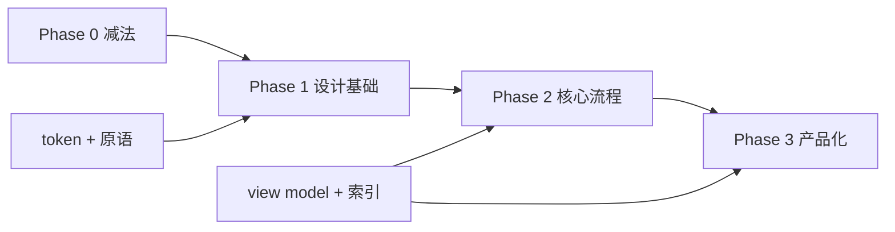

# 松仓前端与 UI 审核

> 审核日期：2026-10-31  
> 审核范围：`apps/web/src` 全部页面、布局、表单与样式；360 / 390 / 768 / 1024 / 1440px 截图  
> 审核方式：代码审阅 + 截图走查 + 启发式评估（Nielsen 十项）+ 设计系统/工程结构审计  
> 证据限制：未做真实用户任务测试；截图为 CI 合成数据，部分内容（重复的“插件验收”）不代表真实家庭；但布局、层级、重复结构、交互路径与数据无关

---

## 0. 结论

**先给结论：当前界面不是“差一点打磨”，而是两代产品叠在一起。**

它同时存在：

- 一套“按商品分组的展开列表”（`Workbench` + `StashResults`）
- 一套“完整表格列表”（`ItemTable` / `InventorySearch` / `ProductCatalog`）
- 一套“侧栏/内联档案”（`ItemInspector`）
- 一套“全页档案”（`ItemDetail`）
- 一套“动态审计日志”（`Activity`）和两套“变化历史”（`History` / `EventChanges`）
- 五套页头、八套标签映射、十二种操作共用一个千行抽屉

用户看到的不是“一个产品”，而是四五个半成品在不同入口轮流出现。**不好用的根源是结构，不好看的根源是设计系统缺失；两者都不是换颜色能解决的。**

### 0.1 粗评分

| 维度 | 评分 | 依据 |
| --- | --- | --- |
| 信息架构 | 3/10 | 商品/实物/位置/分组四个概念同时暴露；搜索页与主列表重复 |
| 视觉层级 | 3/10 | 白色卡片 + 13px 灰字 + 一个陶土色；没有焦点、没有图像、没有节奏 |
| 一致性 | 2/10 | 5 套列表、2 套详情、3 套历史、5 套页头、8 套标签 |
| 操作效率 | 3/10 | 加一件 5–6 步，消耗 4–5 步，筛选藏在弹层 |
| 移动适配 | 4/10 | 安全区和 44px 做了，但密度、返回、工具栏仍不产品级 |
| 可访问性 | 5/10 | 焦点/跳过链接/触控尺寸不错；返回目标、原始 UUID、表格排序不足 |
| 工程可维护性 | 2/10 | 巨型组件、重复实现、全局 CSS、无设计系统包、无视觉回归 |
| 产品完成度 | 3/10 | 功能闭环，但界面仍像数据库管理后台 |
| **整体** | **3.1/10** | 可用的工作台原型，尚不是产品级界面 |

### 0.2 最该先做的五件事

| # | 动作 | 对应 |
| --- | --- | --- |
| 1 | 只保留一套列表、一套详情、一套历史，删除其余实现 | UI01 |
| 2 | 把详情从“字段清单”改成“档案：身份 + 三个关键事实 + 一个主操作” | UI02 |
| 3 | 单件商品不再渲染“组头 + 子行”两行；列表密度提高一倍 | UI03 |
| 4 | 建一套真正的设计基础：token、页头、工具栏、列表行、状态标签、空状态 | UI05/UI10 |
| 5 | 先做 view model 与索引，再做视觉改版；否则 5k 件时改版也救不了卡顿 | UI08 |

---

## 1. 证据与范围

### 1.1 截图

| 页面 | 证据 |
| --- | --- |
| 我的物品 / 桌面 | `output/frontend-audit/items-desktop-top.png` |
| 我的物品 / 手机 | `output/frontend-audit/items-mobile-top.png` |
| 单件档案 / 桌面 | `output/frontend-audit/detail-desktop.png` |
| 编辑抽屉 / 桌面 | `output/frontend-audit/editor-desktop.png` |
| 账号与安全 | `output/frontend-audit/account-desktop.png` |
| 搜索 | `output/ci/playwright/antd-search-1440.png` |
| 商品目录 | `output/ci/playwright/antd-catalog-1440-webkit.png` |
| 移动详情 | `output/ci/playwright/antd-detail-390-chromium.png` |
| 移动移动确认 | `output/ci/playwright/workbench-move-confirm-390.png` |

### 1.2 代码规模

| 文件 | 行数 | 问题 |
| --- | --- | --- |
| `apps/web/src/ui/forms.tsx` | 1334 | 12 种操作共用一个 `ActionSheet`，表单、校验、草稿、审批、提交、恢复全在一起 |
| `apps/web/src/ui/workbench.tsx` | 1242 | 路由解析、列表、筛选、选择、分页、详情、焦点、滚动、打印全在一起 |
| `apps/web/src/ui/layout.css` | 1187 | 单文件全局样式，9 个 media query，其中 5 个在 767px |
| `apps/web/src/pages.tsx` | 1050 | 旧首页、商品页、全页详情、历史、笔记、目录、设置全部并存 |
| `apps/web/src/ui/browser.tsx` | 663 | 第二套列表、第二套搜索、第二套目录 |
| `apps/web/src/ui/inspector.tsx` | 752 | 只读检查器，另一套导航/布局 |
| `apps/web/src/accounts.tsx` | 616 | 账号、家庭、邀请、通行密钥 |
| **合计** | **约 10,100** | 没有 feature/component 边界 |

### 1.3 这份审核不是什么

- 不是“全部推翻”。领域、离线、草稿、幂等、焦点恢复这些难的部分做得不错，应该保留。
- 不是审美偏好。每条结论都有截图或代码位置；评分用于排序，不是精确度量。
- 不是真实用户测试。没有 5 位用户、没有任务成功率、没有眼动；建议在 Phase 1 后补一轮 5 人可用性测试。

---

## 2. 先说做对的

公平地说，这个前端有几处明显高于普通 CRUD 项目：

1. **领域语义认真。** “这页只修改这一件实物，其他同款物品保持各自的记录”“未记录不能变成未开封/可用”等文案和默认值，说明设计者理解模型，不是套模板。
2. **写入恢复完整。** 草稿、revision 冲突、幂等重试、离线只读、成功但刷新失败只重读——这些是很多产品级应用都没做的。
3. **焦点与可访问性有基础。** 跳过链接、抽屉关闭后焦点回到触发点、Splitter 方向键/Home/End、`prefers-reduced-motion`、44px 触控尺寸、安全区变量，都是对的。
4. **响应式不是简单断点。** 位置栏按可用宽度决定内联/抽屉，详情按剩余宽度决定并排/抽屉，比固定三栏成熟。
5. **视觉方向有辨识度。** 暖纸底 + 陶土强调 + 宋体标题，比默认 Ant Design 蓝色后台有品牌感；不引入远程字体也是对的。
6. **打印/标签链路完整。** 这是产品差异化能力，不应在重构中丢掉。

问题不是“没有做工”，而是**做工分布在不一致的四五套实现里**。

---

## 3. 页面逐页拆解

### 3.1 我的物品 / 桌面

截图：`output/frontend-audit/items-desktop-top.png`

**看到什么：**

- 左上“我的物品”，右侧“当前范围 46 种商品 · 298 件实物”；添加按钮在右上。
- 左侧位置树：大量 0 计数节点、截断名称（“插件验收 d59fa…”）、目录/位置混在一起。
- 工具栏一行：搜索、`按商品` 下拉、`筛选`、`名称排序`；下面紧接着“选择当前可见实物”复选框；再下面是“需要留意”四个带 0 的筛选按钮。
- 列表：每个单件商品都是“组头（名称 + 1 件 · 0 个已知位置）+ 子行（同样的名称 + 全部位置 + 剩余 1 L + 尾号）”。20 个商品把页面拉到 3653px。
- 整页是一个巨大的白色圆角卡片，背景只在四周露出一圈米色；右侧没有内容约束，行尾大量留白。

**核心问题：**

1. **单件组双行**（UI03）：组头和子行重复同一名称，单件商品也要两次阅读、两次点击目标；这是密度减半的最大原因。
2. **工具栏过载**（UI12）：15+ 个可交互元素；筛选藏在 popover，关注筛选又以第二排按钮出现；“选择当前可见实物”在非选择模式下也常驻。
3. **零值噪音**（UI12）：`日期已过 0`、`近期日期 0`、`余量不足 30% 0`、`不在手边 0` 四个 0 占据一整行，用户必须先扫过“没有信息”的内容。
4. **位置树不可扫**（UI16）：0 计数节点、截断名称、文件夹图标、数量和名称挤在一行；没有“只显示有物品的位置”或折叠 0。
5. **视觉层级弱**（UI10）：组头 16px 粗体、子行名称也接近粗体、元信息 13px 灰色；除了大小没有第二层区分。没有图片、没有分类图标、没有状态色块。
6. **全宽白卡**（UI17）：内容没有 max-width 或分栏约束，1440px 下每行文字过长，右侧空。

**方向：**

- 单件商品只渲染一行；多件商品才出现组头。
- 工具栏压到一行：搜索 + 一个“筛选”按钮（抽屉/弹层内分面）+ 排序图标；分组模式收进“视图”菜单。
- 关注筛选只在计数 > 0 时显示，作为可清除的 chip；不再有“需要留意”标签 + 0 值按钮。
- 位置树加“隐藏空位置”默认开启；0 计数弱化或折叠。
- 单行规格：`[缩略图/图标] 名称 · 关键事实 · 位置 · 状态 [⋯]`，桌面 64px、手机 72px。

### 3.2 我的物品 / 手机

截图：`output/frontend-audit/items-mobile-top.png`

**看到什么：**

- 顶部品牌 + 家庭切换；页面标题“我的物品”与添加按钮同排，统计“当前范围 46 种商品 · 298 件实物”换成两行。
- 搜索独占一行；下一行三个控件：`按商品` 下拉、`位置` 按钮（文件夹图标）、`筛选` 按钮（下箭头）。三种外观、三种对齐。
- “选择当前可见实物”整行复选框；关注筛选 2×2 换行，4 个 0。
- 20 个商品在 390px 下约 4093px 高。
- 底部导航 4 项；出现位置受全页截图影响，但真实设备固定在底部。

**核心问题：**

1. **首屏没有“物品”**：标题、统计、搜索、三个控件、复选框、四个关注按钮、位置面包屑之后，第一件物品在约 500px 以下。
2. **控件风格不统一**：下拉、带图标按钮、带箭头按钮并排，用户不知道哪个是筛选、哪个是视图。
3. **统计换行**：`46 种商品 · 298 件 / 实物` 断在“实物”前，读起来像两个句子。
4. **密度更低**：单件组双行在手机上变成 4 行文本 + 2 行组头，20 件要滑很久。
5. **返回目标小**：详情页返回是标题前一个 `‹` 文本链接（见 3.3），没有 44px。
6. **底部导航没有“添加”**：添加入口只在页面标题右侧，和“导航”分离是对的；但单手操作时右上角较远，建议悬浮/底栏主操作或长按。

### 3.3 单件档案 / 桌面

截图：`output/frontend-audit/detail-desktop.png`

**看到什么：**

- 标题“统一界面验收 efd2be · 第 4 件”；右侧“未记录位置”。
- 左栏一张卡：“当前剩余”、剩余量、包装规格、全部位置、商品分类、开封状态、到期日期、可用状态、生命周期、物品状况、原始 UUID。
- 然后 2 个全宽陶土主按钮（记录开封、记录消耗）、2 个并排默认按钮（移动位置、编辑资料）、1 个全宽默认按钮（整件用完）、1 个全宽默认按钮（纠正记录）。
- “文字笔记 / 变化历史”两张入口卡；右侧“变化历史”时间线，显示“数量依据：未记录 → 实测值”“名称：未记录 → 未记录”等内部 diff。
- 右栏在历史上方结束，下面大片空白；左右高度差约一倍。

**核心问题：**

1. **数据库形状**（UI02）：9 行属性里 7 行是“未记录/未分类/未指定”；“日期未记录”“未记录位置”“商品分类：未分类”同时出现；原始 UUID 直接展示。用户看到的是 schema，不是“这瓶奶还能不能喝”。
2. **动作过载**（UI04）：6 个动作、3 种视觉权重、2 个全宽主按钮；“整件用完”是破坏性动作，却是全宽默认样式，和“纠正记录”同级。
3. **重复入口**（UI19）：顶部“更多资料与操作”和底部“更多资料、消耗与笔记 ›”指向同一页；顶部“返回列表”和 X 关闭重复；`ItemInspector` 里还有第三套。
4. **重复信息**（UI02）：位置出现两次、规格出现两次、剩余量出现两次；标题里的“第 4 件”由 `itemTitle()` 按全库顺序计算，新增/删除物品后会变，不是稳定身份。
5. **历史不是人话**（UI15）：`名称：未记录 → 未记录` 这种无变化 diff 也显示；原因、操作者、结果都没有；用户无法从“创建记录”里知道发生了什么。
6. **视觉失衡**（UI17）：左栏长、右栏短；右栏没有 sticky，滚动后历史消失；页面没有 max-width，1440 下阅读线过长。

**方向：**

档案应该是：

```text
名称（大）                        位置面包屑
状态 chip · 关键事实 chips
[剩余 1 L] [到期 11-05] [可用]        ← 3 个指标，不超过 3 个
[记录消耗]  [⋯ 更多操作]              ← 1 主 + 1 溢出
资料（只显示已记录，未记录折叠为“补充资料”）
笔记（最近 1 条 + 查看全部）
历史（人话摘要，技术 diff 折叠）
```

### 3.4 编辑 / 操作抽屉

截图：`output/frontend-audit/editor-desktop.png`

**看到什么：**

- 桌面 560px 抽屉；顶部“× 编辑物品”；蓝色通知；上下文卡（名称 + 位置 + 数量 + 原始 UUID）；然后名称、规格、状态、购入日期、备注；底部固定“保存修改 / 取消”。
- 所有字段等宽、等距、无分组；规格是禁用输入框 + “编辑商品共有资料 ›”链接；状态/日期输入有陶土色边框；备注在首屏下方。
- 12 种操作（编辑、入库、消耗、整件用完、开封、移动、改名、属性、纠错、笔记、建位置、建商品）共用一个组件，标题和字段按 `if` 拼接。

**核心问题：**

1. **没有信息分组**（UI11）：名称/状态/日期/备注都是一样的视觉权重；用户不知道哪些必填、哪些影响库存、哪些只影响展示。
2. **上下文卡过重**（UI02）：通知 + 卡片 + 字段重复名称和位置；卡片里还放原始 UUID，移动端占掉首屏 1/3。
3. **表单没有“变更摘要”**（UI11）：用户改了什么、会影响哪些实物，只能在提交后看历史。
4. **一个组件十二种操作**（UI07）：字段、校验、提交、审批、草稿恢复全部条件分支；改一个操作容易影响另一个。
5. **保存后反馈**：成功 toast + 刷新，基本可用；但“操作已保存。请刷新读取最新结果”这种文案把刷新责任交给用户，不够产品化。

**方向：**

- 抽屉分 2–3 个 section（“这是什么 / 放在哪 / 什么时候”），只显示该品类相关字段。
- 顶部只保留一行上下文（名称 + 位置），UUID 收进“技术信息”。
- 提交前显示“将修改 1 件实物”的摘要；保存后自动刷新并关闭，toast 只报结果。
- 按操作类型拆成 `IntakeSheet`、`ConsumeSheet`、`MoveSheet`、`EditSheet`、`NoteSheet`，共享字段原语而不是共享整页。

### 3.5 搜索

截图：`output/ci/playwright/antd-search-1440.png`

**看到什么：**

- 页面标题“搜索”；一行搜索框 + 搜索范围 + 库存状态 + 商品分类 + 名称排序 + 显示列；第二行“30 件实物 · 0 个位置”；表格只有“物品 / 规格 / 剩余”三列，30 行同名“Web 演示饮品”，无分组、无高亮、无操作。
- 与“我的物品”工具栏搜索是两套语义：这里能选范围/状态/分类，主列表把筛选藏进 popover；结果表也不分组。

**核心问题：**

1. **重复页面**（UI14）：主列表已有搜索，`/search` 没有导航入口，也不承担独特任务；却维护第二套筛选/分页/表格。
2. **结果不可扫**：同名行没有区分（无位置、无日期、无尾号列），用户不知道选哪一行；30 行完全一样。
3. **没有搜索反馈**：没有命中高亮、没有“搜索了哪些字段”、没有最近搜索、没有空状态建议。
4. **列太少**：只有规格和剩余，没有位置、状态、到期；对“找东西”没有帮助。

**方向：**

- 搜索并入主列表：一个全局搜索框 + 结果分组 + 命中高亮；`/search` 如保留，必须是“高级搜索/保存视图”，不是第二套列表。
- 结果行显示名称、关键事实、位置、状态、匹配片段；同名项用位置/日期区分，不用尾号。
- 加最近搜索、空结果建议（清除筛选/扩大范围/创建商品）。

### 3.6 商品目录

截图：`output/ci/playwright/antd-catalog-1440-webkit.png`

**看到什么：**

- 左侧分类树 + “全部商品 91 / 未分类 45”；右侧表格 4 列：商品 / 规格 / 分类 / 在库实物。
- 大量“规格未记录”“未分类”“1 件实物”；没有品牌、条码、最近入库、操作。
- 顶部“管理商品资料”是文字链接，“新增商品”是主按钮；标题在左，操作在右。
- 左侧树有 0 计数、截断名称；右侧表格行高约 47px，信息密度尚可但内容空。

**核心问题：**

1. **目录与物品割裂**（UI16）：用户日常在“我的物品”，目录是另一个世界；从物品到 SKU 资料的路径深（详情 → 更多资料 → 商品页）。
2. **表格列没有决策价值**：规格/分类/在库实物三列大量重复“未记录/未分类/1 件”；没有“最近使用/低库存/需要整理”等可行动信息。
3. **批量管理缺失**：没有多选、批量改分类、合并重复 SKU、批量隐藏；目录是“看”的，不是“管”的。
4. **与物品页视觉不一致**：目录用表格，物品用分组卡片；同一批数据两种阅读方式。

**方向：**

- 目录定位为“管理视图”，保留表格，但列改为：商品、关键规格、在库/位置、最近变化、状态、操作。
- 加“未分类/缺规格/重复名称”三个整理入口；支持多选批量归类。
- 从物品详情直接打开 SKU 侧栏，不跳全页。

### 3.7 动态

**看到什么：**

- Collapse 列表，每项“创建记录 · 10/31 06:31”，展开后是内部 diff。
- 没有操作者、没有对象摘要、没有按天分组；`名称：未记录 → 未记录` 也显示。

**核心问题（UI15）：**

- 这是审计日志，不是“家里最近发生了什么”。用户想知道“谁把牛奶放进了冰箱”“昨天买了什么”，不是“attributes.lifecycle.expiry.date: 未记录 → 2026-11-05”。
- 操作者 `actor_id` 在事件里存在，但 UI 不显示；同一 operation 的多个事件归并了，但标题仍是事件类型。
- 没有“只看我/只看某件物品/只看某类操作”的筛选；没有日分组；没有空状态引导。

**方向：**

- 事件 → 人话摘要：“小明把 2 瓶牛奶放进冰箱 · 10:24”，技术 diff 折叠。
- 按天分组，显示操作者头像/名字、对象 chip、结果；支持“只看我”“只看这件”。
- 保留“技术详情”给高级用户/检查器。

### 3.8 设置 / 账号与安全

截图：`output/frontend-audit/account-desktop.png`

**看到什么：**

- 页面顶部左侧“‹ 设置”，右侧巨大“账号与安全”；卡片里又有一个“账号与安全”标题。
- 邮箱、密码/通行密钥状态；四个全宽控件：重新验证身份、添加通行密钥（陶土实底）、修改密码、移除密码（禁用）。
- “重新验证身份 / 修改密码 / 移除密码”看起来和输入框一样（同样的边框、高度、白底），只有“添加通行密钥”明显是按钮。
- 卡片下方 500px 空白。

**核心问题：**

1. **页头布局错误**（UI05）：`page-header` 是 `justify-content: space-between`，只有“返回链接 + h1”两个子元素，于是标题被推到最右；卡片内又重复标题。
2. **按钮与输入不可区分**（UI18）：全宽 default button 和输入框同高同边框；用户会以为“重新验证身份”是一个输入框。
3. **没有分组**（UI17）：身份验证、通行密钥、密码三组操作平铺；没有说明“推荐用通行密钥”“修改密码会使其他会话退出”等层级。
4. **空状态浪费**：900px 高只有 280px 内容；没有账户概览、最近登录、设备列表。

**方向：**

- 统一页头：返回 + 标题 + 一句说明，标题不被 `space-between` 推走。
- 账号页用 section + 行式操作（标题/说明/右侧按钮），不要全宽按钮堆叠。
- 危险操作（移除密码、退出）用 danger + 确认；推荐操作（通行密钥）用主按钮。

---

## 4. 设计系统诊断

### 4.1 颜色

现状：

- 主题色 `#AB5F40`，纸底 `#F6F0E6`，面板 `#FFFCF6`，墨色 `#2B2420`，次要 `#68615C`，分隔 `#E8DFD2`。
- 同一个陶土色同时承担：主按钮、链接、选中导航、进度条、关注筛选激活、输入聚焦、位置选中。
- 状态色没有系统：`Tag` 用 Ant 默认，过期日期用 `#A33828`，低库存没有颜色，借出/清洁/维修没有色。
- `layout.css` 里又硬编码了 `#2b2420`、`#68615c`、`#e8dfd2`、`#f5e5d8`、`#a33828` 等，和主题 token 双写。

问题：

- **单一强调色过载**：所有“重要”都是陶土色，结果没有重要。用户分不清“主操作”“选中”“状态”“链接”。
- **状态不可扫**：列表里的“可用/已开封/临期”主要靠文字和 13px 灰字，没有色块/图标；扫一屏找不到需要处理的物品。
- **硬编码漂移**：改主题色不会改 CSS 里的颜色；设计文档和实现会继续分叉。

建议：

- 语义 token：`--color-action`（陶土）、`--color-selected`、`--color-danger`、`--color-warning`、`--color-success`、`--color-info`、`--color-muted`；CSS 只用 token。
- 状态用低饱和 tint 背景 + 深色文字（临期琥珀、过期红、可用绿、借出蓝、未知灰），不要全用主色。
- 主色只用于主操作和选中；链接可以用更深的墨色/下划线，不必也是陶土。

### 4.2 字体

现状：

- 标题：宋体 24/28，600；正文：系统无衬线 14；元信息 13；手机部分 14/16。
- 没有行高/字重/字距系统；`h1` 1.4，其他继承。
- 数字只有剩余量用了 `tabular-nums`；价格、日期、数量没有。
- 宋体用在品牌、页面标题、档案标题、设置标题，但“商品目录”“搜索”“动态”“账号与安全”有时是宋体、有时是系统无衬线，取决于组件。

问题：

- **层级靠字号硬撑**：16px 粗体组头和 15px 粗体行名太接近；13px 灰字承载了太多信息（位置、规格、日期、状态）。
- **阅读线过长**：桌面详情/列表没有 max-width；1440px 下正文行宽超过 100 字符。
- **数字不齐**：数量、日期、余量混排时没有等宽数字，扫列困难。

建议：

- 4 级字号：28（页面标题）/ 20（区块）/ 16（行标题）/ 14（正文）/ 12（辅助）；字重只用 400/600。
- 行标题 16/600，辅助 13/400，状态 12/500；数字 `font-variant-numeric: tabular-nums`。
- 正文最大 72ch；详情/设置用 720–840px 内容宽度，列表可到 1100px。

### 4.3 间距与布局

现状：

- DESIGN.md 声明 4/8/12/16/20/24；实际 CSS 出现 8/10/12/16/20/24/32，且同一层级不统一（组头 padding 10、实例 padding 10、卡片 24、抽屉 16/24）。
- 页面：`.app-main` 24，`.wb-inventory` 24，卡片内再 24；三层嵌套导致内容被推到很里面，视觉上“空”。
- 断点：9 个 media query，5 个在 767px；后面又有 `min-width:768` 和再次 `max-width:767`，覆盖顺序脆弱。
- 没有 max-width；桌面列表行宽 1000+，移动端内容贴边 16。

建议：

- 8pt 网格：4/8/12/16/24/32/48；同一层级固定。
- 页面只保留一层内容面：背景 → 内容区（可有 max-width）→ 行分隔；不要在卡片里再套卡片。
- 断点收敛为 3 个：<768、768–1199、≥1200；media query 按 mobile-first 排列。
- 设定阅读宽度：列表 960–1120，详情 720–840，设置 640–720。

### 4.4 组件与控件

现状：

- 没有自己的组件层：页面直接用 Ant `Button/Select/Input/Table/Card/Descriptions/Timeline`，靠 className 和 CSS 补布局。
- `Button`、`Link`、`Input` 边界模糊：`重新验证身份` 是 Button 但看起来像 Input；`查看商品共有资料` 是 Link 但看起来像纯文本；`记录开封/记录消耗` 是全宽主按钮，`整件用完` 是全宽默认按钮。
- 30 个 className 在 `layout.css` 中没有定义（见附录 B），包括 `button`、`secondary`、`icon-button`、`quantity`、`desktop-context`、`status-banner`。
- 页头有 5 种写法：`.wb-title`、`PageHeader`、`.page-header.large`、`Typography.Title`、自定义 header。

建议：

- 建 8 个原语：`PageHeader`、`Toolbar`、`ListRow`、`FactChip`、`StatusTag`、`Section`、`EmptyState`、`ActionBar`。
- 每个页面只允许用这些原语；禁止页面级自定义 header/按钮堆叠。
- 为按钮定义 4 个等级：primary、secondary、quiet、danger；全宽只用于移动端底部主操作。
- 所有可点击元素 ≥44px（移动）且视觉上明显可点；不要让 Button 长得像 Input。

### 4.5 状态：加载、空、错误、离线

现状：

- 有 Skeleton、Notice、Empty、离线 banner、错误重试；这是优点。
- 但 `.status-banner` 没有 CSS，离线/登录失效/入库回执横幅没有统一视觉。
- 列表加载没有骨架行，只有整页 Skeleton；筛选切换没有 loading/禁用反馈；写入没有 optimistic update。
- 空状态是纯文字；没有插图、没有主操作、没有“为什么空”的解释。
- 保存成功用 toast；失败用 `Notice` 或 drawer 内 error；不同页面提示位置不一致。

建议：

- 统一 `StatusBanner`（info/warning/danger）和 `EmptyState`（图标 + 标题 + 说明 + 1 个主操作）。
- 列表切换用行级 skeleton/淡出，不做整页闪烁；写入后用局部更新 + 后台刷新。
- 所有空状态给下一步：添加物品、清除筛选、创建商品、打印标签。

### 4.6 可访问性

做对的：

- skip link、抽屉焦点恢复、Splitter 键盘、44px 触控、`aria-label`、`aria-pressed`、`aria-current`、reduced motion。

不足：

- 返回 `‹` 是纯文本 Link，没有 44px 触控区（`pages.tsx:257`）。
- 列表/勾选框的 `aria-label` 包含完整 UUID（`browser.tsx:254`、`stash-results.tsx:115`），屏幕阅读器会念一长串。
- 底部导航 12px 标签；列表元信息 13px；在强光/老花下吃力。
- 表格没有可点击排序表头；筛选结果变化没有 `aria-live`。
- `重新验证身份` 等 Button 与 Input 同形，视觉/语义线索不足。
- 移动端详情页返回只有标题前小箭头；键盘/读屏用户需要多一步找返回。

建议：

- 所有导航返回 ≥44×44，带可见文字或图标 + aria-label。
- 列表 aria-label 用“名称 + 位置 + 第几件”，不念 UUID；UUID 只在技术信息。
- 结果计数/筛选变化用 `aria-live="polite"`；表头排序用 `aria-sort`。
- 正文 ≥14，移动 ≥16；辅助文字 ≥12 且对比度 ≥4.5:1。

### 4.7 动效与深度

- 没有自己的动效系统；Ant 默认过渡 + reduced motion 兜底。问题是：抽屉/详情切换很生硬，列表筛选没有过渡，状态变化没有反馈。
- 没有 elevation token；白色卡片和米色背景只靠 1px 分隔线，层次平。
- 建议：只在“打开/关闭 sheet、筛选结果变化、保存成功”三处加 120–180ms 过渡；其他保持即时；不要给列表加花哨动画。

---

## 5. 信息架构与任务流

### 5.1 心智模型

当前同时暴露四个概念：

| 概念 | UI 词 | 用户实际理解 |
| --- | --- | --- |
| SKU | 商品 / 款 | “牛奶” |
| Item | 实物 / 件 | “这一瓶” |
| 位置 | 位置 / 全部位置 | “冰箱” |
| 分组 | 按商品/按位置/按日期 | “我怎么看” |

领域上这是对的，但 UI 没有把“我在看什么”讲清楚：

- 标题“46 种商品 · 298 件实物”是对的，但列表里又把单件商品渲染成“组头 + 子行”，用户不知道“组头能不能点”。
- “尾号 e4a01c99”是内部身份，不是用户语言；用尾号区分同款，说明没有更好的“这一件”标识（位置/购入日/开封日/标签）。
- “商品关联”“数量依据”“生命周期”“可用状态”是领域词，不是家庭词。

建议：

- 主列表默认“商品摘要 + 展开实物”，但单件商品直接一行；展开后行内显示“位置 · 开封 · 剩余 · 到期”，不再重复名称。
- 用“这瓶/这袋/这件”做量词，用“位置”做区分；尾号只放在“技术信息”。
- 导航保留 4 项，但“我的物品”首页增加“关注事项”作为智能视图，而不是四个 0 按钮。

### 5.2 任务步数

以下按当前实现估算（点击/输入一次算一步）：

| 任务 | 当前 | 目标 | 主要摩擦 |
| --- | --- | --- | --- |
| 给已有商品入库 1 件 | 6–7 | 3 | 添加 → 选商品 → 件数 → 位置 → 核对 → 确认 |
| 新建商品并入库 | 8–10 | 4–5 | 选商品 → 创建新商品 → 名称/分类/依据 → 件数 → 位置 → 核对 |
| 从列表消耗一件 | 5 | 2 | 行 → 详情 → 记录消耗 → 用掉一部分 → 数量 → 确认 |
| 移动一件 | 5–6 | 3 | 选择模式 → 勾选 → 移动 → 选目标 → 确认 |
| 查看某件到期 | 2 | 1 | 行 → 详情；列表本身不显示日期 |
| 编辑笔记 | 5 | 3 | 行 → 详情 → 编辑 → 笔记 → 保存 |
| 找“临期” | 1–2 | 1 | 关注 chip 可用，但 0 值噪音多 |
| 找“冰箱里的牛奶” | 3–4 | 1–2 | 位置树 → 搜索 → 分组/展开 |

**结论：** 读路径尚可，写路径和“从列表直接操作”明显偏长。产品级的关键是**把最常用的 3 个动作放到行上/行尾菜单**：消耗、移动、编辑。

### 5.3 筛选与选择

- 筛选被拆成：搜索框、分组下拉、位置按钮、筛选 popover（5 个 select + 清除）、排序、显示列、关注 chips、范围面包屑、包含下级复选框。
- 没有“已应用筛选”的 chips 汇总；只有一行文字“已筛选 · N 件 + 清除”。
- 选择模式在移动端隐藏在“选择”按钮；桌面始终有复选框；进入选择后出现 4 个操作 + 提示。
- 双分页：全局分页 + 每个商品组内分页；跨页选择 + “不在当前结果”提示，认知负担高。

建议：

- 筛选收敛为一个“筛选”抽屉，内部按“位置/状态/日期/分类”分组；应用后在工具栏下方显示 chips（可单个移除）。
- 取消组内分页：组内最多显示 20 条 + “查看全部 N 件”；全局分页唯一。
- 选择模式由“选择”按钮显式进入；非选择模式不显示复选框；批量栏固定在底部/顶部。

### 5.4 反馈与恢复

做得好：

- 草稿持久化、revision 冲突、幂等重试、离线只读、成功但刷新失败只重读；这些是产品级基础。

不足：

- 用户不知道“输入已保存为草稿”；关闭抽屉再打开才恢复。
- 写入成功后要等 `refresh()`，没有 optimistic；列表会闪一下。
- 错误提示有时在 Notice、有时在 Form.Item、有时在 toast；位置不统一。
- 没有 undo；误操作只能走“纠正记录”。

建议：

- 抽屉顶部显示“草稿已保存 · 14:32”或“未保存”；关闭时若有未保存变更，确认。
- 写入成功先局部更新（数量/状态），后台刷新；失败回滚并提示。
- 统一错误位置：字段错误在字段下，业务错误在表单顶部，网络错误在全局 banner。

---

## 6. 工程诊断

### 6.1 重复实现地图

| 关注点 | 实现数量 | 位置 |
| --- | --- | --- |
| 列表 / 行 | 5 | `StashResults`、`ItemTable`、`PhysicalRow`、`Workbench` 手机 inline、`ProductCatalog` 表格 |
| 详情 | 2 | `ItemInspector`、`ItemDetail` |
| 历史 | 3–4 | `History`、`Activity`、`EventChanges`、`ItemInspector` Timeline |
| 标签映射 | 8 | `presentation.labels`、`eventNames`、`fields.definitions`、`templateLabels`、`pages.fieldLabels`、`activity.fieldLabels`、`forms.titles`、`inspector.titles` |
| 页头 | 5 | `.wb-title`、`PageHeader`、`.page-header.large`、`Typography.Title`、自定义 header |
| 搜索语义 | 2 | `searchInventory`（笔记/位置/ID）与 `productGroups`（名称/品牌/型号） |
| 目录树 | 2 | `LocationTree`、`CatalogTree` |

**后果：** 任何一次改版都要改 2–5 处；不同入口的密度、文案、行为会继续分叉；测试也只能覆盖被点到的那一套。

### 6.2 状态与路由

- 路由只有 root + index + catch-all，所有路径在 `WorkspaceContent` 里用 `if/else` 手写解析（`workspace.tsx:296–314`）。没有 typed routes、没有 route-level lazy、没有 loader/error boundary。
- 列表状态放在模块级 `Map`（`browser.tsx:41–115`），刷新丢失；只有 `q` 会写进 URL（`workbench.tsx:633`），其他筛选/分组/选择不进 URL，浏览器后退和分享链接不可靠。
- 同一屏同时存在：URL 参数、React state、模块 Map、localStorage、React Query、`InventoryProvider` 快照。没有单一 view model。
- `/settings/*` 也被 `InventoryProvider` 包住，必须等全量库存加载完；设置页不应该依赖库存。

### 6.3 渲染性能

- `searchInventory` 对每个 item 做 `ancestors()`（内部 `data.items.find`）和 `data.catalog.find`，再 `data.notes.filter`（`browse.ts:46–77`）；5k 物品 × 5k 笔记时每次按键是千万级比较。
- `latestNote` 对每行都 `data.notes.filter().sort()`（`lib/workbench.ts:119–124`），列表渲染 O(items × notes)。
- `stashGroups` 每次渲染调用 2–4 次，内部对每个 item 调 `stashDate`/`fullPath`；`itemAttention` 又在过滤、组头、行渲染里重复调用，每次都可能新建 `Intl.DateTimeFormat`（`lib/stash.ts:91–178`）。
- 搜索没有 debounce（`workbench.tsx:633`），每个按键都重算。
- `itemTitle` 用全库 `filter/findIndex` 计算“第 N 件”，O(n)，且标题不稳定（`presentation.ts:93–103`）。

**结论：** 300 件时是“有点慢”，5,000 件时是“卡死”。这是架构问题，不是 React 优化问题；需要索引 + view model + 服务端搜索。

### 6.4 CSS / 构建

- 一个 `layout.css` 1187 行，全局命名空间；9 个 media query，5 个在 767px，后置规则覆盖前面的规则。
- 30 个 className 在 CSS 中没有定义（附录 B），包括主 CTA、页头返回、数量、离线 banner。
- 硬编码颜色与 Ant token 双写；没有 CSS 变量层。
- 入口 eager import 所有页面；只有 Printer/Label lazy。`workspace.tsx` 顶部把 Home/Product/ItemDetail/Catalog/Settings/History/Notes 全部导入。
- 没有 CSS module / scoped style / lint 规则；没有视觉回归（只有流程截图）。

### 6.5 测试与设计 QA

- 浏览器测试覆盖流程、跨页选择、草稿、焦点等，质量不错。
- 但没有：视觉 diff、axe 可访问性、Lighthouse/性能预算、组件级测试、Storybook。
- 截图 fixture 大量“插件验收”“统一界面验收”重复数据，设计师看到的不是真实家庭内容；`seed-web-demo.ts` 有更真实的示例，却没有用于设计评审。

---

## 7. 缺陷清单

### 7.1 P0：产品级之前必须修

#### UI01 · 两代 UI 并存，重复实现

- **证据：** 主列表 `Workbench`/`StashResults`，另有 `ItemTable`、`PhysicalRow`、`ProductCatalog`；详情有 `ItemInspector` 与 `ItemDetail`；历史有 `History`、`Activity`、`EventChanges`。见 6.1。
- **影响：** 同一件物品在不同入口有不同密度、文案、操作；每次改版成本翻倍；用户学到的交互不能迁移。
- **修复：** 选一套响应式列表（含表格密度切换）、一套详情（桌面侧栏/移动全页）、一套历史；删除其余；所有入口路由到同一组件。
- **验收：** 代码中每个关注点只有一个实现；同一物品从列表、搜索、目录进入详情，视觉与操作一致。

#### UI02 · 详情是数据库形状，不是用户任务

- **证据：** `ItemDetail` 的 `Descriptions` 显示 5 个属性，卡片内另有 8 行，大量“未记录/未分类”；原始 UUID 直接显示（`pages.tsx:417–466`）；`EventChanges` 显示内部 diff（`activity.tsx:31–58`）。
- **影响：** 用户看到的是 schema；无法快速回答“还剩多少/什么时候到期/能不能用”；空字段制造焦虑。
- **修复：** 档案头（名称、位置、状态）+ 3 个指标（剩余/到期/状态）+ 1 个主操作；只显示已记录字段；未记录字段折叠为“补充资料”并给添加入口；UUID 收进“技术信息”。
- **验收：** 首屏 600px 内看到名称、位置、状态、剩余、到期、主操作；默认不出现原始 UUID；空字段不超过 1 行。

#### UI03 · 单件商品渲染两行，密度减半

- **证据：** `StashResults` 对 `group.items.length === 1` 也渲染组头 + 子行（`stash-results.tsx:55–74`、`:92–150`）；组头 min-height 54、子行 52（`layout.css:1012–1082`）；20 个商品 3653px。
- **影响：** 单件商品占两倍高度；名称重复；扫一屏只能看 8–10 件；手机更严重。
- **修复：** 单件组只渲染一行；多件组才显示组头；行高桌面 64、手机 72；组头不重复名称。
- **验收：** 1440×900 下 20 件商品 ≤ 1800px；390px 下 ≤ 2400px；同一屏不出现同名两次。

#### UI04 · 操作过载，破坏性动作不区分

- **证据：** 详情页 6 个动作：2 个全宽主按钮、2 个并排默认、1 个全宽“整件用完”、1 个全宽“纠正记录”（`pages.tsx:468–536`）；`ItemInspector` 又有一套“记录消耗/整件用完”（`item-inspector.tsx:114–136`）。
- **影响：** 主操作不明确；“整件用完”与普通操作同权重，容易误触；用户每次都要读 6 个按钮。
- **修复：** 1 个主操作（记录消耗）+ 1 个“更多”菜单（移动、编辑、开封、整件用完、纠正、打印）；破坏性动作 danger + 二次确认。
- **验收：** 详情首屏只有 1 个主按钮 + 1 个溢出菜单；整件用完必须二次确认；无重复动作。

#### UI05 · 死 CSS 类导致 CTA/页头失效

- **证据：** 30 个 className 无 CSS 定义（附录 B）；`button secondary` 用在商品页/设置/登录（`pages.tsx:375`、`:808`、`:1020`、`auth.tsx:132`）；`icon-button` 用在返回（`pages.tsx:257`）；`quantity` 用在剩余量（`pages.tsx:419`）；`desktop-context` 用在详情右栏（`pages.tsx:536`）；`status-banner` 用在离线/登录失效/入库回执（`workspace.tsx:220–246`）。
- **影响：** 链接 CTA 变成纯文本；剩余量没有视觉强调；账号页页头被 `space-between` 推到两端（`pages.tsx:925–930` + `layout.css:100`）。
- **修复：** 删除死类名或实现对应原语；页头用统一 `PageHeader`；加一条 CSS 类名 lint（未定义即失败）。
- **验收：** 0 个未定义 className；主 CTA 视觉可点；账号页标题在左、返回在左，不分离。

#### UI06 · 术语与标签不一致

- **证据：** 8 套标签映射（6.1）；同一状态在 `labels`、`fieldLabels`、`status` 里不同；UI 混用“商品/物品/实物/款/件/种”“状态/可用性/生命周期”“资料/详情/技术信息”。
- **影响：** 用户不知道“46 种商品”和“298 件实物”哪个是库存；筛选“库存状态”和“可用性”是不是一回事；学习成本高。
- **修复：** 建一份 glossary + 单一 i18n 表；界面固定“商品（SKU）/实物（件）/位置/分组”；状态用“库存状态/可用性/开封/状况”四个明确标签；删除“尾号”作为主要区分。
- **验收：** 全站同一概念只有一个词；无重复 label map；文案评审通过。

#### UI07 · 巨型组件与十二种操作

- **证据：** `forms.tsx` 1334 行，`ActionSheet` 处理 12 种 action（`forms.tsx:63–70`）；`workbench.tsx` 1242 行；`pages.tsx` 1050 行。
- **影响：** 改一个操作可能影响另一个；测试困难；新人无法定位；样式与业务逻辑耦合。
- **修复：** 按 feature 拆：`features/intake`、`consume`、`move`、`edit`、`note`；共享 `Field`/`Sheet`/`Draft` 原语；页面组件 ≤400 行。
- **验收：** 每个操作独立文件/测试；页面组件不超过 400 行；无 12 路 `if`。

#### UI08 · 全量快照 + 前端 O(n²)

- **证据：** 6.3；`searchInventory` 每个 item 做 ancestors/find/notes filter；`latestNote` 每行 filter+sort；`stashGroups` 重复调用；搜索无 debounce。
- **影响：** 5k 件时输入卡顿、手机发热；全量快照占内存；首屏慢。
- **修复：** 在 `useMemo` 里建索引（itemById、catalogById、notesByItem、childrenByParent、ancestors cache）；查询用索引；服务端搜索/分页；列表虚拟化；`useDeferredValue`/debounce。
- **验收：** 5k 物品、5k 笔记下，输入到结果 <100ms；每次渲染只遍历一次。

#### UI09 · 手写路由 + 全局库存加载

- **证据：** `workspaceRouter` 只有 root/index/catch-all（`workspace.tsx:296–314`）；所有页面在 `if/else` 解析；`InventoryProvider` 包住所有页面（`app.tsx:14–18`），设置页也等全量库存。
- **影响：** 无 route-level 代码分割；设置/账号加载慢；深链和后退不可靠；路由无法做 loader/error boundary。
- **修复：** 显式路由 + `validateSearch` + lazy；`InventoryProvider` 只包库存路由；设置/账号独立数据。
- **验收：** 设置页不请求库存；每个路由独立 chunk；筛选可分享/后退。

#### UI10 · 没有视觉层级，只有一个强调色

- **证据：** 截图；`layout.css` 行样式只有 13px 灰字 + 16px 粗体；没有图片/分类图标/状态色；主色同时用于所有交互（4.1）。
- **影响：** 界面像后台管理模板；用户 5 秒内找不到“最重要的一件事”；没有家庭物品的温度。
- **修复：** 4 级字号 + 2 字重；状态 tint；40px 缩略图/分类图标；主操作唯一；内容 max-width；行分隔替代大卡片。
- **验收：** 5 秒测试中，用户能指出名称、状态、主操作；视觉层级评审通过。

### 7.2 P1：高影响，第一批改版

| ID | 问题 | 关键证据 | 修复方向 | 验收 |
| --- | --- | --- | --- | --- |
| UI11 | 添加/消耗/移动路径长 | intake 6–8 步（`forms.tsx:729–840`）；消耗 4–5 步（`item-inspector.tsx:114–136`）；移动需选模式+选目标 | 行尾快捷操作；消耗一步输入；添加上次商品/最近商品；合并“核对”到提交前摘要 | 已入库 1 件 ≤3 动作；消耗 ≤2；移动 ≤3 |
| UI12 | 工具栏/筛选过载，零值噪音 | `workbench.tsx:719–920`；截图 4 个 0 | 一行工具栏 + 筛选抽屉 + active chips；0 值隐藏 | 工具栏 ≤5 个控件；0 值不显示；已应用筛选可单个移除 |
| UI13 | 双分页 + 选择模式隐藏 | 全局分页 + 组内分页（`workbench.tsx:1060–1130`；`stash-results.tsx:154–170`） | 唯一全局分页；组内“查看全部”；选择模式显式 | 全站 1 个分页；非选择模式无复选框；跨页选择提示清楚 |
| UI14 | 搜索页冗余且弱 | `browser.tsx:373–451`；3 列表格；无分组/高亮 | 并入主列表或升级为高级搜索；结果分组/高亮 | 主列表可完成搜索；结果分组；无重复页面或高级搜索有独立价值 |
| UI15 | 动态是审计日志 | `activity.tsx:31–58`、`:118–165` | 人话摘要 + 操作者 + 日分组；技术 diff 折叠 | 动态显示“谁/何时/对什么/做了什么”；技术 diff 默认折叠 |
| UI16 | 目录与物品割裂，表格空 | `browser.tsx:451–663`；截图 4 列重复 | 目录定位管理视图；列改关键信息；批量整理 | 目录每行有决策信息；支持批量归类；从物品直达 SKU 侧栏 |
| UI17 | 布局不平衡/无 max-width | 详情左右高度差（`pages.tsx:535–539`）；`layout.css:862` | 内容 max-width；右栏 sticky；详情单列+侧栏 | 内容有 max-width；详情两栏高度差 <30%；无 500px 空白 |
| UI18 | 按钮/输入/链接不可区分 | 账号页全宽按钮（`accounts.tsx:345–380`）；`button secondary` 死类 | 4 级按钮；行式操作；链接样式 | 按钮/输入视觉可区分；主/次/危险层级明确 |
| UI19 | 5 种页头，重复返回/关闭 | `workbench.tsx:666`、`pages.tsx:241`、`:897`、`:924` | 统一 `PageHeader`；删除重复入口 | 全站 1 种页头；返回/关闭不重复；标题位置一致 |
| UI20 | 筛选不进 URL，刷新丢失 | `browser.tsx:41–115`；只有 `q`（`workbench.tsx:633`） | `validateSearch` + URL 状态；刷新恢复 | 刷新/后退保持筛选；链接可分享 |
| UI21 | CSS 架构与断点 | 1187 行单文件；9 个 media；5 个 767 | CSS Modules/feature CSS + token；收敛 3 断点 | CSS 按 feature 拆分；3 断点；0 硬编码颜色 |
| UI22 | 可访问性缺口 | 返回 20px（`pages.tsx:257`）；UUID aria（`browser.tsx:254`）；12px 导航；表格无排序 | 44px 返回；不念 UUID；`aria-live`/`aria-sort`；正文 ≥14 | axe 0 critical；返回 ≥44px；aria 不含 UUID；表格可排序 |
| UI23 | 无代码分割/性能预算 | 全页面 eager import（`workspace.tsx:12–25`） | 路由 lazy；bundle budget；Lighthouse CI | 路由级 chunk；初始包体预算；Lighthouse 不退化 |
| UI24 | 状态不一致 | 离线 banner 无样式（`workspace.tsx:220`）；空状态纯文字 | 统一 `StatusBanner`/`EmptyState`；行级 loading；optimistic | banner/empty/loading 一致；写入后局部更新 |
| UI25 | 文案黑话/中英混用 | “尾号/技术信息/商品关联/数量依据/生命周期”；`商品/物品/实物` | glossary；用户词替换；英文只留品牌 | glossary 统一；无黑话/中英混用 |

### 7.3 P2：体验与工程加固

| ID | 问题 | 建议 | 验收 |
| --- | --- | --- | --- |
| UI26 | 无照片/分类图标 | 列表 40px 缩略图；无图用分类图标/首字色块；接入附件后优先 | 列表无图不空白；有图优先显示 |
| UI27 | 无动效/深度 | 3 处过渡：sheet、筛选结果、保存成功；其余即时 | 过渡 ≤180ms；reduced motion 保留 |
| UI28 | 无键盘快捷键/撤销/批量编辑 | `⌘K` 搜索；`/` 聚焦；行尾快捷键；撤销最近操作 | 核心 3 个动作可键盘完成；最近操作可撤销 |
| UI29 | 设计 QA 数据不真实/无视觉回归 | 用 `seed-web-demo` 真实示例；Playwright 截图 diff；5 个视口 | 5 视口视觉基线；真实 fixture 评审 |
| UI30 | 无设计系统包/组件 API | `ui/primitives` + Storybook（或最小示例页）+ token 导出 | 8 个原语有示例页；页面只用原语 |

## 8. 目标设计

### 8.1 设计原则

1. **任务优先，不是字段优先。** 每个屏幕先回答“我现在要做什么”，再展示资料。
2. **一个关注点一个表面。** 列表、详情、历史各一套；响应式只改变布局，不改变信息架构。
3. **渐进披露。** 默认 3 个关键事实；其余折叠。空字段不占空间。
4. **密度与呼吸并存。** 行紧凑、组有间隔；不是把每件物品装进大卡片。
5. **语义色，不是装饰色。** 主色只给主操作；状态有自己的颜色；暖纸底保持。
6. **移动端拇指优先。** 主操作在底部/行尾；返回 ≥44px；不依赖 hover。

### 8.2 信息架构

保留 4 个导航，但职责更清楚：

| 导航 | 职责 | 变化 |
| --- | --- | --- |
| 我的物品 | 日常读写：搜索、关注、列表、详情 | 首页 + 智能视图；删除独立搜索页 |
| 商品目录 | 管理 SKU：整理、合并、规格 | 定位为“管理”，不抢日常入口 |
| 动态 | 家庭最近发生了什么 | 人话 feed；技术 diff 折叠 |
| 设置 | 账号、家庭、打印、缓存 | section + 行式操作 |

“位置”继续是“我的物品”的筛选，不新增导航。

### 8.3 列表行规格

**桌面 64px / 手机 72px：**

```text
[ ] [40px 图/图标]  名称（16/600）            [状态 chip]
                    1 L · 冷藏 · 开封 3 天 · 剩 60%
                    厨房 / 冰箱 / 冷藏层              [⋯]
```

- 单件商品：一行，不渲染组头。
- 多件商品：组头 40px（名称 + N 件 + 位置数），展开后行同上。
- 行尾 `⋯`：消耗、移动、编辑、打印、整件用完。
- 状态 chip 最多 1 个：临期/过期/借出/维修/未知；其他事实用文字。
- 同名物品用位置/日期区分；`尾号` 只在技术信息。

### 8.4 详情规格

```text
← 返回                       [状态 chip] [⋯]

名称（28/600）
厨房 / 冰箱 / 冷藏层

[剩余 1 L]   [到期 11-05]   [可用]        ← 三个指标卡

[记录消耗]   [移动]                         ← 1 主 + 1 次

资料（已记录 4 项）                          ← 折叠
  品牌 蒙牛 · 规格 1 L · 购入 10-01 · 开封 10-30
  + 补充资料

笔记（最近 1 条）                            ← 展开
历史（最近 3 条人话摘要）                     ← 查看全部
```

- 桌面右栏可放“最近动态/相关物品”，但不要重复整块历史。
- 所有空字段收进“补充资料”；点击打开对应 sheet，不跳全页。
- 技术信息（UUID、revision、绑定）折叠在页面底部。

### 8.5 表单与操作

- 一个操作一个 sheet，共享 `Sheet`/`Field`/`Draft` 原语。
- Sheet 分 section：`是什么 / 放在哪 / 什么时候 / 备注`。
- 只显示该 profile 相关字段；未知保持未知，不预填。
- 提交前在 sheet 底部显示“将修改 1 件实物”的摘要；不跳单独核对页（入库除外）。
- 保存后局部更新 + 关闭 + toast；失败保留输入并定位字段。
- 移动端 sheet 全屏，底部固定主操作；桌面 560px。

### 8.6 视觉 token

| 类别 | 建议 |
| --- | --- |
| 间距 | 4/8/12/16/24/32/48，8pt 网格 |
| 字号 | 28/20/16/14/12；行高 1.3/1.4/1.5 |
| 字重 | 400/600；状态 500 |
| 颜色 | action、selected、danger、warning、success、info、muted、divider；CSS 变量 |
| 圆角 | 控件 8、面板 12、chip 999 |
| 阴影 | 仅浮层（drawer/popover），内容面用分隔线 |
| 内容宽度 | 列表 960–1120；详情 720–840；设置 640–720 |
| 图标 | Ant 图标统一 16/20；分类用彩色图标/emoji；有图优先 |

### 8.7 移动端

- 顶部：品牌 + 家庭；页面标题 + 添加。
- 底部：4 导航；详情页底部固定主操作（不遮内容，`padding-bottom` 足够）。
- 行：72px，主信息两行；操作在行尾 `⋯` 打开 bottom sheet。
- 返回：44px 图标 + 可读标签；不使用裸 `‹`。
- 筛选：bottom sheet，应用后 chips；不把 5 个 select 塞进 popover。

### 8.8 工程目标

- `features/*` + `ui/primitives`；页面 ≤400 行，表单每个操作独立。
- 一个 `useInventoryView` 返回索引化 view model；所有页面共享；不在渲染里做 O(n²)。
- 显式路由 + lazy + `validateSearch`；设置/账号不加载库存。
- CSS token + feature CSS；删除全局 `layout.css` 的页面级规则；类名 lint。
- Storybook（或 `/ui` 示例页）+ Playwright 视觉 diff + axe + Lighthouse budget。

---

## 9. 重构路线

### Phase 0 · 减法与一致性（S/M）

目标：先让界面“像一个产品”，不加新功能。

| 任务 | 覆盖 |
| --- | --- |
| 删除旧 `Home`、独立 `/search` 或合并；保留一个列表 | UI01/UI14 |
| 选一个详情实现（建议响应式 `ItemDetail`），删除另一个 | UI01/UI19 |
| 统一历史渲染，技术 diff 只留一处 | UI15 |
| 合并 8 套 label map 为一份 glossary | UI06 |
| 删除 30 个死 className，修 `button secondary`/`icon-button`/`quantity`/`status-banner` | UI05 |
| 统一 `PageHeader`，修账号页标题错位 | UI05/UI19 |
| 单件组只渲染一行 | UI03 |
| 加视觉回归 + axe + 类名 lint | UI29 |

**DoD：** 一套列表/详情/历史；0 死类；账号页页头正确；5 个视口截图稳定；无功能回归。

### Phase 1 · 设计基础（M）

目标：让后续页面有共同语言。

| 任务 | 覆盖 |
| --- | --- |
| token（CSS 变量 + Ant theme 同源） | UI10/UI21 |
| 8 个原语：PageHeader/Toolbar/ListRow/FactChip/StatusTag/Section/EmptyState/ActionBar | UI05/UI18 |
| 字号/字重/间距/内容宽度 | UI10/UI17 |
| 工具栏简化 + 筛选抽屉 + active chips | UI12 |
| 状态色 + 分类图标/缩略图占位 | UI10/UI26 |
| 行密度规格 + 手机规格 | UI03 |

**DoD：** 1440×900 下 20 件商品 ≤1800px；390px ≤2400px；5 秒测试通过；对比度 AA。

### Phase 2 · 核心流程（L）

目标：把最高频的三件事做顺。

| 任务 | 覆盖 |
| --- | --- |
| 详情档案改版 | UI02/UI04 |
| 行尾快捷操作 + 消耗一步输入 | UI11 |
| 添加入口：最近商品/扫码/常用位置 | UI11 |
| 移动流程：行选择 + 位置 sheet | UI13 |
| 动态人话 feed | UI15 |
| 目录管理视图 | UI16 |
| URL 状态 + 浏览器后退 | UI20 |

**DoD：** 已入库 1 件 ≤3 动作；消耗 ≤2；移动 ≤3；详情首屏 3 指标 + 1 主操作；后退/刷新保持筛选。

### Phase 3 · 产品化（持续）

| 任务 | 覆盖 |
| --- | --- |
| 照片/附件、分类图标、空状态插画 | UI26 |
| 键盘快捷键、撤销、批量编辑 | UI28 |
| 代码分割、服务端搜索、虚拟列表 | UI08/UI23 |
| Storybook/组件文档、设计评审流程 | UI30 |
| 真实数据设计 fixture + 5 人可用性测试 | UI29 |

**DoD：** 5k 物品输入 <100ms；初始包体预算；axe 0 critical；5 人任务测试 ≥4/5 完成。

### 依赖



**不要先做视觉改版再删旧页面。** 否则会把同一套新样式复制到五套实现里，债更大。

---

## 10. 验收与指标

### 10.1 可用性任务（5 人）

| 任务 | 成功标准 |
| --- | --- |
| 找到“快过期”的牛奶并消耗一半 | ≤3 动作；不误操作其他瓶 |
| 给已有商品入库 1 件 | ≤3 动作；位置正确 |
| 新建“洗衣液”并入库 | ≤5 动作；分类正确 |
| 把 3 件物品从厨房移到储藏室 | ≤4 动作；确认前看到目标路径 |
| 找到“借给邻居”的电钻 | ≤2 动作；看到持有人/应还日 |
| 查看某件物品最近发生了什么 | 1 次进入；能说出“谁/何时/改了什么” |

### 10.2 视觉与体验

- 5 秒测试：用户能指出名称、状态、主操作、下一个动作。
- 20 件商品：1440×900 ≤1800px；390×844 ≤2400px。
- 首屏信息：详情 600px 内 3 指标 + 1 主操作。
- 0 个未定义 className；0 个原始 UUID 出现在主标签/aria-label。
- 颜色对比度：正文 ≥4.5:1；大字 ≥3:1；触控 ≥44px。

### 10.3 可访问性

- axe：0 critical / 0 serious（5 个关键页面）。
- 键盘：所有操作可 Tab 到达；抽屉焦点陷阱/恢复；表格排序可用键盘。
- 读屏：列表项读“名称、位置、状态”，不读 UUID；结果变化 `aria-live`。
- 缩放 200% 不横向滚动；iOS Safari 输入 16px 不缩放。

### 10.4 性能

- 5k 物品/5k 笔记：输入到结果 <100ms；筛选切换 <200ms；首屏 <2s（本地缓存）。
- 路由级 chunk；初始 JS gzip 预算在改版前测量后设定，后续不得回退 >10%。
- 移动端内存：不持有重复的全量快照 + 派生数组。

### 10.5 工程守则

- 每个关注点 1 个实现；页面组件 ≤400 行；无 8 路以上 `if` 的操作组件。
- 0 重复 label map；0 死类；CSS 只通过 token 取色。
- 每个 PR 附 390/768/1440 截图；视觉 diff 通过；axe/Lighthouse 不退化。

---

## 11. 附录

### A. 截图清单

| 文件 | 用途 |
| --- | --- |
| `output/frontend-audit/items-desktop-top.png` | 桌面列表首屏 |
| `output/frontend-audit/items-mobile-top.png` | 手机列表首屏 |
| `output/frontend-audit/detail-desktop.png` | 桌面详情 |
| `output/frontend-audit/editor-desktop.png` | 编辑抽屉 |
| `output/frontend-audit/account-desktop.png` | 账号页页头/按钮 |
| `output/ci/playwright/antd-search-1440.png` | 搜索页 |
| `output/ci/playwright/antd-catalog-1440-webkit.png` | 商品目录 |
| `output/ci/playwright/antd-detail-390-chromium.png` | 手机详情 |
| `output/ci/playwright/workbench-move-confirm-390.png` | 移动确认 |

### B. 无 CSS 定义的 className（30）

`auth-panel, binding, brand-card, button, conflict, consume-preview, current, data, desktop-context, destination, empty, eyebrow, icon-button, in, instructions, itemAttention, json, large, markdown, note, past, quantity, records, search, secondary, selected, session-bar, status-banner, table, toolbar-spacer`

其中影响视觉/交互的：`button`、`secondary`、`icon-button`、`quantity`、`desktop-context`、`status-banner`、`toolbar-spacer`、`brand-card`、`large`。其余是条件/状态类或语义类，需逐个确认是“未使用”还是“漏样式”。

### C. 重复实现地图

| 关注点 | 实现 |
| --- | --- |
| 列表 | `StashResults` / `ItemTable` / `PhysicalRow` / mobile inline / `ProductCatalog` |
| 详情 | `ItemInspector` / `ItemDetail` |
| 历史 | `History` / `Activity` / `EventChanges` / inspector Timeline |
| 标签 | `presentation.labels` / `eventNames` / `fields.definitions` / `templateLabels` / `pages.fieldLabels` / `activity.fieldLabels` / `forms.titles` / `inspector.titles` |
| 页头 | `.wb-title` / `PageHeader` / `.page-header.large` / `Typography.Title` / custom |
| 搜索 | `searchInventory` / `productGroups` |
| 目录树 | `LocationTree` / `CatalogTree` |

### D. 术语对照（建议）

| 概念 | 统一 UI 词 | 避免 |
| --- | --- | --- |
| SKU | 商品 | 款、商品资料、SKU |
| Item | 实物 / 件 | 物品、实例、物件 |
| 位置 | 位置 | 存放位置、地点、容器（对用户） |
| 分组 | 按商品 / 按位置 / 按日期 | 视图、模式 |
| 库存状态 | 库存状态 | 状态、生命周期 |
| 可用性 | 可用性 | 状态、可用状态 |
| 开封 | 开封 | 开封状态（可保留） |
| 备注 | 笔记 | 记忆、Note |
| 变化 | 历史 / 动态 | 事件、Event |

### E. 建议新增的原语

| 原语 | 用途 |
| --- | --- |
| `PageHeader` | 返回 + 标题 + 说明 + 操作，统一 5 种页头 |
| `Toolbar` | 搜索 + 筛选 + 排序 + 视图，active chips |
| `ListRow` | 缩略图/图标 + 名称 + facts + 位置 + 状态 + 溢出 |
| `FactChip` | 1 L / 冷藏 / 开封 3 天 / 剩 60% |
| `StatusTag` | 临期/过期/借出/维修/未知 |
| `Section` | 标题 + 内容 + 折叠 |
| `EmptyState` | 图标 + 标题 + 说明 + 1 主操作 |
| `ActionBar` | 主操作 + 次操作 + 危险操作（桌面行内/移动底部） |

---

## 12. 一页结论

**当前前端的问题不是“审美不够”，而是“产品结构没有收敛”：**

- 同一件事有 2–5 套实现；
- 同一个屏幕有 15 个控件、6 个按钮、9 行资料里 7 行空/未知；
- 同一个概念有 8 套标签；
- 同一个设计有 30 个类名没有样式；
- 同一个数据在渲染时做 O(n²)。

**先做减法，再做视觉；先做 view model，再做页面；先统一一套列表/详情/历史，再谈品牌和动效。** 这个产品已经有很好的领域、离线、草稿和打印基础，不需要推翻；它需要的是一次“把五个半成品合并成一个产品”的重构。
