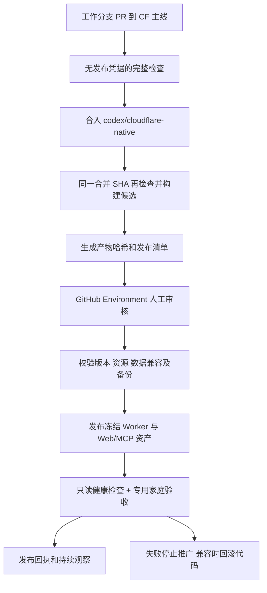

# Acornary 新前端：从当前候选到 CF 产品上线

版本：1.0 · 2026-11-11 · 状态：用户已确认完整方案并要求开始执行，L0/L1 开始。本文覆盖 Phase 2 收尾、Phase 3 真实接线、CF 发布、稳定观察及旧 UI 清理，不再止步于设计候选。

方案制定时未运行回归、推送、配置凭据或部署。用户确认的是“执行方案时恢复完整验收与 CI”；现已开始实施，该安排替代此前的测试暂停。GitHub 发布审核仍由用户执行，不把代码审阅、CI 成功或本方案确认冒充实际发布批准。实际进展见 [执行记录](cf-launch-execution.md)。

执行补记：用户已回复“好的，开始执行”，完整回归与工作分支 CI 现已获授权。开始时重新读取 GitHub，`CF_PREVIEW_DEPLOY_ENABLED` 实际存在且为 `false`；覆盖下方规划时 404 的旧观察，部署保持关闭。发布人工审核、Phase 2 阶段确认与真实设备验收仍按各自门槛执行。

## 1. 已确认的结果与边界

| 决策 | 已确认安排 |
| --- | --- |
| CF 数据定位 | 功能完整、真实读写的独立试用环境。非 CF 继续保存正式记录；CF 写入不回灌、不双向同步 |
| 验收与 CI | 正式执行本方案时恢复完整验收，允许推送工作分支及 PR 触发 GitHub Actions |
| 发布方式 | 合入 CF 主线后自动检查，检查通过后由用户在 GitHub 确认发布 |
| 首版数据 | 沿用现有 CF 数据，另外建立专用验收家庭；不重建、覆盖或重新导入现有 CF 库存 |

目标域名沿用 `https://cf.acornary.protium.top`。非 CF 域名、服务器、数据库、账号凭据与发布链维持原状。两个环境可以保留相同历史 UUID，但不是同一套可自动合并的数据。上线页面须明确标注“CF 独立试用”，避免用户把试用写入误认为正式记录。

本轮交付范围：日常 D01–D09、管理 M01–M06、账号/家庭/授权/打印/检查器、真实 Web 和 MCP App 接线，以及既有 Android cfPreview 的协议兼容与验收。Android 同一 APK 内切换环境沿用已完成的专项设计，**不作为本次 Web/MCP 上线必须新增的功能**；正式包继续使用非 CF，cfPreview 使用 CF。保持现有注册/邀请策略，不自行开放公众注册或新增权限等级。

## 2. 实施起点与已知阻塞

### 2.1 核对快照

- 开发工作树：`/Users/timli/workspace/Acornary-cf-frontend-vnext`。
- 开发分支：`codex/cf-frontend-vnext`，本轮方案起点 `f452cfc`；原集成合并 `403b842`。
- CF 目标主线：`codex/cloudflare-native`，核对 HEAD `89544793352d8d8ea7be23ac7dbddaa811ddee43`。
- 远端 `main`：`18f7e0496ecb4fb960a6619f12f57c68b3898410`；已部署非 CF 兼容底线仍按前次版本 GET 的 `a7252bc` 记录，实施时重新读取版本。
- 当前候选只有 P03 四类任务实际使用根 OperationSession。其余 Journey 仍为隔离执行器；production query/command/platform 端口不等于已实现 adapters。
- `cf:build:candidate` 目前输出源码库，**不是可上线应用**。正式 `cf:build` 仍构建旧 Web/MCP。

2026-11-11 GitHub 只读核对：仓库公开、默认分支 main；CF 主线未配置分支保护；`cloudflare-preview` Environment 已存在，但无 required reviewers 和分支限制，Environment secret 列表为空；仓库级 secret 仅列出两项 CF Android 签名配置，未发现 CF API token。`CF_PREVIEW_DEPLOY_ENABLED` 查询为 404，现有 workflow 的 `== 'true'` 条件不成立。组织级继承凭据是否存在未据此断言；部署前必须验证实际访问和目标作用域。

CF `8954479` 的 native checks 与完整 CI 有 2026-11-06 成功记录；它们不证明新前端分支通过。当前本地候选只有类型、静态检查、构建和有限人工抽查证据。

### 2.2 已知阻塞必须逐项关闭

| 编号 | 当前差距 | 本方案处理方式 |
| --- | --- | --- |
| G01 | 多个任务仍由页面内 fixture 控制器执行 | 抽取共享应用层，所有正式任务从页面卸载中独立，生产组件不导入 Journey |
| G02 | 未接真实身份、查询、缓存、审批和命令 | 分波接通既有 Web/MCP 协议；同一组件接受 fixture 或正式 adapter |
| G03 | 设置页 owner/admin/member/viewer 超出现有契约 | 新 UI 使用真实成员身份和命令可用性，移除无契约的角色分配动作；不为 UI 增加权限模型 |
| G04 | 预览 CSV 不是真实冻结导出 | 接 begin_export/read_export/cancel_export，遍历签名游标，保留查询范围和脱敏语义 |
| G05 | 旧 QR/详情链接尚未全部映射 | 明确兼容路径和返回上下文，不能重定向首页后算完成 |
| G06 | 新类型/能力不能与新 SKU/Item 在同一原子命令声明 | 普通新商品原子入库正常接通；扩展分支说明限制并保留草稿，不拆两次写入冒充原子操作 |
| G07 | 日期类型、未知值、缓存覆盖及跨模式投影缺少完整验收 | 共用事实模型/查询缓存；增加实际数据及切换回归 |
| G08 | 新 Web/MCP 入口和资源包未形成 | 创建真实 bootstrap、platform adapters、路由和自包含 MCP 资源 |
| G09 | CF 发布未配置可靠门槛与 API token | 完成本方案第 6 节的 Actions、Environment、产物和凭据配置 |
| G10 | 真机/宿主、长期容量、备份恢复证据不足 | 对本次候选单独执行并记录；物理设备/人工授权由用户参与，不能以模拟替代 |

完整追踪以 [22 组功能与 54 操作映射](feature-parity-matrix.md)、[兼容矩阵 B01–B22](backend-compatibility-matrix.md) 为准。已有缺陷与本轮回归分开登记，不能要求 CF 复制旧端错误，也不能借“历史问题”隐藏新前端功能退步。

## 3. 分支、工作方式和审阅

代码继续在 CF 派生工作树完成，通过小 PR 合入 `codex/cloudflare-native`；不把新 UI 合入 main 的非 CF 应用，不恢复 Docker/SSH 发布 workflow，不创建匹配非 CF `v*` 发布规则的 tag。

执行开始先确认部署开关处于关闭状态；在发布门槛和凭据配置完整前，代码 push/PR 只能检查，不能部署。CF 主线随后启用 PR/必需检查保护，最终合并提交重新执行完整检查；不能只使用 PR 临时合并 SHA 的结果发布另一个 SHA。

使用主代理加最多 3 个 subagent：主代理独占共享接口、依赖/锁文件、scope/OperationSession、发布和数据操作。工作代理按“日常接线”“管理/设置接线”“契约测试/兼容验收”分工；稳定后切换为独立代码审阅和失败修复。工作代理不操作 Git 索引、推送、秘密或部署，不并行修改公共文件。

保留 6006/6007/6008 的组件、逐页和连续试用审阅，继续使用隔离 fixture。意见 ID 和 RC6 历史批准保留；受影响页面标记待复审。每个里程碑给出提交、可打开入口、实际结果和待验收项。线上正式构建不包含本地意见服务、fixture、模拟权限或模拟设备；线上问题通过对应版本的本地审阅页复现和反馈，不引入新反馈后端。

## 4. 从当前状态推进到上线的工作包

### L0：恢复验收并固定发布边界

- 保存本地干净检查点，核对当前分支/远端/上线版本/CF 资源，保留用户原工作树修改。
- 恢复现有有效单元、浏览器、CF 原生及 Android 检查；先执行任务层新增用例与当前构建，随后完整基线。失败按既有问题、环境问题、本次变更分别记录并修复。
- 显式保持 CF 自动部署关闭；允许工作分支 push 和 PR 检查。补新 UI 验收 job，不跳过现有 native/Android 检查。
- 建立可追踪矩阵：每项功能有实现位置、真实契约、测试、人工结果、发布资格及阻塞编号。

产出：恢复后的 CI 基线、发布隔离检查、功能验收账本。测试未通过不宣称 Phase 2 已完成。

### L1：完成正式应用层和真实入口装配准备

- 将开封/日期/笔记/附件、管理编辑/批量/目录、账号设置中需要恢复的任务抽取为共享控制器。按任务协议扩展现有 OperationSession，不把所有账号操作强塞进库存命令 schema。
- 根持有任务；页面只消费事实、任务状态和意图回调。模式/路由/旋转不销毁任务；提交中阻止卸载；不确定请求保存原键和原参数；恢复不能制造新请求；冲突保留输入并重新核对。
- 正式 Web 持久化 adapter 复用/审查既有生产草稿协议，MCP 遵守宿主存储与回读条件；可靠保存失败则不发送。旧正式草稿只做可验证、可恢复的版本迁移，无法解释的原记录保留并阻止危险重试。
- 用环境/origin、账号、家庭、客户端及稳定数据集绑定隔离缓存和任务，会话代次拒绝旧响应。部署 SHA 不充当数据集身份，不能每次更新就丢掉未决任务。本次沿用 CF 资源不重建；未来数据集重建需另做身份迁移方案。
- 抽取正式 TanStack Router 注册、深链兼容、返回/焦点/滚动上下文及模式偏好；URL 优先于偏好。共享 TanStack Query 的真实参数、服务端分页/排序、已知覆盖范围和失效。
- 新建正式 Web/MCP bootstrap 与构建选择（建议 `main.vnext.tsx`、`plugin.vnext.tsx`），此处先用隔离 adapters 验证正式根组件；不以 candidate library 或 review/trial HTML 代替最终应用。
- 完成状态、键盘、响应式、存储故障和性能验收；组件和页面候选提交用户审阅。Phase 2 阶段确认后进入真实业务接线。

产出：所有任务的正式候选应用层、可装配入口、adapter 契约、通过的 Phase 2 工程证据和阶段确认。

### L2：真实 CF 身份、只读和首个写入闭环

- 接现有 Session/Connection Provider、账号/家庭、协议版本和真实权限。Web 使用 CF 同源协议；MCP 只用宿主允许的工具/桥，不靠跨域 HTTP 绕过宿主能力限制。
- 接我的物品、搜索、商品摘要、单件档案、需要留意、最近变化。列表、管理、详情和统计从同一事实/查询层投影；未知、零、估计、日期类型、家庭时区和部分缓存准确呈现。
- 优先打通“登录/家庭 → 搜索 → 单件 → 部分使用 → 余量/历史 → 丢回执恢复”。先在本地真实 workerd/隔离测试实例运行，再在专用 CF 验收家庭复验。
- L2–L5 的本地接线验收先行；真实 CF 上的新界面验收依赖 L6 的首次受审发布，远端证据取得前相应项目保持待验收，不为取得证据提前手工部署。
- 校验授权撤销、revision 冲突、原键重放、异参数冲突、提交成功但断网、刷新和身份切换。不能用试用世界执行器作为正式 adapter。

产出：首个真实端到端闭环及数据/事件/回执证据。读页面成功不表示其写按钮已接通。

### L3：日常全部任务接线

| 流程 | 交付与关键验收 |
| --- | --- |
| D01 查找 | 同名商品、多件 Item、多位置、无结果、分页/筛选、离线覆盖和快捷操作 |
| D02/D03 入库 | 真实 intake context/治理审批 → 原子 commit → 回执；逐件 UUID、件数 1 可见，不猜位置/状态/日期 |
| D04 使用 | decimal string、单位/精度、未知量整件结束、超量拒绝、幂等与冲突 |
| D05 移动 | 目标必须为有效容器 Item，环和子树语义、批量明确 UUID，结果原子 |
| D06 开封/日期 | 真实日期类型/来源/时区，不擅自推算日期，修改范围明确 |
| D07 扫码/打印 | 商品条码不自动选 Item；CF 标签旧路径兼容；旧非 CF 标签保留来源，不靠同 UUID 静默改写域名；打印未知不自动重打 |
| D08 笔记/附件 | Item/SKU 归属、敏感资料、真实上传票据/字节传输/确认/下载、归档与修订 |
| D09 留意 | 沿用真实查询/日期和补货策略；未知事实不生成临期或低库存断言 |

附件浏览器传输与 MCP 能力降级分别验收；宿主不支持的设备/字节能力提供真实可行的 Web 转交，不显示假成功。新商品类型/能力的原子契约缺口保留为明确不支持的新扩展分支，基本入库不能因此缺失。

### L4：管理、账号与其余入口全部接线

- M01 商品目录：GROUP/SKU、完整路径、profile/能力、创建/修改/移动/作废与真实治理审批。
- M02 位置：房间/容器也是 Item；创建、移动、空位置、环和后代关系。
- M03 精确编辑：SKU 共有资料与 Item 实例资料分开，模板绑定/版本/未知模板保留；单件修改范围可追溯。
- M04 批量：完整 UUID、跨页隐藏选择、revision 快照、混合能力与 100/101 边界；不隐式拆批，不实现无契约的全结果授权。
- M05 历史与纠错：服务端分页、操作者、前后事实、原因；拆包/处置/作废/恢复/引用依真实命令和权限；恢复作废不复活已终结拆包源。
- M06 设置：真实账号/家庭/邀请/成员、登录/OAuth/Passkey、打印、离线缓存、未决任务与检查器。无契约角色操作不开放；服务端权限不能由“日常/管理模式”推断。
- 导出：完整服务端冻结范围与游标；不把本页 CSV 当全库导出。
- 补齐所有旧 Web 入口可达性；按 F01–F22 和 54 操作确认“直接页面”“高级操作”“按宿主能力转交”等各自位置，不能通过隐藏功能达成完整迁移。

产出：功能对等矩阵逐项有真实执行证据，剩余仅为明确超出现有契约的新能力；已有必需功能未对等则不能宣称完整上线。

### L5：MCP、Android 兼容与完整验收

- 新 MCP 使用同一正式页面/控制器，自包含资源不依赖开发服务器；验证 iframe 尺寸变化、存储拒绝、重挂载、身份变化、焦点、宿主菜单/导航、OAuth 和实际工具结果。
- Canonical MCP 路径为 `/mcp`，现有 54 公共工具和 App 专用工具/资源兼容；公共工具能力与 App 内受限能力分别记录。协议 harness 不代替真实宿主 UI 验收。
- 保留正式 Android 和 cfPreview 双包；CF 包构建、签名、OAuth/App Links、snapshot/detail/history、三种 v1 写命令和原键 lookup/replay 对照。正式 APK 不自动更新，AOD/打印硬件行为不以模拟器代替。
- 非 CF 对照用固定版本的本地/隔离实例，不向正式库存写测试。相同种子和操作序列比较终态、事件、revision、错误、回执；认证域名和新生成 ID 等允许差异预先列明，不能删字段使测试通过。
- 真实设备/宿主需要用户操作时，先准备好具体版本、步骤和预期结果，再逐项核对；未验证能力不能凭代理或构建标为通过。缺设备只阻止相应发布资格，不停止无依赖开发。

产出：候选发布报告、真实客户端记录、跨后端差分证据、用户验收。

### L6：CF 验收发布、默认入口切换与稳定观察

- CI 产出同时包含新 UI 与旧 CF 回退入口的真实应用包。首个验收发布保持旧默认入口，新入口以明确内部路径/受控配置开放；两入口共用同一真实业务协议，不是两套执行系统。
- 本文“验收发布”不是现有 `release.mjs --stage`：该选项会移除路由/定时任务，不可用于承载已有 CF 数据和访问入口的 Worker。验收入口仍经正常受审发布，保留现有路由、绑定和服务能力。
- 用户在 GitHub 批准后部署到既定 CF Worker；现有 CF 数据沿用。只对新建专用验收家庭执行自动写入，家庭 ID 使用明确 allowlist，不能将“当前家庭”当测试目标。
- 实际 CF 域名验证 HTTPS、版本/部署 ID、Web、MCP OAuth/UI、附件、设备以及备份；失败停止入口推广，并按兼容清单回退。不能只拿 `/health` 为上线成功证据。
- 完整功能验收后形成默认入口为 vNext 的发布候选，通过同一 Actions 审核再发布；此时交付可真实使用的 CF 新前端，线上明确独立试用定位。
- 新默认入口稳定观察至少 7 天，期间按错误、延迟、写入恢复、Free 限额、备份完成与设备行为记录证据。关键版本/资源行为变更重启相关观察窗口，不借旧版本天数抵扣。

### L7：关闭迁移并清理旧 UI

- 观察窗口与回滚演练通过后，移除旧 CF React/Ant UI、失效样式/开关和未使用依赖；旧二维码和深链的兼容映射继续保留。
- 保留历史 CF Worker/产物的可回退清单和其数据兼容条件。清理不触及非 CF main/服务器，非 CF 继续使用旧产品。
- 再执行完整验收并由 Actions 发布清理版本；更新设计系统、运行手册、功能矩阵及已知限制。最终新 CF 默认生产路径不依赖 Ant，不包含 fixture/意见服务。

## 5. 测试与验收口径

### 5.1 必需自动检查

现有命令继续执行，按实际 package scripts 审核组合副作用，不跳过失败用例：

- `pnpm typecheck`、`pnpm test`、`pnpm build`。
- `pnpm cf:contracts`、`pnpm cf:auth-schema`、`pnpm cf:typecheck`。
- `cf:test:kernel` / `inventory` / `auth` / `http` / `snapshot` / `backup` / `operators`。
- `pnpm cf:test:browser`（当前 `test:e2e` 指向此入口）及 WebKit 关键任务。
- `check:ui-tokens` / `check:ui-boundaries` / `check:ui-catalog`，组件、预览及正式 Web/MCP 构建。
- 补齐新应用层/页面/正式 adapter 的定向 Vitest 与 Playwright，用新旧 UI 的实际行为断言替代旧视觉选择器；不得删除业务断言或用 skip 掩盖未实现功能。
- Android 当前有效的构建、lint、单元与模拟器验收，保留 cfPreview 独立签名。

PR/普通 CI 使用本地隔离数据和 workerd，不持有 CF 发布或正式数据凭据。需要真实 CF 的检查属于受控验收 job，限定测试家庭及 CF origin。现有 DB 差分按仓库隔离流程运行，不连接线上 PostgreSQL。

### 5.2 核心状态与安全语义

覆盖正常、空、加载、未知事实、校验失败、审批要求/失效、403/401、revision 冲突、幂等冲突、回执丢失、存储失败、离线、账号/家庭变化和关闭返回。特别验证：发送前未保存则零请求；发送后不确定只能原请求恢复；设备发送不等于纸张成功；旧代次响应不能进入新作用域；所有批量结果原子、UUID 范围明确。

缓存冷启动、部分覆盖与重连必须有可完成的只读状态；不能因旧离线列表挂起是既有问题而放过新产品验收。新旧 Service Worker/静态缓存升级要验证，不能清除未决写入日志来解决版本问题。

### 5.3 体验和性能

- 360/390/768/1024/1440/1920 px，以及缩放后的有效 320 px；中文输入法、软键盘、安全区、键盘/焦点、减少动态效果、大字体和主要屏幕阅读器流程。
- 自动无障碍无 Critical/Serious，其他问题登记；自动检查不替代人工焦点和读屏体验。
- 11/500/5000 件隔离数据，保持服务端分页；至少 10 冷样本/30 热样本，分别记录前端渲染、网络等待和搜索防抖，报告 p50/p95。
- 先测可比旧基线，再冻结绝对预算；初步相对门槛 p95 不退化超过 10%。正式包与 Storybook 包分别计量，不能把源码库全量出口大小当首屏。
- 真人任务记录完成率、耗时、错误、协助、额外确认；已有商品入库约 3 次主要动作、部分使用 2–3 次、移动约 3 次，必要输入/审批/冲突独立计数。错对象、重复写入、跨家庭泄露、丢失未决任务为零。

## 6. GitHub Actions 发布方案

### 6.1 总体流程

正常发布继续使用 CF 分支 push 事件，不需要改 main 才能出现发布审批。用户的按钮是部署等待时的 **Review deployments → Approve and deploy**，不是另起一次任意分支构建的 Run workflow。

### 6.2 Workflow 改造

1. 保留 `.github/workflows/ci.yml` 的完整检查与 Android；增加新 UI 的实际验收和正式产物边界。
2. 保留/完善 `.github/workflows/cloudflare-checks.yml` 的 native checks，部署 job 显式依赖所有必需检查。将真实 CF 验收与不持有 secret 的 PR 测试隔开。
3. 给 `cloudflare-preview` 设置 required reviewer 为用户对应 GitHub 账号/团队，deployment branch 只允许 `codex/cloudflare-native`。单维护者安排允许发起人进行手工批准，不能配成无人能审核的自审禁止。
4. 在保护和 API token 就绪前，`CF_PREVIEW_DEPLOY_ENABLED` 明确为 false；完成配置与演练后才启用。PR/fork 不得取发布 secret，也不因 PR 内容修改 workflow 获得部署权限。
5. 不保留“任一旧 CI 成功即可发布”的宽松检查：锁定 repo、workflow 身份、合并 commit、event、run/attempt；使用最新有效尝试，失败/取消/超时/缺检查全部阻止。PR merge SHA 的成功不替代实际发布 SHA。
6. 同一 CF 环境串行发布，`cancel-in-progress: false`，进行中的迁移/发布不可取消后重入。等待批准的旧候选若被更新取代，部署前再次确认有效性，不能覆盖较新的已部署版本。
7. 三方 Actions 固定完整 commit；Node/pnpm/依赖锁文件与构建标志固定。主分支非 CF `Release`、镜像/SSH 凭据、域名与 `v*` 触发规则不修改。

GitHub 手动 `workflow_dispatch` 要求工作流存在默认分支，因此本轮选择现有 CF push + Environment 审核路线，避免为了一个 Run workflow 按钮调整非 CF 主线。若日后需要专用手动入口，再以只有 CF workflow 的独立变更处理。[GitHub 手动工作流说明](https://docs.github.com/en/actions/how-tos/manage-workflow-runs/manually-run-a-workflow)、[Environment 保护规则](https://docs.github.com/en/actions/reference/workflows-and-actions/deployments-and-environments)。

### 6.3 构建与发布物一致

发布清单必须包含：commit、CI run/attempt、构建工具版本、UI 默认模式/入口标志、Web/MCP/Worker 产物哈希、CF origin/资源映射、schema/迁移/template digest、前一可回退版本、兼容判断和已获验收项目。

优先构建一次、验收后部署同一不可变产物；需补足现有 `release.mjs`（它现在在发布时重新构建）的 prepare/deploy 分离。若平台必须重打包，固定依赖/环境并逐项核对最终 Worker、资产和清单哈希；不部署未经核对的二次构建。GitHub approval 展示确切候选，部署不能 checkout 浮动分支头。

Worker 与 Static Assets 是同一个版本交付，MCP resource 内容/hash 与其匹配。发布不是仅上传 UI 文件；须核对整个 Worker，保留 DO class exports/bindings。严禁候选源码库、review/trial、mock 角色/写入/设备或本地 feedback 服务进入发布物。

建议归档：发布 manifest、构建校验、脱敏测试摘要、Worker version/deployment ID 和烟测回执。GitHub 仓库为公开仓库，真实库存、附件、账号/令牌和完整备份只放私有 CF 存储，不能作为公开 Actions artifact 上传。

### 6.4 凭据与配置

- CI 使用专用 Cloudflare API token，通过 `cloudflare-preview` Environment secret 注入；不上传本机 Wrangler OAuth token，不在对话或仓库展示 secret。
- 按 Cloudflare 支持的实际权限粒度限制 account/zone 与必要操作，不能承诺所有权限都可精确限制到单个 Worker。日常发布和一次性资源管理/迁移尽量分权；配置 allowlist 再检查 Worker 名、domain、D1/R2/Queue/DO 身份。
- 保留独立 CF AUTH_SECRET、OAuth issuer/client/resource、Android 签名；不复制正式登录凭据。对缺少配置的登录/恢复能力显示真实限制，不用 fixture 回应。
- 凭据需要用户在安全入口创建/录入时，先准备具体权限清单和目标 Environment，再逐项核对；不要求在聊天发送密钥。

[Cloudflare 官方 GitHub Actions 部署说明](https://developers.cloudflare.com/workers/ci-cd/external-cicd/github-actions/)支持 Wrangler + API token；本项目复用锁定的 Wrangler 和现有 release 校验，不需要照搬示例中的最新 Action tag。

## 7. 数据、迁移、备份与回滚

### 7.1 现有数据保持

日常部署不得执行 snapshot 导入、清空 D1/DO、重置账号或覆盖 R2。创建专用验收家庭时记录其完整身份和用途，自动验收只操作该家庭；已有 CF 家庭仅用于另行安排的只读/用户手工试用。CF 试用数据不回传非 CF，所有客户端持续呈现环境。

发布前创建并验证 CF 备份：D1 身份/目录、家庭库存/事件/回执与私有 R2 的一致性 manifest。保持既有 credential/token 排除规则；若回滚不恢复会话，明确重新登录路径。不能用本地 fixture 或过时非 CF 快照替代当前 CF 备份。

### 7.2 迁移策略

现有 `release.mjs --deploy` 自动运行 remote D1 migrations，必须改为先检查待迁移项。纯前端发布预期零新领域数据迁移；出现新迁移时列出 backward compatibility、执行顺序、备份和恢复演练证据，再允许发布。破坏性迁移不能被普通 UI 发布批准隐式覆盖。

不删除已部署 DO class、重绑定现有家庭空间、改写 Item/SKU 身份或重新建库来方便前端。添加 schema 采用经过验证的兼容方案；回退候选必须保留所有已部署的必要类与资源。

### 7.3 回滚分层

| 情形 | 处理 |
| --- | --- |
| 新 UI 问题，协议/数据仍兼容 | 先启用包内旧 CF UI，保留当前数据和未决请求；随后提交修复或回滚 PR |
| Worker 行为问题，无不兼容迁移 | 使用核对过的前一完整版本/配置回退，并验证 API、资源、任务恢复 |
| 数据迁移或 DO 生命周期不兼容 | 停止受影响写入，保全新事件/回执；按预先演练的数据恢复/前向修复方案处理，不盲目回滚代码 |
| 备份或发布前校验失败 | 不发布，不自动清空/重建 CF |
| 发布烟测失败 | 不宣告上线；兼容条件成立时按已批准回退目标处理，否则保持故障状态并报告 |

常规回滚通过 CF 回滚 PR、CI 和同一 GitHub 发布审核完成，保留完整审计。紧急平台回滚只针对已经验证兼容的版本，作为独立操作记录，不能覆盖数据库或回退到非 CF 后端。用户不需要在每个普通开发步骤确认，但实际发布仍在 GitHub 审核。

Cloudflare Worker 代码回滚不会自动回滚连接的数据资源；DO 生命周期或绑定变化还可能阻止回滚。因此“上一版本存在”不是完整恢复方案。[Cloudflare 回滚约束](https://developers.cloudflare.com/workers/versions-and-deployments/rollbacks/)。

上线前至少演练一次：故障新 UI → 旧 UI/旧兼容代码 → 数据仍在 → 原未决请求可恢复；另在隔离资源演练完整备份恢复，记录真实 RPO/RTO，再冻结承诺，不能把单次导入耗时当端到端恢复时间。

旧 UI 能打开不代表能读取新 UI 的任务日志。切换前必须验证日志版本兼容和原请求恢复；必要时保留独立于两套页面的共享恢复入口。若旧版本无法恢复当前未决请求，该版本不进入自动回退清单，也不能通过清除日志或重新提交规避。

## 8. 上线验收与运行维护

### 8.1 宣告 CF 产品可用的必要条件

- D01–D09、M01–M06 与现有必需功能均真实接线，功能对等清单没有未处理的上线阻塞。
- Web 和 MCP 新入口来自正式源码；Android cfPreview 的受支持 v1 契约未退化。没有 fixture/假按钮/模拟成功进入线上。
- 真实身份、家庭、授权、审批、事务、revision、幂等、草稿和结果不确定恢复有证据；P0/P1 缺陷为零。
- 必需 CI 对同一发布 SHA 全通过；响应式、无障碍、主要设备/宿主及真人任务验收有清楚结论。人工参与缺失不能填通过。
- CF 现有数据保留，测试仅进入专用家庭，备份恢复与代码回退演练通过。
- GitHub Environment 审核、受限凭据、发布序列化、不可变产物与部署回执完整。
- CF 域名上新前端为默认入口，旧深链可用，用户可以完成真实日常及管理任务；非 CF 没有变化。

### 8.2 上线观察

记录前端错误、API 5xx/超时、写入不确定/重复尝试、冲突恢复、登录/刷新/MCP OAuth、附件/Queue/Cron 备份、CPU/配额、延迟与实际任务反馈。日志记录脱敏错误码、request/operation 关联和版本，不记录原始敏感库存/令牌。

沿用现有 CF 套餐，不在本方案中自动付费升级。实施时核对当前套餐及实际错误/配额；若 Free 的真实约束阻断完整功能或可靠性，给出测量和具体付费选项逐项确认，不削减功能来勉强通过。生产级可维护代码不意味着获得无限平台容量。

至少 7 天稳定观察后再移除旧 CF UI。不可达的真实设备/宿主验收、长期观察未满和 P2 已知问题分别记录，不把这些门槛归为“全部通过”。

## 9. PR 与提交顺序

| 批次 | 交付 | 合并/发布门槛 |
| --- | --- | --- |
| R1 | 恢复 CI、新 UI 检查、部署禁用与分支保护准备 | 只检查，不部署 |
| R2 | 其余任务控制器、生产持久化/路由/查询边界、正式入口候选 | Phase 2 工程验收与用户阶段确认 |
| R3 | CF 身份与只读 + 首个使用/恢复闭环 | 本地 workerd、隔离后端协议证据 |
| R4 | 其余日常及附件/标签接线 | D01–D09 真实任务证据 |
| R5 | 管理/设置/导出/历史/深链接线 | M01–M06 与 F01–F22 完整映射 |
| R6 | MCP、Android兼容与双后端差分 | 明确自动、宿主、设备结果 |
| R7 | 发布脚本、Environment/凭据、备份与回滚、冻结产物 | 演练通过，待 GitHub 审核 |
| R8 | CF 验收发布 → 默认 vNext 发布 | 每次部署均有确切 SHA/结果和用户 GitHub 批准 |
| R9 | 稳定观察、反馈修复、移除旧 CF Ant UI | 观察窗口、回滚条件和全量回归通过后再次发布 |

允许 R1/R7 的无依赖构建工作与功能接线并行；不得提前启用部署或绕过 Phase 2/3 边界。每个 PR 按目标、内容、文件/契约、流程、测试、真实宿主边界、证据、缺口、数据/部署影响和依赖报告。每个里程碑保持可运行。

## 10. 完整交付物与后续

最终提供：真实 CF 新前端、共享应用层/平台 adapters、完整验收矩阵、GitHub 发布/回滚流程、release manifest、保留数据的备份与恢复手册、用户审阅入口及意见记录、兼容 Android cfPreview、最终设计系统和已知限制。

CF 独立试用上线后，仍不执行非 CF 的正式迁移。后续若要正式切换：另行冻结旧端写入，获取新的完整一致快照，验证身份/历史/回执/附件，明确账号与域名/二维码/客户端迁移，使用新正式 CF 数据环境；已有 CF 试用写入不自动并入正式库存。同 APK 双环境选择也按专项设计独立实施和验收。

L6 的默认入口发布是“CF 新前端可用”的里程碑；L7 通过后才是“旧 CF UI 与 Ant 迁移清理完成”。两者分别报告，稳定观察未满时不宣称整个前端迁移已经收尾。

本文件描述执行范围，实际进度与证据见 [CF 上线执行记录](cf-launch-execution.md)，不得把方案中的待办算成测试、发布或上线。完整方案及四项用户决策已经确认，不再重复询问。执行中只对新增重大产品语义、不可兼容迁移、付费变更、凭据授权和真实设备参与等具体问题逐项核对。
