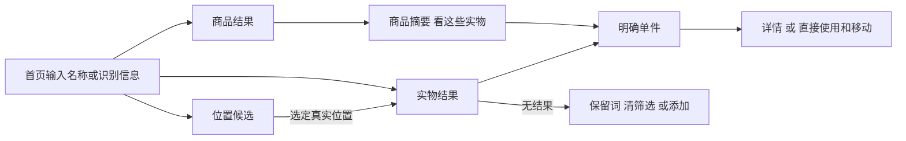
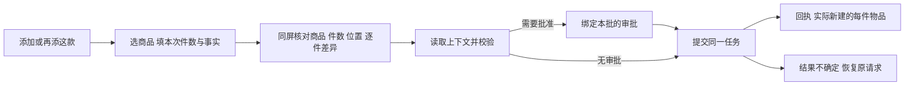
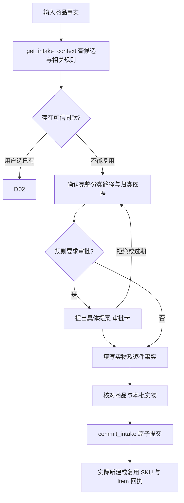
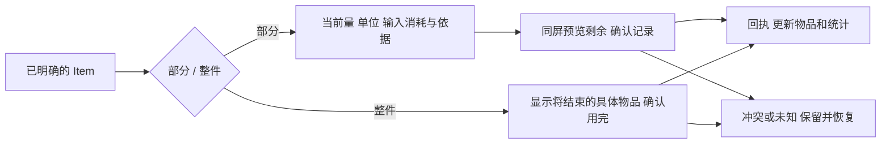
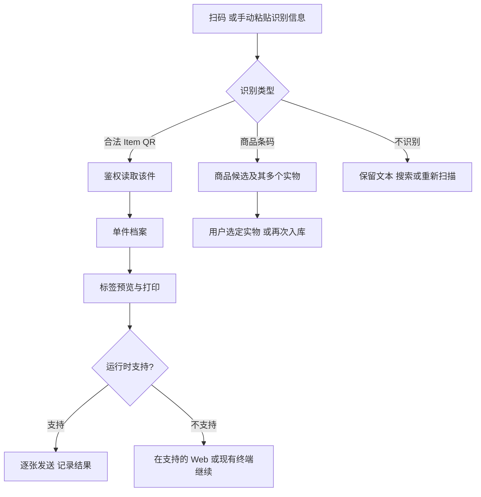

# 日常流程 D01–D09

所有流程继承[交互状态 ST00–ST14](interaction-states.md)；下文给出每个任务的特定分支。页面编号见[页面规格](screen-specifications.md)。示例是设计数据，不是正式库存。

## D01 查找物品

**入口/退出：** S01 首页搜索始终可见；S08 识别后也进入 S02/S04。结果行打开单件，返回保留词、筛选、页和焦点；只读检索不创建写草稿。

1. 输入即显示加载状态；实物/商品/位置三类结果不混为同一可操作列表。默认实物，已有商品但零库存可在商品类找到。
2. 单件行显示商品名、自定义名（若有）、完整可展开位置、最多两条关键事实、已知状态。相同商品多位置时每件都有位置；同名 SKU 用品牌/规格/分类路径区分。
3. 商品行显示“款”身份、服务端件数及未知量，不显示直接消耗按钮。点击行进入 S03，按 UUID 选择单件后使用。
4. 位置候选由容器查询/上下文读取取得；选位置成为显式筛选。查询中的 within_item_id 包含其下级，界面写“此位置及下级”；不提供当前契约不支持的“仅直接子级”服务端筛选假象。
5. 默认分页 50，加载更多保持已有内容；没有游标即结束。筛选改变从第一页读；INVALID_CURSOR 保留筛选、重新载入，不保留过期分页结论。

**异常：** 首次加载有骨架和取消返回；已有内容刷新时标“正在更新”。无结果不等于没有库存。离线只在已缓存集合中检索，显示覆盖范围与缓存时间；未缓存返回“离线暂时无法查询”，不显示“0 件”。网络读取失败可重试读取，不进入写请求不确定状态。

**映射：** query_items / query_catalog_nodes / query_inventory_groups / get_item；LocationPicker 使用容器候选。查询 location 全文和自然语言解释不在现有 search 契约内。

## D02 已有商品再次入库

**入口：** S01 添加，或 S03“再添这款”。S06 一个任务，初始件数 **1** 可见；商品预选仅来自明确入口，不从搜索相似项自动选。

**字段与默认：** 商品必选；件数整数 1–100；位置初始“未指定位置”，从位置页进入仅显示“使用当前查看位置”的候选，用户选中才写入。日期、开封、余量、精度、购入日期不填默认事实。能力驱动显示可选字段，不根据名称推断包装净含量。

多件相同事实默认共用一组输入，明确“应用于本次全部 N 件”。“逐件不同”展开每件的临时序号与覆盖字段；减少件数时列出会丢弃的已输入逐件资料并确认。临时序号不是 Item ID；成功后替换为回执中真实 ID。一个任务也可添加不同商品行，总数上限 100，不自动拆成多次任务。

**核对/提交：** 表单底部常驻商品、件数、位置和已填事实摘要。按钮“确认入库 N 件”即唯一最终核对；点击先校验与持久化完整 attempt，再 commit_intake。读取上下文时不更改用户输入。依赖/规则版本改变进入冲突；需要审批时进同一面板的审批步骤，审批不是库存成功。

**结果：** “已入库 N 件，复用商品 X”，显示实际创建 Item、位置及逐件不同事实，可“查看本次物品 / 打印标签 / 完成”。打印失败不回滚入库。changed=false/replay 显示“已恢复这次入库结果”，不宣称新增第二批。

**恢复：** AMBIGUOUS_PRODUCT 提供候选差异；规范冲突和版本冲突保留原输入。网络未知使用 get_intake_receipt 或原 commit_intake 完整重放；不换键。读到成功回执后只重读库存。

**动作目标口径：** 已有商品、1 件、无需补位置/可选事实、无审批：添加 → 选商品 → 确认入库，3 次主要动作；从已知 SKU 入口为 2 次。选择位置、展开逐件事实与必要审批均额外计数并报告，不隐去。

## D03 新商品入库

**入口：** S06 商品搜索无合适候选后“创建新商品并入库”。不是单独的商品建档任务。

**四个明确步骤：** 商品识别 → 分类 → 本批实物 → 核对。手机全屏步骤页，桌面同一个宽 Sheet；每步有返回，不因返回丢字段。名称必填；品牌、型号、固定规格、条码等按真实模板可选，未知省略。候选卡同时显示完整路径和身份差异，不能仅凭同名复用或合并。

分类选择只接受 GROUP；已有相关规则时显示一句适用依据与完整路径，需要时展开规则原文。无规则时显示“需确认此分类规范”，可提出长期规则或本次例外；二者范围不同，切换需重建相应 proposal。禁止默认“其他”、根级随意挂载、自动重构已有目录。

审批可以在分类阶段预览，但最终一次性授权必须绑定完整最终批次；随后更改商品、位置、件数或逐件事实使原批准不再适用，回到最终核对重新申请。确认卡失败保持草稿；APPROVAL_EXPIRED 重新读取同提案的 review/challenge，不由 UI 伪造凭证。

**现有能力与 G01：** commit_intake 已有新商品与独立实物的原子提交，initial_attributes 也存在；未指定 profile 的旧兼容路径并不等于有服务端声明的能力。新商品 schema 无 profile/capabilities，UI 当前也提示先建档。本设计禁止把缺失的显式类型写入拆成“先建 SKU 再入库”来假称原子完成。基础无此要求的新商品可沿现约实现；用户需要声明新类型/能力时，显示“此批需要商品类型支持，已保存草稿”，暂不提交；G01 解决后才接通这一分支。Phase 2 fixture 可以展示目标流程，但必须标出契约等待状态。

**重复/冲突：** 提交时出现新的匹配 SKU，呈现服务器候选与不可保留的商品事实；让用户选择复用、修改或取消。分页未查尽不能断言不存在。任何失败不显示部分入库；服务器原子失败为整批未提交。成功同时列出新建/复用商品与实际实物数。

## D04 记录消耗

**入口：** 明确 Item 行的“使用”或 S04“记录使用”。选择部分消耗 / 整件用完，两者结果预览不同。

部分：当前剩余量及单位置顶；数量用字符串输入，必须大于 0 且不超当前量。测量/估计/未记录为独立选项，默认未记录；不能从当前精度自动推断本次精度。预览只用于核对，提交结果以服务端回执为准。单位不可静默换算，无依据时要求与记录单位一致。

余量未知时，部分消耗说明“需先记录余量”；可到资料补录后回来，不填 0。符合现有状态条件时允许“整件用完”，调用 consume_items([明确 ID])；即使余量未知也不自动创造原始量。整件用完面板显示名称、位置、标签及结束含义，“确认用完”是必要确认，不再叠第二个空对话框。

成功回到原列表/详情：该件终态而从当前列表消失时，用回执提示和“查看这件记录”维持可追溯。引用该件的商品摘要、留意和历史失效刷新；不能只减列表计数。冲突比较最新剩余与原输入，允许修改或取消，不自动缩小消耗量。未知时字段冻结，恢复原请求。

**动作目标：** 单件行使用 → 确认记录为 2 次；整件选择额外 1 次。额外补录、冲突与身份辨认单列。

## D05 移动物品

单件行“移动”直接打开目标选择；批量先显式选择。LocationPicker 显示物理路径和容器标记，不出现 GROUP/SKU 分类候选。允许选择“未指定位置”（parent_id=null），并解释是移出容器，不是删除。

自身、后代、终态/VOID、不允许容纳的目标不可选并给原因；客户端只提前提示，提交仍靠服务器完整检查。移动容器时明确“这些内容仍在容器内，将随容器改变位置路径”，只修改该容器父关系，不把后代当成直接移动 UUID；若后代计数未完整加载，写“包含其全部内容，数量未完整读取”，不可编数字。

批量同时选择容器及其后代时，展示重叠关系并要求用户选“只移动容器”或“将所选子件分别移出”；不静默去重成不同意图。提交前固定完整 ID 集合、旧路径、目标路径和所需 revisions。move_items 最多 100，任一冲突全部失败；不显示部分成功。

**结果/返回：** 显示实际移动件数及目标；在原位置列表中消失时允许查看目标位置。网络未知保留同请求；无有效位置时可保留草稿、进入 M02 建位置后返回并重新校验。动作目标为移动 → 选目标 → 确认，3 次。

## D06 开封与日期记录

开封有“现在开封”和“补记开封时间”两种意图；现在按钮明确显示家庭本地时间，点击是用户确认该时间，不是打开面板就默认已开封。补记需明确带时区时间。只知道已开封但不知道时间时，经模板属性记录 state=OPENED 且不填 opened_at；不用省略 open_item.opened_at 冒充未知（该命令可记录当前时刻）。已开封的修正走资料/纠正，不重复开封。

日期编辑展示类型选择、日期、依据；支持当前 lifecycle.expiry 的 USE_BY / BEST_BEFORE / ESTIMATED 以及未记录类型；选择空值是显式清空/省略，不等于“无期限”。新增 deadline 只开放现有五种 kind，不伪造一个通用日程命令。完成周期事项显示本次完成日和服务端产生的下一日期；非周期完成后保留历史。

同一件可能同时有厂家日期、开封后期限和维护日期，逐条显示来源；不合并成一个“过期”。只有已记录 opened_at 与 after_opening_days 才可沿领域规则计算开封后期限，并显示依据。商品 shelf_life_days 不按购入日推算厂家日期。

日期清除/替换在摘要中列“原日期 → 新日期/未记录”；使用绑定原版本更新，升级模板单独确认。冲突展示当前日期、类型、依据和原输入。能力消失时保留输入但停止提交，禁止悄悄丢字段。

## D07 扫码与标签

扫描只有用户点击后请求相机；拒绝/缺少相机/宿主不提供时显示手动粘贴输入，不出现假取景框。摄像头离开即停止。现有 Web 尚无扫码采集 UI，此能力为运行时适配工作，QR 解析和 Item 链接已有。

Item QR 使用既有 /i/:compactId；跨家庭或无权限时“当前家庭无法访问此物品”，不暴露其他家庭名称。可重新授权/显式切到本人可用家庭，再读取原链接；不能自动跨家庭执行。未知 URL 不自动跳转外站。商品条码只识别 SKU，哪怕只看到一页库存也不自动指定某件消耗。

标签可从 Item、UUID 选择集和入库回执进入；显示名称、日期类型、短编号、QR 和纸张预览。旧 canPrintLabels 的桌面安全上下文/Web Bluetooth 限制保留，手机 Web 与 MCP 不伪造设备支持；可提供带目标 ID 的安全 Web 深链接，登录后重选设备。不得把原生终端成功称为浏览器能力。

逐张状态：待发送 / 正在发送 / 设备报告完成 / 出纸待确认。任一传输错误停止剩余队列，当前张标“不确定”；用户核对纸张后明确选择是否重打，绝不自动补打。物理出纸不以本地预览或 Promise 成功替代。重打不创建新物品，不产生库存移动/消耗事件。

## D08 笔记与物品记忆

笔记区视觉上是可阅读的文本，不混进日期/余量字段表。标题可选，正文为 Markdown，保持当前渲染安全策略；“使用说明/故事”只是标题建议，不增加私有领域类型。商品公共说明与单件笔记显示不同 scope，默认从当前单件创建。

列表只读摘要，打开时 get_note；敏感内容显示“已隐藏”，显式披露按服务端支持执行，不能从缓存原文补回。编辑带 note ID 及其所属目标的 revision；冲突显示当前正文与我的草稿，复制/保留原文需用户决定，不能覆盖其他成员笔记。

图片/附件：Web 且接口/能力/传输允许才开放。限制沿现约 JPEG/PNG/WebP/PDF、25 MiB/文件、20 个有效附件/目标、5 GiB/家庭。先票据、上传、再完成关联；显示“上传完成，尚未关联”与“已保存附件”区别。关联结果未知时保留原 upload_id 和命令，不能重建上传来躲过恢复。PDF 下载，不伪造缩略图。

MCP 当前附件不可用，展示已有可读摘要和“在网站继续”的上下文入口；不显示无效上传按钮。自由笔记不被自动转换成结构化事实；若要记录日期/重量，用户点击“记录为资料”开始对应任务并再次核对。

## D09 需要留意

默认“日期”，分为已过记录日、今天、未来 7 个家庭自然日。只有 USE_BY 可使用使用期限风险文案；BEST_BEFORE 和 ESTIMATED 分别显示原含义。服务端 date_facts 决定状态；旧缓存无类型/时区只显示绝对日期，不能计为已过使用期限。

“补货”是 SKU 的 query_stock(low_only=true) 结果，依赖显式 stock 策略及真实已知量；显示阈值、当前依据和 unknown_count。low=null 不计入低库存，缺策略时说明“尚未设置补货规则”，可到该商品管理，不以任意 20% 当全站阈值。点击补货进入 D02；不是直接生成采购或订单。

“借出”用 custody.status=LOANED_OUT；“维护”分别查询 service.state=CLEANING/REPAIR/MAINTENANCE 的子类别，避免现约 AND 过滤被当 OR。展示持有人/服务事实中已知内容；归还/结束维护进入相应模板编辑并列明字段，不声称已有专门归还命令。

每个类别独立分页、独立计数；首页入口写“查看需要留意的物品”，不显示未经全范围去重的合计数字。空态“当前范围没有已记录的此类事项”，不写“家里一切正常”。处理后是否消失由重新读取决定；不因关闭面板或本地勾选而删除提醒。
