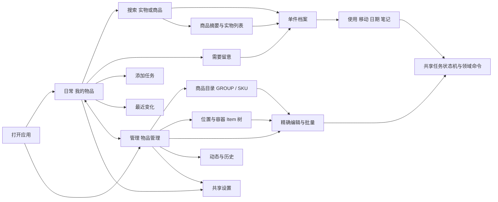

# 双模式信息架构

## 导航冻结候选

| 位置           | 日常                                  | 管理                                       |
| -------------- | ------------------------------------- | ------------------------------------------ |
| 桌面顶部       | 品牌、当前家庭                        | 同左                                       |
| 桌面独立主动作 | 添加物品                              | 添加物品；目录页另有新建商品/分类          |
| 桌面主导航     | 我的物品、需要留意、最近变化          | 物品管理、商品目录、位置与容器、动态与历史 |
| 桌面底部       | 设置、日常 / 管理文字切换器           | 同左，管理选中                             |
| 手机顶部       | 当前家庭、日常模式入口；页面标题      | 当前家庭、管理模式入口；页面标题           |
| 手机底栏       | 物品、留意、动态、设置                | 物品、目录、位置、动态、设置               |
| 添加入口       | 物品/留意页标题区；商品摘要“再添这款” | 物品页标题区；目录商品“新增实物”           |
| 扫码入口       | 首页搜索框旁“扫码”                    | 搜索工具栏“扫码”                           |

添加是可恢复任务而非一个第五导航页。它仍有直接可达的 /add URL，地址不会限制其以 Sheet 形式打开。底栏可见文字不缩成模糊图标。小于 768px 的 MCP 内容区采用同样紧凑布局，不依据宿主外层窗口尺寸。

## 页面注册表

页面 ID 用于流程、测试和 Phase 2 任务引用。详情区块可由 URL tab 定位；不为每个区块维护独立业务页面。

| ID  | 页面                | 规范 URL                                                   | 主要任务                       | 页面数据主体                        |
| --- | ------------------- | ---------------------------------------------------------- | ------------------------------ | ----------------------------------- |
| S01 | 我的物品            | /items                                                     | 搜索、查看、快捷处理、添加     | Item 查询；不强制全量下载           |
| S02 | 搜索                | /search?q=…&entity=items                                   | D01；名称/识别信息；位置候选   | Items 或 Catalog 查询、独立位置查询 |
| S03 | 商品摘要            | /products/:catalogId                                       | 看这款的多个实物、再次入库     | SKU + 服务端分组 + 分页 Item        |
| S04 | 单件档案            | /items/:id                                                 | D04–D08                        | get_item + 懒读笔记/历史/附件       |
| S05 | 需要留意            | /attention?kind=dates                                      | D09                            | 按类别独立服务器查询                |
| S06 | 添加任务            | /add                                                       | D02/D03                        | intake context + 持久任务           |
| S07 | 最近变化            | /activity                                                  | 家庭操作摘要                   | 分页 get_history                    |
| S08 | 扫码                | /scan                                                      | D07                            | 运行时扫码能力 + 只读解析           |
| S09 | 物品管理            | /manage/items                                              | M03/M04                        | 服务端 Item 筛选与选择快照          |
| S10 | 商品目录 / 商品资料 | /manage/catalog、/manage/catalog/:id                       | M01                            | GROUP/SKU、规则、模板               |
| S11 | 位置与容器          | /manage/locations、/manage/locations/:id                   | M02                            | 可容纳 Item 路径及其内容            |
| S12 | 管理单件详情        | /manage/items/:id                                          | M03                            | 与 S04 同一对象和读模型             |
| S13 | 动态与历史          | /manage/activity                                           | M05                            | 家庭/对象/操作历史                  |
| S14 | 设置及子页          | /settings?mode=daily 或 management                         | M06                            | 当前会话/家庭/设备适配              |
| S15 | 身份和授权          | /login /consent /register /recover /join /choose-household | M06                            | 现有身份协议；不依赖库存加载        |
| S16 | 检查器              | /inspect 及既有子路径                                      | M05/M06 高级只读检查           | 现有鉴权只读检查接口                |
| S17 | 操作面板            | 原页面附 task=:localTaskId                                 | 写任务、审批、冲突、恢复、打印 | 共享任务上下文；URL 不含正文或凭证  |

S06/S08 也可从 /manage/add、/manage/scan 打开；它们只是带模式的路由别名，共用页面与控制器。/settings/account、/settings/households、/settings/printer 保持可达，沿用 mode 查询值。

## 查询、分组和范围

- 我的物品默认显示非终态、非 VOID 的逐件列表；未知 lifecycle 独立标注并允许出现，不冒充已确认在库。
- 不在客户端排除所有容器再保留服务器总数。当前无 exclude_containers 参数：保留容器行并标识“容器”，页面总数称“当前结果”；位置入口单独组织它们。
- 切换“实物 / 商品”改变读取 endpoint 与结果类型，保留可共同表达的 search、位置和目录范围；不将当前页拼成全家庭商品统计。
- 商品摘要不嵌套第二套分页。可展开最多 3 条已加载实物预览，并提供“查看这款全部实物”到 S03。预览不声称穷尽，操作永远携带该行 Item ID。
- 一次界面只应用一个留意类别；类别之间不生成未经服务端支持的 OR 查询/总计。类别切换保留搜索、位置与已应用范围。
- 管理模式支持 UUID 跨页选择；“选择当前页”是显式动作。vNext 首版不提供“全选所有匹配结果”后台隐式展开。100 件为单个原子批量命令上限。

## 搜索不暗示不存在的能力

首页输入名称、品牌、型号、规格或条码时走现有 server search/barcode。位置线索通过独立“位置”候选通道搜索名称，选中后转为 within_item_id；不把“冰箱里的牛奶”当成已经存在的自然语言解析器。搜索框提示为“搜索物品、商品或位置”，结果类型有文字标签。

无结果时先区分没有匹配、筛选排除、没有权限或离线无缓存；保留输入，提供清除筛选或添加。匹配商品存在但实物为 0 时显示“这款当前没有实物”，可再次入库。搜索完整词不自动拆词或扩展同义词，拼写建议必须有来源。
