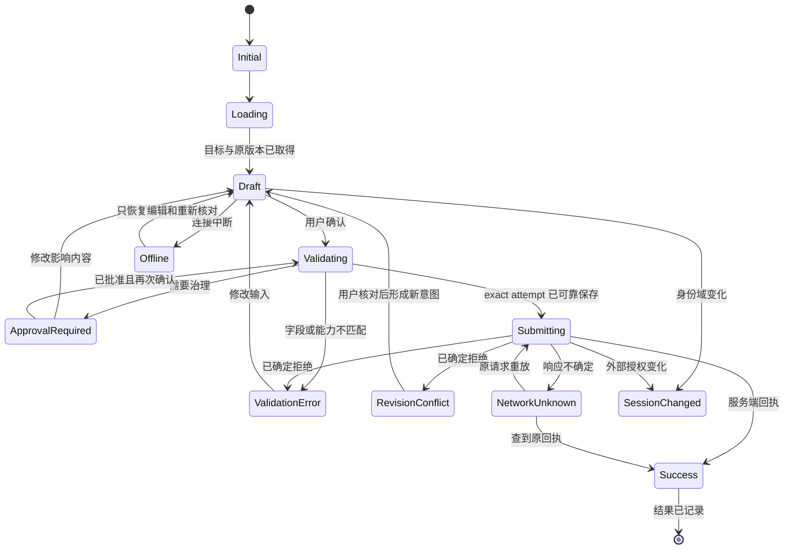

# 全局交互状态与恢复协议

状态属于共享应用层的 OperationSession；页面/表单/模式只呈现它。以下是目标交互规范，不表示当前 ui/forms.tsx 已完全满足。业务状态不能由 Toast、Dialog 或 React Hook Form 私有状态替代。

## 状态定义

| ID / 状态              | 用户看见什么                                    | 允许操作与离开规则                                  | 保留/请求规则                                                       |
| ---------------------- | ----------------------------------------------- | --------------------------------------------------- | ------------------------------------------------------------------- |
| ST00 Initial           | 当前家庭、模式、对象/任务入口                   | 可浏览/返回；无授权事实不预选                       | 不创建业务写入；件数 1 明示                                         |
| ST01 Loading           | 与目标内容相同位置的骨架；已有内容标更新中      | 读可取消离开；不显示虚构 0；取消过时查询            | 请求按 scope 和条件关联，旧响应不得覆盖新查询                       |
| ST02 Empty             | 空家庭/无匹配/无位置/无缓存各自说明             | 添加、清筛选、换范围或返回                          | 无结果不能证明 SKU 不存在；无缓存不是无库存                         |
| ST03 Draft             | 输入、目标范围、草稿已保存时间或保存失败        | 可编辑、保留并关闭、明确丢弃未发送草稿              | 草稿离开组件仍存活；mode/viewport 不在任务 identity 中              |
| ST04 Validating        | 就地“正在核对…”                                 | 禁重复提交；可取消尚未发送的校验                    | 校验字段、能力、目标版本、policy；持久化 exact attempt 前不发送     |
| ST05 Approval Required | 家庭、提案、长期/本次范围、完整影响与差异       | 批准/返回改草稿/取消；批准后回最终提交              | challenge 仅 app-only 私有渠道；过期重新 review；批准不等于保存     |
| ST06 Submitting        | 固定摘要与“正在保存…”                           | 禁字段、关闭、模式/家庭切换和第二次提交             | 先持久化原键+参数；重试不自动发生；超时转 ST10，不能永远锁面板      |
| ST07 Success           | 实际回执、对象数、前后事实、是否原结果重放      | 查看记录/打印/返回；读刷新可重试                    | 保存 result，再更新失效 queries；刷新失败只读，不重发命令           |
| ST08 Validation Error  | 首错摘要+字段错误，保留输入                     | 聚焦首错、修改；已确定拒绝后才形成新尝试            | MISSING_EXPECTED_REVISION 要补读，不是假 revision 冲突              |
| ST09 Revision Conflict | 原值、最新值、我的输入；哪些对象/规则变了       | 重读、逐项核对、保留修改或取消                      | 不静默替换 expected_revisions；已知拒绝后的新意图新键，审批重验     |
| ST10 Network Unknown   | “结果待确认，可能已保存”；原任务摘要与诊断引用  | 核对结果 / 重试同一次；可收起但全局保持恢复入口     | attempt 不可编辑；原键原参数。intake 先 receipt；一般写按原协议重放 |
| ST11 Offline           | 缓存时间和覆盖范围；“离线只读”                  | 读缓存/保留草稿/重新连接；禁止业务发送              | 不离线排队写；未缓存内容明确不可读；已发送的仍保持 ST10             |
| ST12 Forbidden         | 当前身份不可执行/连接只读；不暴露未授权对象信息 | 返回、核对连接、必要时重新授权                      | 不显示假成功；无需反复诱导登录；权限改变后重读                      |
| ST13 Session Changed   | 全局遮断旧内容；账号/家庭/授权已变化            | 重新建立合法上下文；不可直接提交旧任务              | 取消读、清 Query/selection/旧回调；隔离旧草稿；不同身份绝不重放     |
| ST14 Cancel / Back     | 已保存草稿可直接收起；未持久化时提示保留失败    | 未发送可保留/丢弃；提交中不可 UI 关闭；未知只能收起 | 焦点回触发器；触发器不在则回标题；浏览器返回同样守卫                |

“保存失败”要区分本地草稿持久化失败、业务明确拒绝、网络无结果、业务已成功但刷新失败，四者不可用同一个“重试”按钮。

## 完整任务覆盖矩阵

R=读取分支适用；W=写分支适用；P=打印设备专用；N=该只读流程无此状态（开始写后归属对应 D/M 任务）。表中编号均引用上表的明确行为，不允许把 N 当作“无需错误处理”。

| 流程 | Initial ST00  | Loading ST01  | Empty ST02      | Draft ST03      | Validating ST04 | Approval ST05  | Submitting ST06 | Success ST07     |
| ---- | ------------- | ------------- | --------------- | --------------- | --------------- | -------------- | --------------- | ---------------- |
| D01  | 首页词为空    | R 搜索        | R 无匹配/缓存   | N               | R 查询参数      | N              | N               | R 结果而非写成功 |
| D02  | 件数1/位置空  | R 商品上下文  | R 无SKU/位置    | W 逐件事实      | W 件数/规则     | W 规则要求时   | W 原子入库      | W 实际Item回执   |
| D03  | 新商品草稿    | R 候选/规则   | R 无合适候选    | W 全批          | W 身份/归类/G01 | W 具体提案     | W 原子创建      | W SKU+Item       |
| D04  | 明确单件      | R 最新剩余    | R 未知量        | W 消耗输入      | W 正数/超量     | N 普通消耗     | W 单件命令      | W 新余量/终态    |
| D05  | 固定ID集合    | R 位置/版本   | R 无有效位置    | W 目标          | W 环/范围       | N 普通移动     | W 原子移动      | W 实际位置       |
| D06  | 适用能力      | R 类型/日期   | R 未记录        | W 日期与依据    | W 日期/版本     | N 单件日期     | W 专用命令      | W 事实及提醒     |
| D07  | 扫码/打印入口 | R 相机/标签   | R 未识别/无设备 | P 选择/纸张     | P 目标及权限    | N 打印不改目录 | P 逐张发送      | P 设备结果       |
| D08  | 笔记摘要      | R 正文/附件   | R 无笔记        | W 文本/上传     | W 目标/限制     | N 单件笔记     | W 保存/关联     | W 实际笔记附件   |
| D09  | 日期类别      | R 类别读取    | R 无已知事项    | N 转D流程       | R 过滤条件      | N 转D/M流程    | N 转D/M流程     | R 读最新状态     |
| M01  | 目录树        | R 节点/规则   | R 空分类        | W 资料/路径     | W 类型/引用     | W 目录治理     | W 原命令        | W 商品或分类     |
| M02  | 位置树        | R 容器内容    | R 空位置        | W 新建/移动     | W 父级/环       | W 缺SKU转M01   | W Item命令      | W 容器路径       |
| M03  | 单件范围      | R 模板/版本   | R 无适用绑定    | W 字段三态      | W 模板/状态     | W 改SKU/共享   | W 明确命令      | W 事实与事件     |
| M04  | 无选择        | R 页/选择清单 | R 无选择        | W 固定集合      | W 逐件适用性    | N 仅现有批量   | W 原子或P       | W 精确范围       |
| M05  | 家庭历史      | R 分页/操作   | R 无历史        | W 纠错/导出设置 | W 原因/范围     | W 纠错改SKU    | W 纠错/导出     | W 新事件/导出    |
| M06  | 设置首页      | R 身份/能力   | R 无家庭/设备   | W 设置输入      | W 权限/未决任务 | N 库存治理     | W 账号设置动作  | W 服务端确认     |

| 流程 | Validation ST08  | Revision ST09       | Network Unknown ST10 | Offline ST11   | Forbidden ST12     | Session Changed ST13 | Cancel / Back ST14 |
| ---- | ---------------- | ------------------- | -------------------- | -------------- | ------------------ | -------------------- | ------------------ |
| D01  | 查询参数就地修正 | R stale重读         | N 读失败可重试       | R 标缓存范围   | R 不显示越权对象   | R 清结果             | 保留词/滚动        |
| D02  | 原输入与字段错   | W SKU/位置/规则对比 | W receipt/原commit   | W 禁写留稿     | W 不发入库         | W 隔离原批           | 留稿/未发可弃      |
| D03  | 候选/G01不可提交 | W 规则/身份对比     | W 原批恢复           | W 禁写留稿     | W 不越过审批       | W 批准失效           | 四步骤可返回       |
| D04  | 超量/单位        | W 最新量/原输入     | W 原consume重放      | W 禁写         | W 只读说明         | W 不换对象           | 留稿/恢复焦点      |
| D05  | 环/目标非法      | W 旧新位置          | W 原move重放         | W 禁写         | W 清越权目标       | W 固定集合失效       | 保留选择           |
| D06  | 类型/日期错      | W 原/新日期         | W 原命令重放         | W 仅绝对日期   | W 字段不可写       | W 保留隔离           | 留稿/不推定开封    |
| D07  | 无效码/无设备    | P 打前目标变化      | P 人工核对出纸       | P 禁新发送     | R 重新授权         | P 停后续队列         | 停相机/停后续      |
| D08  | 文本/大小/类型   | W 正文/目标对比     | W 原保存/关联        | R 缓存摘要     | R 不解密旧缓存     | W 隔离正文           | 留稿/取消未关联    |
| D09  | 日期范围非法     | R stale重读         | N 处理转D流程        | R 不报实时总量 | R 隐藏越权事项     | R 清类别结果         | 保留类别           |
| M01  | 名称/引用        | W 版本/政策对比     | W 原命令/批准恢复    | R读 W禁        | W 服务端为准       | W 不跨身份批准       | 留稿/不提前改树    |
| M02  | 环/不可容纳      | W 路径/子件变化     | W 原Item命令         | R读 W禁        | W 不泄露内容       | W 清树与选中         | 回原树锚点         |
| M03  | 字段三态错误     | W 三方对比          | W 原命令             | R读 W禁        | W 敏感字段保留遮蔽 | W 清详情             | 留稿/保留原版本    |
| M04  | mixed/超过100    | W 停整批            | W 每个原子请求       | W 禁写保留选择 | W 不静默跳过       | W 清选择/隔离任务    | 保留原集合         |
| M05  | 日期/原因        | W 纠错读当前        | W 原纠错；导出重读   | R仅已缓存      | R按实际脱敏        | R 清历史             | 取消导出/返回对象  |
| M06  | 账号字段错       | W 依账号接口        | W 按该接口恢复       | R说明不可设置  | W 角色解释         | W 全局重建           | 明确待处理任务     |

## OperationSession 设计契约

必备数据：taskId、schemaVersion、scope（origin/actor/household/session cache key/client）、kind、完整 target IDs、originRoute、returnFocus、草稿 values、原始值与 revisions、校验状态、proposalId、不可变 attempt(operation/payload/idempotencyKey)、result、错误/request_id、持久化状态。审批 challenge 不进 URL、可导出的日志或模型上下文。

- 任务 ID 在打开时产生；幂等键沿既有草稿机制保存。发送前封存完整参数，计算指纹只用于校验，不修改领域指纹规则。
- 原请求已经尝试时，任何按钮必须先区分“核对结果”与“新建任务”。模式变化不能清 attempt。幂等冲突永远先恢复原请求，不能统一把所有 4xx 当可换键重试。
- 已知校验拒绝/真实 revision 冲突：保留字段、读取最新内容、用户核对后形成新意图，可换键；不要自动重新提交。
- Web IndexedDB 与 MCP 私有 widgetState 写入必须确认成功后才发送。只有内存可用时允许读/编辑临时草稿，**不发送可能无法恢复的业务写入**，明确说明原因和网站继续入口。
- 模式偏好可内存降级，不代表草稿可靠性也可降级。宿主重新挂载先按 scope/schema 恢复；旧草稿若不能无损迁移保留诊断状态，不生成替代请求。
- 新控制器的重试路径须处理现有恢复码，包括 IDEMPOTENCY_CONFLICT、POLICY_CONFLICT、APPROVAL_REQUIRED/EXPIRED、SESSION_CHANGED；不照抄旧泛化 4xx 清 attempt 分支。

## 身份变化与离开

主动切家庭/退出：未发草稿可明确保留于原作用域或丢弃；若原 scope 会被既有清理销毁，必须在动作前如实提示。已发未决请求先恢复，不能把“清缓存”当取消写入。外部身份失效立即停止后续请求并清可见旧数据；原 attempt 仅保留于受隔离的存储，重授权确认同 actor/household 后才能沿协议恢复。若当前隔离机制不能安全保留/重绑，列为集成阻塞并停止该写功能，不能退回匿名缓存。

浏览器物理关闭不可能由 UI 保证阻止；beforeunload 只是提示，恢复依靠发送前持久化。提交超时即 ST10，提供可离开的恢复条，不能让“禁止关闭”变成无限期焦点陷阱。

## 成功和局部更新

先保存回执，再按 affected_objects.after_revision 合并已知事实或失效对应 query；不得对未知字段进行 optimistic 猜测。成功回执与刷新状态分开显示。暂时看不到列表新行时保留“查看此次结果”，不能重发写命令。原子失败没有部分成功 toast；打印部分完成按纸张状态呈现。
