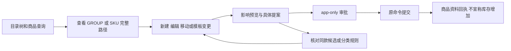
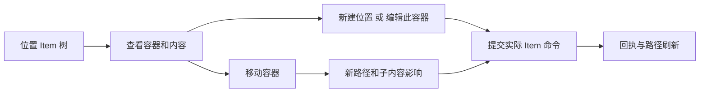
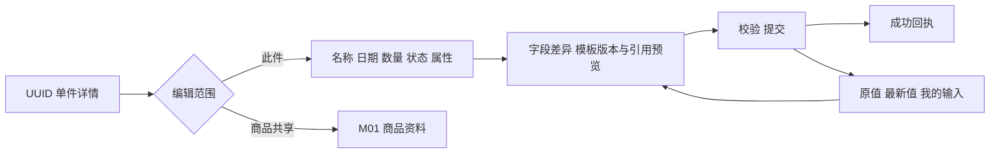
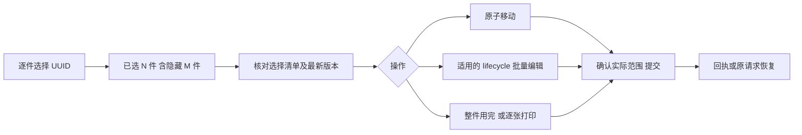
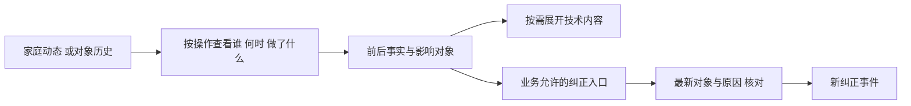
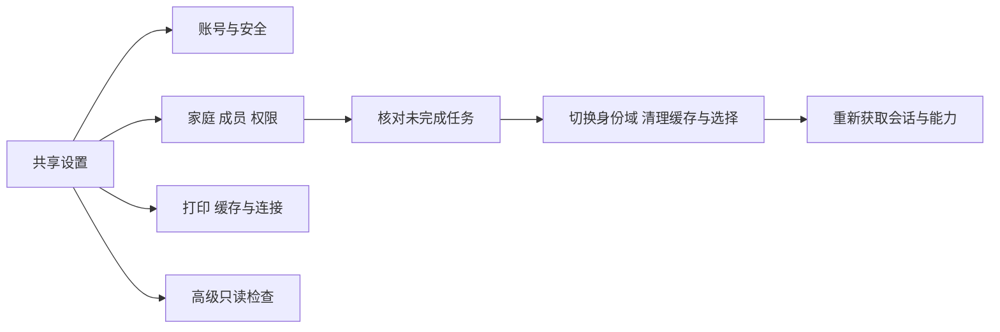

# 管理流程 M01–M06

管理模式和日常模式使用相同家庭、身份与任务恢复协议。管理模式展示更多信息，不授予额外权限。每项操作继承[交互状态](interaction-states.md)，功能可用性以[能力映射](baseline-and-capabilities.md)为准。

## M01 商品目录治理

S10 桌面左侧 GROUP 树、右侧分页 SKU 列表；树节点只改分类范围，不打开编辑。手机先显示路径和“选择分类”，进入整页层级选择器；返回保持滚动与筛选。列表默认不展示 VOID/hidden/one_off，支持明确开关并标明当前范围；这些参数以 schemas 为准，补齐旧 read-v2 类型缺失字段，不能 silently strip。

GROUP 详情显示名称、完整路径、规则含义、下级分类/商品入口。SKU 详情显示名称、品牌/规格/条码、profile、显式 capability override 和 effective_capabilities、模板版本、同款实物、共享笔记、历史。两类详情标题有明确“分类 / 商品”标记。

**新建：** 用户先选“商品资料”或“分类”；不从树层数猜。名称必填；父级选择 GROUP 或经批准的根级，分类依据与规则可查看。profile 可明确选择；未知保持未设置。不能从物品名推断消费品/设备。商品创建成功只提示“商品资料已建立”，另给“新增实物”进入 D02。

**编辑/移动：** 修改共享资料提示“影响这款商品及引用这些资料的实物”；展示服务端同款实物数，数量不可得则标范围已知、数量待读取，不编造数值。改变类型时列出将开放/不再开放的字段，原绑定不自动删除。显式 override 非空时说明改 profile 不会抹掉 override。改父级预览旧/新路径及所有下级路径受影响；不改变实际存放位置。

**治理：** 先保存具体 catalog_command / policy / intake_exception proposal；审批卡显示家庭、对象、前后差异、规则长期/本次范围、有效性。confirm 后仍必须执行原领域命令。更改 payload、版本或身份后旧批准失效；保留输入并重新核对。未批准不提前改变目录树。

同款识别只提供可比较候选，不合并身份。条码冲突给出可访问的现有商品入口；不存在 merge_sku 命令，不提供“自动合并”。规则更新不自动移动历史记录；历史例外要明确记录。SKU 作废严格遵守无引用前置条件；GROUP 没有通用删除命令，不显示假删除。

## M02 物理位置管理

S11 明确说明“位置也是具有独立身份的容器物品”。树显示房间、柜、箱及实际容器 Item，分类树不出现在此面板。位置搜索按名称返回完整物理路径；同名抽屉以路径/标签区分。右侧为当前容器资料和“此位置及下级”内容；直接子节点是结构导航，不冒充完整物品总计。

新建位置字段：显示名称必填、上级位置可选、容纳能力及所用容器商品资料可解释。优先使用当前 container_catalog_id，create_items(count=1) 并按已有模板声明 can_contain；若缺容器商品定义，保存位置任务并转 M01 建立合法容器商品，不能以 GROUP 代替或新造隐式后端实体。

移动容器复用 D05，显示整条路径变化和子物品归属不变；环检测/有效父级/权限仍在服务端。变更为不可容纳时先读取当前子物品并遵守引用约束，不自动把它们放到根级。

空位置可保留、改名、移动。确认为误建且无子件/其他阻止条件时，提供“作废记录”及原因，调用 void_item；有内容则提供“查看并移动内容”，不级联删除。已用坏/赠送的真实容器使用处置语义，不能假称作废。作废记录仅在明确打开“含作废”时列出，可经 correct_item(reason, record_state=VALID) 恢复。

## M03 实物精确编辑

S12 头部一直保留单件名称、商品关联、位置、稳定标签和记录状态。页内区块：概览 / 单件资料 / 笔记与附件 / 历史 / 记录信息。商品共有资料作为只读摘要带“编辑这款商品”入口；不在同一保存按钮下混写 Item 和 SKU。

基础编辑沿用 update_item / edit_item；位置用 move_item，开封/消耗用专用命令；模板编辑依据 target_kind、绑定版本与模板字段。字段的“未改 / 设值 / 清空”三态必须可区分；false、0、空字符串、缺失不能相互代替。未知模板只读展示名称/版本/安全摘要，不冒充可编辑 JSON 表。

模板添加、修改、移除、升级分别有操作名和差异。升级读取目标版本，展示保留/新增/将移除字段，提交完整目标 values；不能因表单没渲染未知字段而丢失。普通保存保持原 template_version。移除绑定先说明影响，受 TEMPLATE_IN_USE 拒绝则保留草稿。

批量编辑入口只是选定 UUID 的 M04；单件页面不提供 SKU 汇总写入。重新归属商品走 correct_item(core.catalog_node_id, reason)，需要对应目录审批；不得借改显示名称完成身份迁移。

### 扩展操作的完整设计边界

| 操作         | 面板字段和影响预览                                                                  | 命令及失败处理                                                    |
| ------------ | ----------------------------------------------------------------------------------- | ----------------------------------------------------------------- |
| 处置         | 售出/赠送/捐赠/退回/丢弃；日期必填；接收方引用或姓名二选一；可选备注；终态说明      | dispose_item；失败保留输入；不能自动恢复为 ACTIVE                 |
| 作废误建记录 | 必填原因；说明从默认集合隐藏；列引用/子件阻碍                                       | void_item；不作为用完；STATE_CONFLICT 重读                        |
| 恢复作废     | 显示原原因/当前引用与恢复结果，填写原因                                             | correct_item(record_state=VALID)；重新校验                        |
| 拆包         | 源 Item、目标 SKU、1–100 子件、每件必要内容与单位；守恒预览、源将结束、子件独立身份 | split_item；SPLIT_NOT_CONSERVED 阻止；不以 parent_id 表示拆分来源 |
| 日期事项     | 当前 kind、日期、依据、完成日/周期下一日期                                          | add/update/remove/complete_deadline；遵守 D06                     |
| 关联引用     | 已有 ACTOR/ITEM/CATALOG_NODE/EXTERNAL；展示全名与类型，敏感信息不展开               | query_references + 合法模板字段更新；跨家庭 REFERENCE_INVALID     |
| 单位/基准    | 当前单位、转换依据、估计/实测/未知；清楚区分数量表达与实际消耗                      | 真实模板/units 契约；不隐式换算或补基准                           |
| 补货策略     | SKU 的 COUNT/CONTENT、单位、阈值/目标，未知量说明                                   | 商品 stock 模板，沿 M01 治理；仅策略不创建库存                    |

这些领域能力大多已存在，当前 Web 缺完整任务 UI，MCP 部分被过滤；不能一概称为新后端需求。每一项仅在运行时可用时显示执行入口；不支持的宿主提供上下文 Web 入口，并保留完整交付差距。

冲突面板固定三列/手机三段：“打开时 / 服务器现在 / 我的修改”。只选择需修改字段；显式核对完成后生成经修订的新意图，旧请求若结果仍不确定则先恢复，不允许比较页直接换键覆盖。

## M04 批量管理

桌面每行复选框；手机点击“选择”进入选择状态；点击标题始终打开详情，不混用选择。首行复选框含义是“选择当前已加载页”，不是全库。跨页继续累加完整 UUID 集；应用筛选不自动清除已有选择，批量栏写“已选 12 件，7 件不在当前可见结果”，可查看全部/仅保留可见/清空。切模式保留 scope 内选择；操作面板使用固定快照而非实时可变 Set。

批量面板显示所有目标的名称、路径、标签及最新 revision 状态，超过一屏分页展示选择清单；计数来自实际选中 IDs。最多 100，达到上限后仍可取消，新增选择被拒绝并说明。大于 100 的任务必须由用户明确拆分，不后台分批宣称原子完成。

**可用操作：** move_items；update_items_lifecycle（每件绑定版本、set/unset）；consume_items（全量结束影响）；标签逐张打印。任意模板批量编辑或批量目录移动不在现有原子契约内，首版不提供一个伪“批量保存”按钮；可逐件进入 M03，明确每次独立提交。

混合类型时显示“可执行 n / 已选 N”并列不适用原因，默认整个批次不提交。用户可明确“仅处理可执行 n 件”，这会重建选择摘要并重新核对；不能静默跳过。共同字段 mixed 用“多个值”占位，保持未修改；清空值是显式动作，不能将 mixed 写成空。

**部分失败口径：** move_items、consume_items、update_items_lifecycle 的一次请求为原子事务，拒绝即全部未执行；本稿禁止伪造逐件部分成功。部分完成仅适用于用户明确拆开的多次任务或物理打印队列，分别展示成功/未开始/不确定 ID 与每次回执；恢复只针对原失败/不确定请求，不能把成功部分再发一遍。

隐藏选择的对象若变为不可访问，只显示“1 项已不可访问”，清除需要用户确认；不展示旧缓存的敏感名称。版本变化先停批次核对，不能自动剔除冲突项后继续。

## M05 历史、动态与纠错

S13 筛选由现有 get_history 支持的 target、operation_id、event_type、recorded_from/to 组成；操作者显示但当前无 actor 过滤参数，不提供无效操作者筛选。日期输入按家庭时区转换为时间范围；纯日期字段不做这种转换。

每行优先“成员 A 把 3 件物品移到厨房 / 抽屉”，详情列每个对象前后事实及操作来源。只加载到部分同 operation_id 事件时标“已加载部分”，展开通过 operation_id 再读，不能以页面子集冒充完整批次。occurred_at 与 recorded_at 不一致时同时解释“发生时间 / 记录时间”。

技术区可展开完整 ID、revision、request/operation ID、允许披露的变更字段；隐私脱敏信息保持不可见，不从旧快照拼回。活动列表不预载所有笔记正文和附件二进制。

“纠正记录”先读取当前对象，展示要纠正的事实及原因，调用相应领域命令；新事件追加记录，旧事件不被编辑。没有通用 undo endpoint，不提供承诺可撤销的 toast。更换 SKU、恢复 VOID、修正属性分别按其权限/审批规则执行；已处置/已消耗的恢复只在契约确实允许时开放，不能赋任意生命周期跳转。

管理列表的冻结导出使用 begin_export → read_export 分页 → cancel_export（取消/结束），输出说明查询范围、生成时点、敏感披露范围；CURSOR_STALE 必须重新开始冻结，不把新旧页拼在一起。它是现有服务能力的待接 UI，不能下载当前页后称完整导出。

## M06 账号、家庭及系统设置

S14 主列表：当前身份/家庭 → 账号与安全 → 家庭与成员 → 打印机与标签 → 缓存与连接 → 高级。日常/管理仅外壳色与来源不同，内容和权限一致。设置骨架不等完整库存；缓存统计可单独加载。

账号与安全保留 Passkey、密码、恢复和退出；注册/恢复/邀请是否可用按服务端 capability，不在禁用环境显示假提交。登录后回到经过白名单校验的原路由；OAuth consent 显示服务、家庭、scope 和明确允许/拒绝，不以模式取代 scope。

家庭页显示可访问家庭及当前成员角色；邀请、离开、移除等由现有账号接口决定。切换前展示未保存草稿或结果待确认的任务：未发送草稿可明确保留于原作用域或丢弃；结果不确定必须先核对，不能用“丢弃”掩盖已发生写入。切换发生后新页面先为空/加载，不短暂闪现旧家庭。

MCP 设置解释当前连接家庭、读写 scope、宿主存储状态；账号/家庭管理转到受控 Web 页面或宿主授权界面，不调用现有空实现 switchHousehold 假装成功。重新授权会重建身份域，旧 scope 不自动授权新写请求。

缓存区显示时间、实际缓存覆盖范围、在线/只读状态及草稿可恢复状态。清缓存必须明确区分读缓存与待恢复请求；清理读缓存不删除未决 attempt。退出登录按既有隐私规则清理，不保证退出后跨账号恢复。若未决任务无法在身份变化前可靠确认，停止依赖写入并显示原请求诊断引用。

打印设置沿现有 D101 能力显示连接/纸张/浓度/试打入口和实际支持环境，设备连接状态不能充当出纸成功。高级保留只读检查器、协议/版本/缓存诊断；不把 SQL 编辑带入管理模式。
