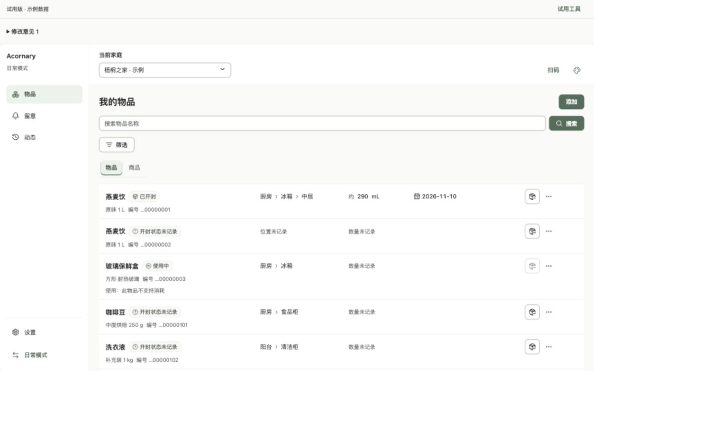

# Trial RC1：完整产品隔离试用版

2026-11-10 · `codex/frontend-vnext` · **可本地试用，待用户审阅。**

## 目标与入口

将 Pages RC1 的 29 页装配为连续体验，复用 RC6 组件和正式候选页面，继续使用隔离数据。

- [完整试用版](http://127.0.0.1:6008/#/items)：本轮主要入口。
- [逐页/组件审阅](http://127.0.0.1:6007/)：保留原场景、尺寸和意见记录。
- [Storybook](http://127.0.0.1:6006/)：保留原子组件审阅。

启动：`pnpm dev:ui-trial`。构建：`pnpm build:ui-trial`，输出 `output/ui-trial`。三个本机服务交付时均在监听。默认已登录“梧桐之家 · 示例”，初始数据包含 11 件日常物品与 13 件独立位置容器；“周末小屋 · 示例”为空家庭，默认只读。四配色和双模式沿用 RC6。

## 本轮实现

- 独立 Vite 入口、hash 路由、全窗口 Shell、单个主内容滚动区、当前家庭和模式上下文。URL 优先；无页面 URL 时读取当前账号/家庭的模式偏好。
- 单件档案与管理精确编辑保留同一个 Item ID；商品与商品目录也保留对象上下文。管理和设置按组延迟加载。
- 世界、目录覆盖、任务、笔记、附件、打印和设置通过统一作用域存储访问。库存事实与操作历史共用；商品名称与单件名称覆盖保留不同范围。
- 普通日常操作和管理修改更新同一组物品；容器身份实际存在，日常移动检查有效容器和容纳环。读取投影保留分页与明确数量。
- 任务保存冻结参数、稳定请求键、期望版本和结果；提交中阻止关闭/路由/家庭/角色/故障场景切换。刷新后的提交中记录恢复为待核对。
- “结果不确定”在日常使用、日期/笔记等适用适配器内模拟已修改但回执未送达；恢复沿用原请求。世界与回执在本地事务中提交，恢复不重复制造库存事件。
- 笔记与附件按 Item/SKU 分开；附件使用内置 PNG/PDF 样例，可预览、关联与移除，不上传外部服务。打印、扫码、审批、登录和 OAuth 仅有示例状态。
- 试用工具提供正常、不确定、冲突、离线、无权限情景，所有者/成员/只读角色、家庭时区下的示例日期及重置确认。日期起点为 2026-11-07；调整日期不修改用户记录的事实。
- 页面和任务面板均有修改意见入口，记录 Trial RC1、页面、模式、配色、实际宽度、路由、数据集版本及任务状态。继续使用 `.local/ui-review-feedback/`；不自动批准设计。

## 存储与实施选择

`review/trial/storage.ts` 持有版本化存储信封，业务页面不读写浏览器存储。世界和任务记录按账号/家庭隔离；账号设置单独按账号隔离。未读取或迁移 6007、旧生产入口的数据。

为了兼容当前同步受控表单，采用 **localStorage 持久日志 + IndexedDB 整体镜像**：先同步写入完整版本化日志，成功后才发布 UI 世界变化，随后事务写入 `acornary-trial-v1/world/current`。日志为恢复权威；IndexedDB 不可用时提示日志降级。日志不可写则阻止提交，不能将内存结果显示成持久成功。这与方案中单独以 IndexedDB 承担全部提交的建议不同，不将其描述为纯 IndexedDB 实现。

多标签采用浏览器独占写入锁：只有一个试用标签持有写权限，其他标签只读，关闭写入标签后需刷新以接管。另有信封 revision 核对与跨标签变更提示。没有浏览器锁能力时不写入。这是更保守的单写入标签规则，不提供多标签并发合并。

继续复用现有 Journey 作为开发适配器，未机械搬移为 `src/app-vnext`。正式候选页面与组件仍只接收事实、状态和回调；新增的 OperationSupportContext 只是可选内容注入，不携带反馈请求或库存逻辑。**生产可替换的根 OperationSession 与正式读取/命令适配器抽取仍是 Phase 2 工程收尾门槛；本轮的本地恢复机制不作为该项已完成的证明。**

试用工具暂放在全局轻量顶部，任何页面均可到达；不是正式设置中的业务功能。浏览器清理站点数据后不能保证恢复。静态构建不包含本地意见服务，意见输入保留并提示提交失败；应使用运行中的本地入口提交。

## 页面覆盖与导航

下表表示装配与入口已存在，不表示逐页所有分支已经人工或自动验收。全部页面继续待本轮用户复审。

| 页面 | 正常入口/路径 | 本轮连续体验范围 |
| --- | --- | --- |
| 我的物品 | `/items` | 共用库存、分页、物品/商品切换 |
| 搜索结果 | 首页搜索 → `/search` | 查询及位置保留在 URL |
| 商品资料 | 商品名称 → `/products/:id` | 共用目录投影与实物汇总 |
| 单件档案 | 物品名称 → `/items/:id` | 共用余量、日期、笔记、历史 |
| 需要留意 | 留意 → `/attention` | 日期类型和试用时钟、明确补货规则 |
| 最近变化 | 动态 → `/activity` | 共用事件、操作分组 |
| 已有商品入库 | 添加 → `/tasks/intake` | 独立 Item、原请求与回执 |
| 新商品入库 | 入库切换 → `/tasks/new-product` | 示例审批、基本 SKU + Item；类型/能力缺口仍受限 |
| 记录使用 | 单件图标 → `/tasks/consume` | decimal 数量、版本、恢复 |
| 移动物品 | 单件操作 → `/tasks/move` | 有效容器、原位置、环检查 |
| 开封记录 | 档案 → `/daily/opening` | 明确开封事实与时间 |
| 日期事项 | 档案 → `/daily/dates` | 多日期事实、留意与历史投影 |
| 笔记 | 档案 → `/daily/notes` | 单件/商品范围、冲突、历史 |
| 附件 | 档案 → `/daily/attachments` | 内置文件关联/预览/移除 |
| 扫码 | Shell 扫码 → `/daily/scan` | 示例 Item QR、条码候选、未知身份 |
| 标签打印 | 档案 → `/daily/labels` | 实物目标、设备反馈和纸张确认状态 |
| 物品管理 | 管理导航 → `/manage/items` | 同一 Item、版本、筛选与选择 |
| 商品目录 | 管理导航 → `/manage/catalog` | GROUP/SKU、商品共有资料 |
| 位置与容器 | 管理导航 → `/manage/locations` | 实际容器 Item、层级与空位置 |
| 精确编辑 | 管理物品 → `/manage/edit?id=…` | 单件草稿、属性与独立管理命令 |
| 批量管理 | 选择条 → `/manage/bulk` | UUID、隐藏选择、100 件限制 |
| 历史与纠错 | 管理动态 → `/manage/history` | 共用历史和适用纠错 |
| 设置 | 两模式设置 → `/settings` | 共用设置入口 |
| 账号与家庭 | 设置 → `/settings/household` | 全局家庭/身份上下文 |
| 成员权限 | 设置 → `/settings/members` | 示例角色与操作限制 |
| 登录与授权 | 设置 → `/settings/auth` | 模拟退出/登录/OAuth，无真实凭据 |
| 打印设置 | 设置 → `/settings/printing` | 示例设备能力 |
| 缓存与离线 | 设置 → `/settings/cache` | 当前作用域未决任务及恢复路径 |
| 只读检查器 | 设置 → `/settings/inspector` | 隔离连接与能力说明 |

## 实际检查记录

使用项目指定运行环境。未运行任何回归套件。

| 检查 | 结果 |
| --- | --- |
| `pnpm exec tsc -p apps/web/tsconfig.json` | 通过 |
| `pnpm build:ui-trial` | 通过 |
| `pnpm build:ui-preview` | 通过 |
| `pnpm build:storybook` | 通过 |
| `pnpm check:ui-boundaries` | 通过：77 个正式入口可达文件无 review/fixture；99 个候选源文件无直接业务/设备 I/O |
| `pnpm check:ui-tokens` | 通过：派生产物一致；8 组合的 125 个文字色对满足阈值 |
| `pnpm check:ui-catalog` | 通过：70 组件、5 组合、29 页、901 状态的登记与 Storybook 链接可解析 |
| 新增试用 Shell 静态视觉扫描 | 无发现；不代表全部页面视觉验收 |
| `git diff --check` | 通过 |

本机日志在 `.local/trial-rc1-evidence/`。仍有 Vite/Storybook 配置扩展名提示及大包警告：试用初始 JS 1,236.51 kB，gzip 380.60 kB；管理/设置已独立分块。未以放宽警告阈值掩盖，未测量性能基线。

人工检查使用 Codex 内置浏览器，经 DOM 确认有效宽度；未运行 Playwright 回归：

1. 使用数量填写后刷新，恢复原输入。
2. 正常使用 10 mL 后刷新回执，列表从 310 mL 变为 300 mL。
3. 切换周末小屋，空库存；切回梧桐之家仍为 300 mL。
4. 不确定结果再次使用 10 mL，提交中关闭禁用；刷新保留原键 `fe5c1324-4e3d-41d0-b43d-6ffef368d653`，恢复后余量 290 mL，没有重复扣成 280 mL。发现核对文案重复计算的问题后已修正为冻结摘要/已提交值。
5. 管理页读取同一物品版本 9；从精确编辑切回日常，URL 保留相同 Item UUID，档案显示 290 mL。
6. 有效 360px 与 1440px 宽度下文档没有横向溢出；抽查窄屏底栏、家庭入口和管理摘要。300px 额外观察不等于完整 320px 重排验收。
7. 页面意见通过本地服务保存，代理实际读取文件 `05f73adf-70a3-4ec2-8788-24fb3114f727.json`，包含 Trial 元数据。该记录明确标注“代理连通检查”，不是用户意见或批准。任务面板内意见入口可见。

人工检查修改了隔离浏览器内第一件燕麦饮，目前为约 290 mL；可从试用工具重置。没有清除其他审阅记录。

## 尚未通过的门槛

- 回归测试、全仓库生产构建/测试、性能基准、真实 MCP、摄像头/打印机、服务端授权和真实事务均未运行，不标为通过。
- 本轮不是 29 页全部状态逐项人工验收。日期/附件/模板/拆包/批量/纠错的完整组合、多标签竞争、存储拒绝、关闭浏览器重开、跨账号过期响应等仍需要后续专项验证。
- 未完成 390/768/1024/1920px、跨浏览器、软键盘、屏幕阅读器与完整焦点矩阵；不能用本次有限截图代替。
- 根部生产任务控制器与正式协议适配边界仍需工程收尾；当前 Journey 的示例执行器不得直接用于生产。
- 新 SKU 同请求声明类型/能力、任意全结果选择、任意模板批改等契约缺口保持受限。真实设备、OAuth/MCP 宿主仍为示例能力。
- 工具在顶部、单写入标签规则、持久日志权威及 IndexedDB 镜像均是本轮明确实现选择，后续工程验收应覆盖这些选择。

## 本轮影响、版本和下一步

新增 `review/trial/`；修改五类 Journey、共享 inventory-session、管理持久桥、局部日期/附件/设置 props、意见元数据及边界脚本。正式 `main.tsx`、`plugin.tsx`、领域契约、Ant Design 依赖与生产环境均未改。

设计批准历史保留；OperationSheet 新增可选意见插槽及页面连续状态需要本轮复审。**Trial RC1 可试用不等于 Phase 2 全部完成。**

下一步：用户连续试用并在当前页提意见 → 修正体验 → 收尾共享正式应用控制器/适配边界 → 用户恢复回归后执行工程验收 → Phase 3 隔离真实接线。没有推送、部署或生产库存操作。

本地检查点：`a169341`（执行方案）、`f769cbd`（独立入口和持久化）、`8140ec0`（日常任务/笔记/附件）、`c90f594`（管理状态）、`7af1973`（家庭/身份/设置）。交付文档及截图单独提交；未推送分支。
